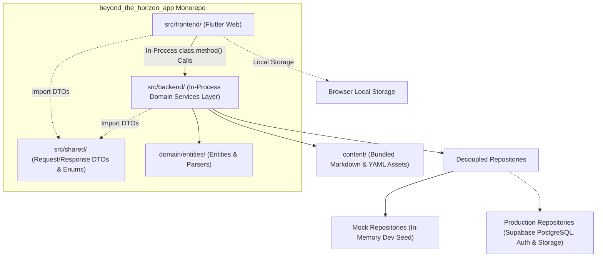

# SDD 01: Overview

## 1. Document Control
- **Document Title:** System Design Document - Overview
- **Project:** Beyond the Horizon - Digital Companion & Rules Platform ("Beyond the Horizon App")
- **Author:** Henrique Schorr
- **Status:** Active
- **Version:** 0.4.0
- **Last Updated:** 2026-10-20

---

## 2. Product Vision & Objectives

The **Beyond the Horizon App** is a digital platform and companion application for the Beyond the Horizon tabletop sci-fi roleplaying game (TTRPG). It serves as an interactive reference, character management, rules lookup, and digital toolkit for players and game masters exploring the Beyond the Horizon universe.

### 2.1 Core Objectives
1. **Interactive Rules & Compendium:** Provide fast, accessible search and exploration of the game rules, setting lore, and content compendium.
2. **Character & Play Management:** Support interactive character creation, sheet tracking, action resolution, and session management.
3. **Immersive Atmosphere & Thematic Experience:** Deliver an atmospheric experience following a Minimalist Brutalism aesthetic with Industrial and Cosmic Sci-Fi Horror sensibilities.
4. **Modular Monorepo Architecture:** Structure the project as a clean, modular monorepo (src/frontend/, src/backend/, src/shared/, design/), ensuring clear separation of concerns, high maintainability, and streamlined local development.
5. **Zero-Cost Operation & Sustainability:** Run indefinitely at $0.00/month utilizing static hosting (such as Cloudflare Pages) and managed BaaS (such as Supabase free tier).

### 2.2 Target Platform Scope (Phase 1)
1. **Supported Platforms (Phase 1):**
   - **Web Desktop:** Viewports at or above 1024px width.
   - **Web Tablet:** Viewports at or above 768px width (in both portrait and landscape orientations).
2. **Explicit Exclusion (Phase 1):**
   - **Smartphones / Mobile Viewports:** Strictly excluded from Phase 1 development (viewports below 768px). Dedicated mobile companion views will be evaluated in subsequent phases.

---

## 3. High-Level Repository Architecture

The repository is structured as a clean, self-contained monorepo:

```
beyond_the_horizon_app/
├── .agents/                  # Agent configurations and modular rulebooks
│   ├── skills.json           # Skill discovery configuration (points to skills/)
│   └── rules/                # Modular domain rulebooks (01 to 05)
├── skills/                   # Modular agent skills & playbooks
│   ├── design/               # grill-with-docs architectural design skill
│   ├── planner/              # to-tickets tracer-bullet breakdown skill
│   └── prototype/            # UI wireframing and ideation skill
├── content/                  # Curated Game Content from bth_game
│   ├── codex/                # Canonical rulebook chapters (Markdown + YAML frontmatter)
│   └── database/             # Structured entity YAML dictionaries (mechanics, catalogs)
├── supabase/                 # Supabase configuration & persistence
│   └── seeds/                # Database seed SQL & data (keywords, epigraphs)
├── src/
│   ├── backend/              # In-process Dart domain services / Shelf server
│   │   ├── bin/              # CLI and standalone server entry point
│   │   ├── lib/              # Services, entities, repositories, routes
│   │   └── pubspec.yaml
│   ├── frontend/             # Flutter Web client application
│   │   ├── lib/              # Screens, controllers, design system, widgets
│   │   ├── web/              # HTML shell, icons, web manifest
│   │   └── pubspec.yaml
│   └── shared/               # Shared pure Dart wire contracts
│   │   ├── lib/              # Request/Response DTOs, enums, constants
│   │   └── pubspec.yaml
├── design/                   # Software Design Documents (SDDs)
│   ├── GLOSSARY.md           # Live domain dictionary & ubiquitous language
│   ├── decisions/            # Architecture Decision Records (ADRs)
│   ├── specs/                # Auxiliary Subsystem Specifications
│   ├── references/           # Aesthetic, documentation & site reference studies
│   ├── tickets/              # Active tracer-bullet ticket files (0001-0020)
│   ├── project_planner.md    # Central project planner & roadmap register
│   ├── 01-sdd-overview.md    # System overview & high-level vision
│   ├── 02-sdd-database.md    # Relational schema & persistence
│   ├── 03-sdd-backend.md     # In-process backend services & logic
│   └── 04-sdd-frontend.md    # Flutter UI, state management & theme
├── .obsidian/                # Obsidian vault configuration & plugins
└── Agents.md                 # Master agent constitution & rule index
```



---

## 4. Guiding Architectural Principles

1. **Strict Separation of Concerns (Backend-Only External Calls):** All external communications (database queries, cloud storage, external APIs) originate exclusively from the backend package. The frontend package is strictly limited to UI presentation, local client storage, and user interactions.
2. **Provider-Agnostic Presentation:** The frontend communicates with backend services exclusively through typed shared DTOs, without direct knowledge of database providers, SQL, or PostgREST.
3. **In-Process Backend Execution:** The backend operates as an in-process Dart package imported by the Flutter client for local zero-latency execution, while retaining standalone Shelf HTTP capabilities for automated testing and tools.
4. **Bundled Asset-First Delivery:** Phase 1 Codex content is bundled directly as local assets, enabling instant 0ms retrieval, 100 percent offline availability, and zero database quota usage.
5. **No Data Logic in Widgets:** All data formatting, validation, string manipulation, and state transitions reside strictly in feature controllers or domain helpers.
6. **Strict Typography & Design System:** All visual presentation relies on design system tokens and semantic typography widgets without arbitrary inline sizing or raw text widgets.
7. **Frictionless Public & Zero-Login Access:** Exploring the rules compendium and configuring application settings require zero authentication. Application settings are stored locally on the client machine via browser local storage without server round-trips.

---

## 5. Five-Phase Release Lifecycle

The platform progresses through five distinct, focused phases:

1. **Phase 1: Rules Compendium & Universe Codex MVP (Active Focus):** Executed across four iterative milestones: Milestone 1A (Core Rules End-to-End), Milestone 1B (Evo'raz Character Foundation & Specialized Page Presentations), Milestone 1C (Full Codex Content Expansion), and Milestone 1D (Interactive Overlays, Compendium Databases & Global Search).
2. **Phase 2: Character Creation & Interactive Play Sheet:** Step-by-step character wizard, tactile personnel dossier sheet, integrated dice roller engine, and local/cloud character persistence.
3. **Phase 3: Atmospheric Polish, Transitions & Micro-Animations:** Tactile CRT scanlines, CRT flicker and bloom, classified dossier wipes, chromatic alert shifts, analog terminal audio cues, and multi-device ergonomics.
4. **Phase 4: Facilitator & Campaign Operations:** Campaign management, live session lobbies, tactical encounter runner, secret player transmissions, and facilitator live party cockpit.
5. **Phase 5: The Mind Place & Advanced Expansions:** Alan Wake 2-inspired cork and concrete case board, Homebrew studio, encumbrance grid, condition ticks, printable PDF export, and offline PWA sync.

---

## 6. User Roles & Access Architecture

The platform recognizes four distinct user tiers with clear privilege boundaries:

| Role | Primary Purpose & Responsibilities | Key Capabilities |
| :--- | :--- | :--- |
| **Visitor (Public / Zero-Login)** | Explore the setting, study game rules, and configure local client preferences. | • Full read access to public rules compendium chapters.<br>• Unauthenticated access to application settings persisted in browser local storage.<br>• Quick rules search and reference navigation.<br>• Seamless registration and login call-to-actions. |
| **Player** | Create, manage, and play individual characters during live game sessions. | • All Visitor capabilities.<br>• Character creation wizard & live interactive play sheet.<br>• Personal dice roller with modifier support.<br>• Join active games/campaigns via invite code.<br>• Real-time session participation (character tracking, resources, and action resolution).<br>• Access public rules compendium & unlocked player handouts. |
| **Facilitator (GM)** | Orchestrate campaigns, moderate one-shot sessions, design encounters, and guide narrative flow. | • All Player capabilities.<br>• Campaign & session creation, scheduling, and player roster management.<br>• Live Party Screen (Facilitator HUD): Monitor party members' active status in real-time.<br>• Encounter Management: Initiative order, encounter participants, turn progression, and hazards.<br>• Private/hidden GM dice rolling & secret audit notes.<br>• Dispatch Secret Transmissions & classified handouts to individual players.<br>• Campaign-scoped homebrew content creation. |
| **Admin** | Maintain official rules content, moderate accounts, and supervise system health. | • All Facilitator and Player capabilities.<br>• Official rules compendium curation and system content management.<br>• Global user administration, permissions, and moderation.<br>• System telemetry, rate limit inspection, and error logging. |

---

## 7. Core Aesthetic

The application visual design follows a **Minimalist Brutalism** philosophy with an **Industrial and Cosmic Sci-Fi Horror** aesthetic. Detailed design tokens, typography, and component specifications are documented in the frontend design document (04-sdd-frontend.md).

---

## 8. Document Roadmap

- [Project Planner & Roadmap Register](./project_planner.md) - Prioritized feature roadmap across five release phases
- [01-sdd-overview.md](./01-sdd-overview.md) - System overview, vision, and companion ecosystem (This Document)
- [02-sdd-database.md](./02-sdd-database.md) - Relational schema, realtime session subscriptions, and Supabase data architecture
- [03-sdd-backend.md](./03-sdd-backend.md) - In-process domain services, YAML frontmatter parsing, and content indexing
- [04-sdd-frontend.md](./04-sdd-frontend.md) - Flutter Web architecture, Dual Browsing layout, slide-over drawer, and design tokens
- [GLOSSARY.md](./GLOSSARY.md) - Live two-tier domain dictionary (App Domain & Game Domain)
- [studied_designs.md](./studied_designs.md) - Studied designs, comparative research, and visual archives
