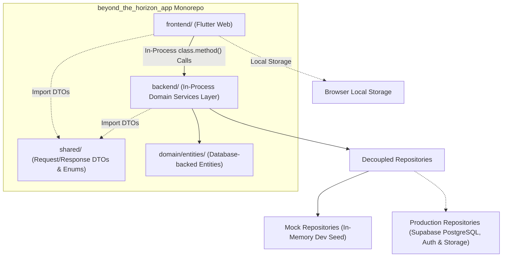

# SDD 01: Overview

## 1. Document Control
- **Document Title:** System Design Document - Overview
- **Project:** Beyond the Horizon - Digital Companion & Rules Platform ("Beyond the Horizon App")
- **Author:** Henrique Schorr
- **Status:** Active
- **Version:** 0.3.0
- **Last Updated:** 2026-10-13

---

## 2. Product Vision & Objectives

The **Beyond the Horizon App** is a digital platform and companion application for the *Beyond the Horizon* tabletop sci-fi roleplaying game (TTRPG). It serves as an interactive reference, character management, rules lookup, and digital toolkit for players and game masters exploring the *Beyond the Horizon* universe.

### 2.1 Core Objectives
1. **Interactive Rules & Compendium:** Provide fast, accessible search and exploration of the game rules, setting lore, and content compendium.
2. **Character & Play Management:** Support interactive character creation, sheet tracking, action resolution, and session management.
3. **Immersive Atmosphere & Thematic Experience:** Deliver an atmospheric experience following a Minimalist Brutalism aesthetic with Industrial and Cosmic Sci-Fi Horror sensibilities.
4. **Modular Monorepo Architecture:** Structure the project as a clean, modular monorepo (frontend/, backend/, shared/, design/), ensuring clear separation of concerns, high maintainability, and streamlined local development.
5. **Zero-Cost Operation & Sustainability:** Run indefinitely at $0.00/month utilizing static hosting (e.g., Cloudflare Pages) and managed BaaS (e.g., Supabase free tier).

### 2.2 Target Platform Scope (Phase 1)
1. **Supported Platforms (Phase 1):**
   - **Web Desktop:** Viewports at or above 1024px width.
   - **Web Tablet:** Viewports at or above 768px width (in both portrait and landscape orientations).
2. **Explicit Exclusion (Phase 1):**
   - **Smartphones / Mobile Viewports:** Strictly excluded from Phase 1 development (viewports below 768px). Dedicated mobile companion views will be evaluated in subsequent phases.

---

## 3. High-Level Repository Architecture

The repository is structured as a clean, self-contained monorepo:

```
beyond_the_horizon_app/
├── backend/                  # In-process Dart domain services / Shelf server
│   ├── bin/                  # CLI and standalone server entry point
│   ├── lib/                  # Services, entities, repositories, routes
│   └── pubspec.yaml
├── frontend/                 # Flutter Web client application
│   ├── lib/                  # Screens, controllers, design system, widgets
│   ├── web/                  # HTML shell, icons, web manifest
│   └── pubspec.yaml
├── shared/                   # Shared pure Dart wire contracts
│   ├── lib/                  # Request/Response DTOs, enums, constants
│   └── pubspec.yaml
├── design/                   # Software Design Documents (SDDs)
│   ├── 01-sdd-overview.md    # System overview & high-level vision
│   ├── 02-sdd-database.md    # Relational schema & persistence
│   ├── 03-sdd-backend.md     # In-process backend services & logic
│   └── 04-sdd-frontend.md    # Flutter UI, state management & theme
├── .obsidian/                # Obsidian vault configuration & plugins
└── AGENTS.md                 # Agent instructions & guidelines
```



---

## 4. Guiding Architectural Principles

1. **Strict Separation of Concerns (Backend-Only External Calls):** All external communications (database queries, cloud storage, external APIs) originate exclusively from the backend/ package. The frontend/ package is strictly limited to UI presentation, local client storage, and user interactions.
2. **Provider-Agnostic Presentation:** The frontend communicates with backend services exclusively through typed shared DTOs, without direct knowledge of database providers, SQL, or PostgREST.
3. **In-Process Backend Execution:** The backend operates as an in-process Dart package imported by the Flutter client for local zero-latency execution, while retaining standalone Shelf HTTP capabilities for automated testing and tools.
4. **Pluggable Storage Layer:** Abstract repository interfaces allow switching seamlessly between local in-memory test fixtures (Mock...Repository) and production cloud persistence (Prod...Repository).
5. **No Data Logic in Widgets:** All data formatting, validation, string manipulation, and rstate transitions reside strictly in feature controllers or domain helpers.
6. **Strict Typography & Design System:** All visual presentation relies on design system tokens and semantic typography widgets without arbitrary inline sizing or raw text widgets.
7. **Frictionless Public & Zero-Login Access:** Exploring the rules compendium and configuring application settings require zero authentication. Application settings are stored locally on the client machine via browser local storage without server round-trips.

---

## 5. User Roles & Access Architecture

The platform recognizes four distinct user tiers with clear privilege boundaries:

| Role | Primary Purpose & Responsibilities | Key Capabilities |
| :--- | :--- | :--- |
| **Visitor (Public / Zero-Login)** | Explore the setting, study game rules, and configure local client preferences. | • Full read access to public rules compendium chapters.<br>• Unauthenticated access to application settings persisted in browser local storage.<br>• Quick rules search and reference navigation.<br>• Seamless registration and login call-to-actions. |
| **Player** | Create, manage, and play individual characters during live game sessions. | • All Visitor capabilities.<br>• Character creation wizard & live interactive play sheet.<br>• Personal dice roller with modifier support.<br>• Join active games/campaigns via invite code.<br>• Real-time session participation (character tracking, resources, and action resolution).<br>• Access public rules compendium & unlocked player handouts. |
| **Facilitator (GM)** | Orchestrate campaigns, moderate one-shot sessions, design encounters, and guide narrative flow. | • All Player capabilities.<br>• Campaign & session creation, scheduling, and player roster management.<br>• **Live Party Screen (Facilitator HUD)**: Monitor party members' active status in real-time.<br>• **Encounter Management**: Initiative order, encounter participants, turn progression, and hazards.<br>• Private/hidden GM dice rolling & secret audit notes.<br>• Dispatch **Secret Transmissions** & classified handouts to individual players.<br>• Campaign-scoped homebrew content creation. |
| **Admin** | Maintain official rules content, moderate accounts, and supervise system health. | • All Facilitator and Player capabilities.<br>• Official rules compendium curation and system content management.<br>• Global user administration, permissions, and moderation.<br>• System telemetry, rate limit inspection, and error logging. |

---

## 6. Companion Platform Feature Ecosystem

The application combines the utility of industry-standard digital companion platforms (such as *D&D Beyond* and *Demiplane*) with mechanics tailored specifically to the *Beyond the Horizon* universe.

### 6.1 Core Features
1. **User Creation & Onboarding:** Frictionless account registration with email verification and direct transition to active play.
2. **Authentication & Session Persistence:** Secure authentication with persistent sessions and password recovery.
3. **Logged-Out Landing Page:** Public entry portal introducing the platform, providing zero-login access to public rules and settings, and offering direct sign-in and registration pathways.
4. **Logged-In Player Dashboard / Command Deck:** Central operational hub for authenticated users to access their characters, launch character creation, explore the compendium, configure preferences, and jump into game sessions.
5. **Lore Epigraphs & Archival Transmissions:** Ambient in-universe narrative excerpts, transmissions, confidential documents, and planetary news bulletins delivered dynamically to the player command deck.
6. **Rules Compendium:** Fast, filterable digital rulebook and content index—fully accessible without authentication.
7. **Character Creation Wizard:** Guided step-by-step flow for creating and configuring player characters.
8. **Interactive Character Play Sheet:** Live digital play sheet for managing character state, resources, actions, and status tracking during sessions.
9. **App Settings:** Client-side application preferences persisted locally without requiring an account or login.
10. **Game & Campaign Management:** Campaign and one-shot organization tools for Facilitators, including descriptions, rosters, and player invites.
11. **Live Session Orchestration:** Real-time virtual session lobby coordinating connected participants, active game clock, and synchronized session state.
12. **Tactical Encounter Management:** Tools for managing combat and hazard encounters, turn progression, and participant status.
13. **Integrated Dice Roller Engine:** Digital dice roller supporting polyhedrals, custom roll formulas, modifiers, and public vs. GM-secret rolls.
14. **Session Audit Log & Narrative History:** Chronological feed recording dice rolls, ability activations, damage, and GM announcements.

### 6.2 Extended Companion Platform Capabilities
To achieve parity with and exceed modern TTRPG companions (*D&D Beyond*, *Demiplane*), the platform incorporates the following high-value extensions:

- **Live Party Screen (Facilitator HUD):** A dedicated Facilitator view presenting real-time status and telemetry for the entire party on a single dashboard, eliminating the need to interrupt play with status inquiries.
- **Interactive Compendium Tooltips (Hover-to-Inspect):** Any rule, item, or compendium reference in character sheets or encounter cards features interactive hover tooltips and slide-out detail drawers, preventing manual rulebook lookups.
- **Secret Transmissions & Classified Handouts:** Facilitators can beam encrypted sensor logs, audio transcripts, or secret notes directly to specific player screens, reinforcing cosmic paranoia and tactical secrecy.
- **Inventory & Encumbrance Grid:** Slot-based or weight-based encumbrance calculating carrying capacity, ammunition, and gear tracking.
- **Automated Condition & Status Tracking:** Real-time tracking of persistent status effects and conditions across rounds.
- **Homebrew Content Creator:** In-app builder allowing Facilitators to design custom content scoped to their campaign.
- **Character Sheet Export (PDF & Markdown):** One-click generation of high-contrast printable PDF sheets and clean Markdown files for offline play or Obsidian vault synchronization.
- **Progressive Web App (PWA) Offline Caching:** Offline capability enabling uninterrupted character play and dice rolling during physical in-person table sessions with intermittent connectivity.

---

## 7. Core Aesthetic

The application visual design follows a **Minimalist Brutalism** philosophy with an **Industrial and Cosmic Sci-Fi Horror** aesthetic. Detailed design tokens, typography, and component specifications are documented in the frontend design document ([04-sdd-frontend.md](./04-sdd-frontend.md)).

---

## 8. Document Roadmap

- [Open Points & Roadmap Register](./open_points.md) - Prioritized feature roadmap across Phase 1, Phase 2, and Phase 3
- [01-sdd-overview.md](./01-sdd-overview.md) - System overview, vision, and companion ecosystem *(This Document)*
- [02-sdd-database.md](./02-sdd-database.md) - Relational schema, realtime session subscriptions, and Supabase data architecture
- [03-sdd-backend.md](./03-sdd-backend.md) - In-process domain services, dice formula engine, and session orchestration
- [04-sdd-frontend.md](./04-sdd-frontend.md) - Flutter Web architecture, design system tokens, controllers, and screens
- [studied_designs.md](./studied_designs.md) - Studied designs, comparative research, and visual archives

