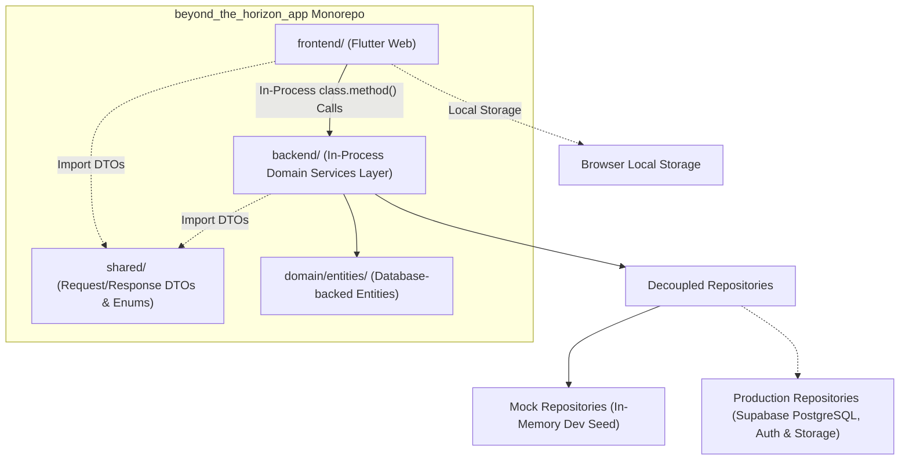
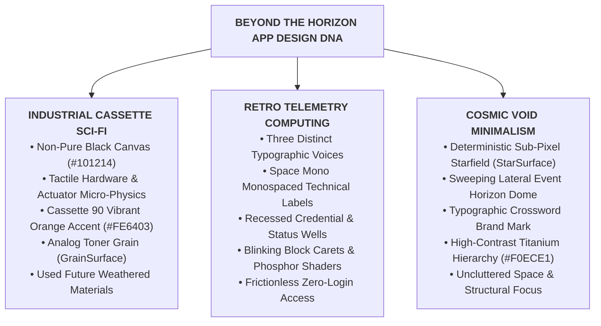

# SDD 01: Overview

## 1. Document Control
- **Document Title:** System Design Document - Overview
- **Project:** Beyond the Horizon - Digital Companion & Rules Platform ("Beyond the Horizon App")
- **Author:** Henrique Schorr
- **Status:** Draft / Active
- **Version:** 0.2.0
- **Last Updated:** 2026-10-11

---

## 2. Product Vision & Objectives

The **Beyond the Horizon App** is a digital platform and companion application for the *Beyond the Horizon* tabletop sci-fi roleplaying game (TTRPG). It serves as an interactive reference, character management, rules lookup, and digital toolkit for players and game masters exploring the *Beyond the Horizon* universe.

### 2.1 Core Objectives
1. **Interactive Rules & Compendium:** Provide fast, accessible search and exploration of core mechanics, manuscript chapters, species, abilities, equipment, threats, and lore.
2. **Character & Play Management:** Support interactive character creation, sheet tracking, ability resolution, and session management.
3. **Immersive Atmosphere & Thematic UI:** Deliver a dark retro-futuristic aesthetic inspired by hard sci-fi, tactile terminal interfaces, and cassette futurism.
4. **Modular Monorepo Architecture:** Structure the project as a clean, modular monorepo (frontend/, backend/, shared/, design/), ensuring clear separation of concerns, high maintainability, and streamlined local development.
5. **Zero-Cost Operation & Sustainability:** Run indefinitely at $0.00/month utilizing static hosting (e.g., Cloudflare Pages) and managed BaaS (e.g., Supabase free tier).

### 2.2 Target Platform Scope (Phase 1)
To ensure optimal visual density, tactile telemetry ergonomics, and uncompromised geometric fidelity for the event horizon arc and command deck:
1. **Supported Platforms (Phase 1):**
   - **Web Desktop:** Viewports at or above 1024px width (standard 1080p, 1440p, and 4K displays).
   - **Web Tablet:** Viewports at or above 768px width (iPad and Android tablets in both portrait and landscape orientations).
2. **Explicit Exclusion (Phase 1):**
   - **Smartphones / Mobile Viewports:** Strictly excluded from Phase 1 development. Mobile screens below 768px width display an atmospheric telemetry terminal notification advising the operative to connect via a desktop or tablet station. Future mobile support will be evaluated as a dedicated companion view in later phases.

---

## 3. High-Level Repository Architecture

The repository is structured as a clean, self-contained monorepo:

```
beyond_the_horizon_app/
├── backend/                  # In-process Dart domain services / Shelf server
│   ├── bin/                  # CLI and standalone server entry point
│   ├── lib/                  # Services, entities, repositories, routes
│   └── pubspec.yaml
├── frontend/                 # Flutter Web client application
│   ├── lib/                  # Screens, controllers, design system, widgets
│   ├── web/                  # HTML shell, icons, web manifest
│   └── pubspec.yaml
├── shared/                   # Shared pure Dart wire contracts
│   ├── lib/                  # Request/Response DTOs, enums, constants
│   └── pubspec.yaml
├── design/                   # Software Design Documents (SDDs)
│   ├── 01-sdd-overview.md    # System overview & high-level vision
│   ├── 02-sdd-database.md    # Relational schema & persistence
│   ├── 03-sdd-backend.md     # In-process backend services & logic
│   └── 04-sdd-frontend.md    # Flutter UI, state management & theme
├── .obsidian/                # Obsidian vault configuration & plugins
└── AGENTS.md                 # Agent instructions & guidelines
```



---

## 4. Guiding Architectural Principles

1. **Strict Separation of Concerns (Backend-Only External Calls):** All external communications (database queries, cloud storage, external APIs) originate exclusively from the backend/ package. The frontend/ package is strictly limited to UI presentation, local client storage, and user interactions.
2. **Provider-Agnostic Presentation:** The frontend communicates with backend services exclusively through typed shared DTOs, without direct knowledge of database providers, SQL, or PostgREST.
3. **In-Process Backend Execution:** The backend operates as an in-process Dart package imported by the Flutter client for local zero-latency execution, while retaining standalone Shelf HTTP capabilities for automated testing and tools.
4. **Pluggable Storage Layer:** Abstract repository interfaces allow switching seamlessly between local in-memory test fixtures (Mock...Repository) and production cloud persistence (Prod...Repository).
5. **No Data Logic in Widgets:** All data formatting, validation, string manipulation, and rstate transitions reside strictly in feature controllers or domain helpers.
6. **Strict Typography & Design System:** All visual presentation relies on design system tokens and semantic typography widgets without arbitrary inline sizing or raw text widgets.
7. **Frictionless Public & Zero-Login Access:** Exploring the rules compendium and configuring application settings require zero authentication. Application settings are stored locally on the client machine via browser local storage without server round-trips.

---

## 5. User Roles & Access Architecture

The platform recognizes four distinct user tiers with clear privilege boundaries:

| Role | Primary Purpose & Responsibilities | Key Capabilities |
| :--- | :--- | :--- |
| **Visitor (Public / Zero-Login)** | Explore the setting, study game rules, and configure local client preferences. | • Full read access to public rules compendium chapters.<br>• Unauthenticated access to application settings persisted in browser local storage.<br>• Quick rules search and reference navigation.<br>• Seamless registration and login call-to-actions. |
| **Player** | Create, manage, and play individual characters during live game sessions. | • All Visitor capabilities.<br>• Character creation wizard & live interactive play sheet.<br>• Personal dice roller with modifier injection.<br>• Join active games/campaigns via invite code.<br>• Real-time session participation (adjust HP/stress, spend ammo, cast abilities).<br>• Access public rules compendium & unlocked player handouts. |
| **Facilitator (GM)** | Orchestrate campaigns, moderate one-shots, design encounters, and guide narrative flow. | • All Player capabilities.<br>• Campaign & session creation, scheduling, and player roster management.<br>• **Live Party Screen (Facilitator HUD)**: Monitor all party members' vital stats in real-time.<br>• **Encounter Management**: Initiative order, threat stat cards, automated turn cycles, environmental hazards.<br>• Private/hidden GM dice rolling & secret audit notes.<br>• Dispatch **Secret Transmissions** & classified handouts to individual players.<br>• Campaign-scoped homebrew content creation (custom threats, abilities, items). |
| **Admin** | Maintain official rules content, moderate accounts, and supervise system health. | • All Facilitator and Player capabilities.<br>• Official rules compendium curation (manuscript revisions, official species, abilities, equipment catalog, bestiary).<br>• Global user administration, permissions, and moderation.<br>• System telemetry, rate limit inspection, and error logging. |

---

## 6. Companion Platform Feature Ecosystem

The application combines the utility of industry-standard digital companion platforms (such as *D&D Beyond* and *Demiplane*) with mechanics tailored specifically to the *Beyond the Horizon* universe.

### 6.1 Core Features
1. **User Creation & Onboarding:** Frictionless account registration with email verification and immediate transition to active play.
2. **Authentication & Session Persistence:** Secure login with persistent sessions (localStorage / Supabase Auth tokens) and password recovery.
3. **Logged-Out Landing Page:** Atmospheric terminal portal featuring the typographic crossword brand mark (Beyond the Horizon sharing the letter O), the parabolic event horizon arc exiting strictly through the lateral screen borders, flanking zero-login utility buttons (Compêndio book icon on the left, Settings gear icon on the right), recessed credential inputs, and side-by-side action controls with the tactile sign-in CTA button.
4. **Logged-In Player Dashboard (Command Deck):** Seamless spatial continuation gliding the brand mark and black hole curvature into the left third of the screen, presenting a clean direct operative greeting (Bem-vindo, [Nome]!) without secondary session metadata, and five prioritized feature actions (Jogar Personagem, Criar Personagem, Compêndio, Configurações, Sair).
5. **Rules Compendium:** Fast, filterable digital rulebook indexing core mechanics, species profiles, abilities, weapons, equipment, threats, and lore. Completely accessible to public visitors without requiring authentication.
6. **Character Creation Wizard:** Guided step-by-step creation flow: species selection, background origin, attribute distribution, ability selection, starting equipment, and automatic derived stat calculation.
7. **Interactive Character Play Sheet:** Digital character sheet with live vitality/HP meters, stress/wounds tracks, one-tap ability execution, inventory slots, and status indicators.
8. **App Settings:** User preferences managed directly on the client machine and persisted in browser local storage without requiring an account or login.
9. **Game & Campaign Management:** Creation of long-running campaigns or standalone one-shots, featuring custom descriptions, campaign banners, and shareable player invite links.
10. **Live Session Orchestration:** Session lobby showing connected participants, active game clock, session objectives, and live status syncing.
11. **Tactical Encounter Management:** Turn-order initiative tracker, threat stat blocks, active monster HP/armor counters, hazard triggers, and turn progression.
12. **Integrated Dice Roller Engine:** Digital dice roller supporting standard polyhedrals, custom ability formulas, automated stat modifiers, and public vs. private (GM-only) roll toggles.
13. **Session Audit Log & Narrative History:** Timestamped, chronological feed logging all dice rolls, ability invocations, damage dealt, and GM announcements.

### 6.2 Extended Companion Platform Capabilities
To achieve parity with and exceed modern TTRPG companions (*D&D Beyond*, *Demiplane*), the platform incorporates the following high-value extensions:

- **Live Party Screen (Facilitator HUD):** A dedicated Facilitator view presenting live vitality, stress, armor, and passive perception for the entire party on a single dashboard, eliminating the need to interrupt play with status inquiries.
- **Interactive Compendium Tooltips (Hover-to-Inspect):** Any ability, item, threat, or rule term mentioned in character sheets or encounter cards features interactive hover tooltips and slide-out detail drawers, preventing rulebook page-flipping.
- **Secret Transmissions & Classified Handouts:** Facilitators can beam encrypted sensor logs, audio transcripts, or secret notes directly to specific player screens, reinforcing cosmic paranoia and tactical secrecy.
- **Inventory & Encumbrance Grid:** Slot-based or weight-based encumbrance calculating movement penalties, ammunition tracking, and biological symbiont integration.
- **Automated Condition & Affliction Ticks:** Real-time tracking of persistent status effects (e.g., Bleeding, Radiation Poisoning, Cyber-Shock, Panic) with automated start-of-turn damage or stress triggers.
- **Homebrew Content Creator:** In-app builder allowing Facilitators to design custom abilities, homebrew species, weapons, and threats scoped to their campaign.
- **Character Sheet Export (PDF & Markdown):** One-click generation of high-contrast printable PDF sheets and clean Markdown files for offline play or Obsidian vault synchronization.
- **Progressive Web App (PWA) Offline Caching:** Offline capability enabling uninterrupted character play and dice rolling during physical in-person table sessions with intermittent connectivity.

---

## 7. Visual Design DNA & Aesthetic Foundation

The visual identity of *Beyond the Horizon App* merges **The Used Future** of industrial cassette sci-fi (*Alien*, *Fallout*, *Mothership*, *Death in Space*) with **Cosmic Void Minimalism** and **Tactile Telemetry Computing**.



### 7.1 Core Aesthetic Devices
1. **Typographic Multi-Voice Hierarchy:** The interface balances three distinct typographic voices:
   - **Monumental & Hero Voice (Space Grotesk):** For monumental crossword titles, major headlines, and section banners.
   - **Machine & Tactical Voice (Space Mono):** Bold, tracked uppercase monospaced labels for tactical action buttons, system status indicators, telemetry readouts, input field headers, and atmospheric tooltips.
   - **Editorial & Rules Lore Voice (Inter):** High-legibility neutral grotesque for long-form reading comfort across compendium articles and game rules lore.
2. **Single Universal Accent Token:** The interface utilizes a single accent color across all interactive elements: **Cassette 90 Vibrant Orange** (\#FE6403 on dark mode surfaces, calibrated to high-contrast Burnt Tape Orange \#C2410C on light mode surfaces). Character resilience attributes exclusively reserve Blue, Red, Yellow, and Purple, eliminating any chromatic conflict.
3. **Canvas Materiality Shaders:**
   - **StarSurface:** Deterministic sub-pixel starfield generated from fixed seed 42 with reading corridor attenuation.
   - **GrainSurface:** Procedural analog risograph toner stipple stochastically overlaid across all non-text buttons (tactical buttons, rounded-square utility icon buttons, and dashboard feature launchers) to provide physical materiality. Pure text-only buttons remain untextured.
   - **CrtSurface:** Reusable cathode-ray tube shader providing calibrated horizontal scanlines, phosphor glow, and curved perimeter vignette for future telemetry diagnostics and optional retro display mode.
4. **Interactive Redaction Mechanic:** Undiscovered lore and Facilitator secrets display thick black redaction blocks (████████) on player screens until declassified.
5. **The Facilitator Case Board (*Alan Wake 2* Mind Place):** The campaign and encounter planner offers a tactile board where NPC dossiers, threats, and clue nodes are pinned and connected with red relationship threads.

---

## 8. Document Roadmap & Next Steps

### 8.1 System Design Documents
- [Open Points & Roadmap Register](./open_points.md) - Prioritized feature roadmap across Phase 1, Phase 2, and Phase 3
- [01-sdd-overview.md](./01-sdd-overview.md) - System overview, vision, companion ecosystem, and visual DNA *(This Document)*
- [02-sdd-database.md](./02-sdd-database.md) - Relational schema, realtime session subscriptions, and Supabase data architecture
- [03-sdd-backend.md](./03-sdd-backend.md) - In-process domain services, dice formula engine, and session orchestration
- [04-sdd-frontend.md](./04-sdd-frontend.md) - Flutter Web architecture, design system tokens, controllers, and screens

### 8.2 Design & Aesthetic References
- [Remedy Entertainment: Control & Alan Wake Aesthetic Study](./references/remedy_design_reference.md)
- [The Industrial Entropic Future: Comparative Aesthetic Report](./references/shared_design_trends_comparative_report.md)
- [Alien Franchise Design Reference](./references/alien_design_reference.md)
- [Fallout Series Design Reference](./references/fallout_design_reference.md)
- [Mothership RPG Design Reference](./references/mothership_design_reference.md)
- [Death in Space RPG Design Reference](./references/death_in_space_design_reference.md)

