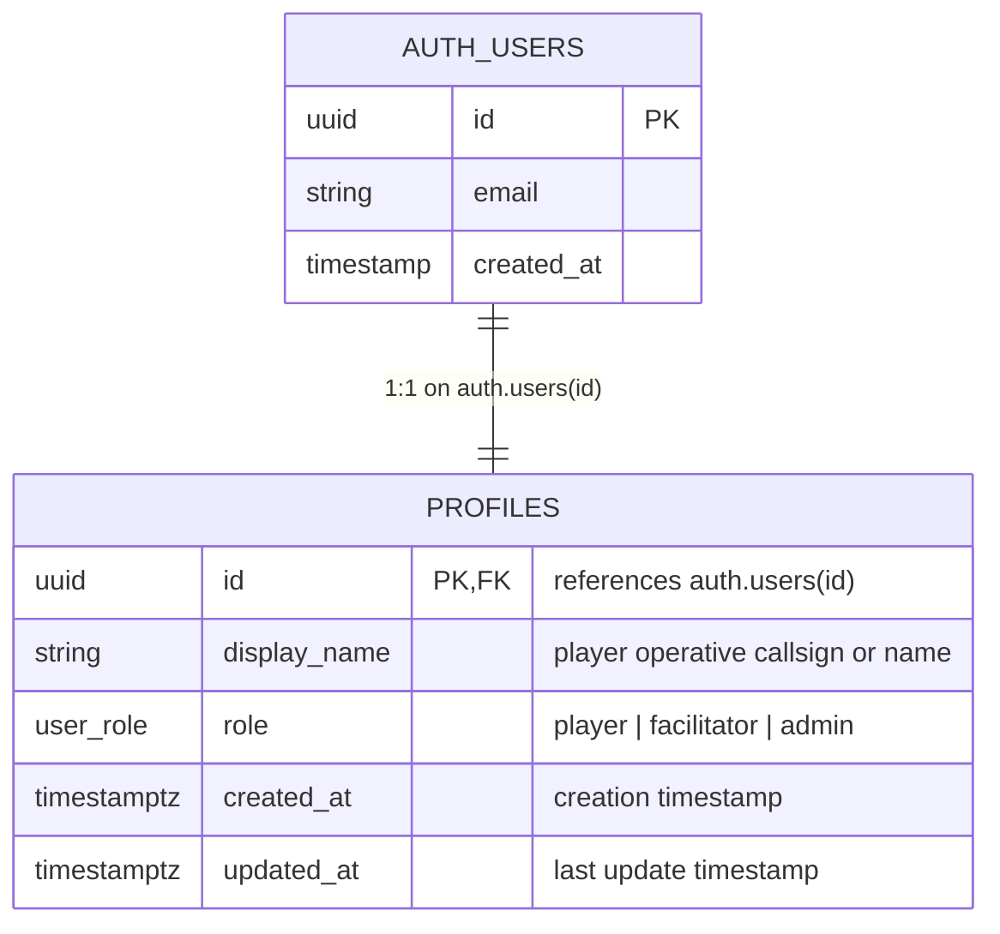
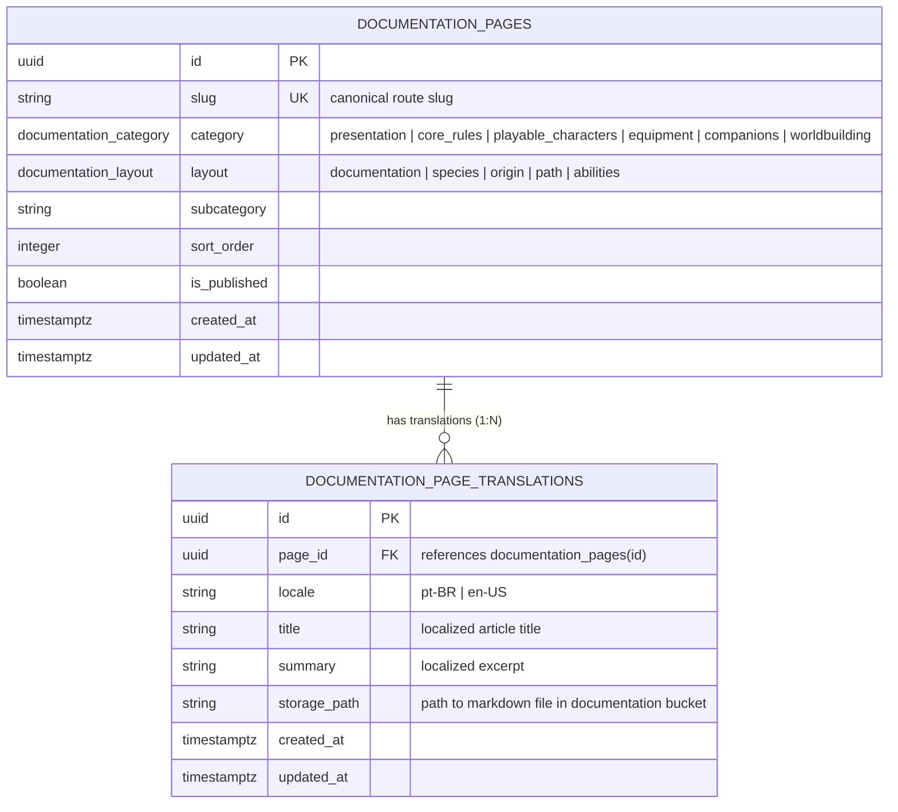

# SDD 02: Database & Data Architecture

## 1. Document Control
- **Document Title:** System Design Document - Database & Data Architecture
- **Project:** Beyond the Horizon - Digital Companion & Rules Platform ("Beyond the Horizon App")
- **Author:** Henrique Schorr
- **Status:** Active
- **Version:** 0.3.1
- **Last Updated:** 2026-10-10

---

## 2. Core Standards & Architectural Conventions

The data architecture of *Beyond the Horizon App* is built on top of Supabase PostgreSQL and adheres to the following core engineering standards:

1. **Universal Identifiers (UUIDv4):** All relational tables utilize UUID primary keys generated via gen_random_uuid(). Foreign keys referencing Supabase Auth map directly to auth.users(id).
2. **UTC Timestamps:** All timestamp fields are explicitly typed as TIMESTAMPTZ with defaults set to timezone('utc'::text, now()).
3. **Discrete Domains as Native PostgreSQL Enums:** Any column representing a predefined, fixed domain of values MUST be modeled as a PostgreSQL ENUM type (CREATE TYPE ... AS ENUM (...)) rather than unconstrained strings or ad-hoc check constraints.
4. **Row-Level Security (RLS) by Default:** Every table created in the public schema has Row-Level Security (ENABLE ROW LEVEL SECURITY) activated immediately upon creation. No table is left open to public unauthenticated mutations.
5. **OWASP Top 10 & Security Hardening:**
   - **A01/A07 Access Control:** Policies enforce ownership via auth.uid() = id (or foreign key ownership columns). Direct role mutation / privilege escalation is prohibited via BEFORE UPDATE trigger checks.
   - **A03/A05 Search-Path Hijacking Defense:** All database functions executed as triggers or stored procedures are declared with SECURITY DEFINER SET search_path = public to prevent search path manipulation.
   - **A03 Data Sanitization:** Text attributes enforce length boundaries (CHECK (char_length(...) <= N)) and trimming constraints.
6. **Decoupled Backend Boundary:** Frontend clients never execute raw SQL. All data interactions are brokered by the backend/ domain service layer over PostgREST or in-process repositories.
7. **Dashboard-First Migration Execution:** Database migrations are versioned as raw SQL scripts within supabase/migrations/ and documented for direct manual execution inside the Supabase Dashboard SQL Editor (prohibiting Supabase CLI dependencies).

---

## 3. Database Migration Management

Migrations are stored in the project repository under supabase/migrations/ using timestamped naming:

```
beyond_the_horizon_app/
└── supabase/
    └── migrations/
        ├── 20261010000001_create_profiles_table.sql
        └── 20261010000002_create_documentation_pages.sql
```

### 3.1 Applying Migrations via Supabase Web Dashboard
1. Open the [Supabase Web Dashboard](https://supabase.com/dashboard).
2. Select the **Beyond the Horizon** project.
3. In the left navigation bar, open the **SQL Editor**.
4. Click **New query**.
5. Paste the contents of the target migration file (e.g. [20261010000002_create_documentation_pages.sql](../supabase/migrations/20261010000002_create_documentation_pages.sql)).
6. Click **Run** and verify successful execution in the results pane.
7. Navigate to **Table Editor** to inspect created tables, columns, and constraints.
8. Navigate to **Authentication > Policies** to verify active RLS policies.
9. Navigate to **Storage** to confirm bucket provisioning and access policies.

---

## 4. Feature Module 1: User Management & Authentication (OP-01 & OP-02)

### 4.1 Scope & Design Boundaries
- **User Role Domain (public.user_role):** The system establishes an explicit PostgreSQL enum public.user_role containing 'player', 'facilitator', and 'admin'. In Phase 1, all newly registered accounts default to 'player'. Facilitator and Admin functional capabilities remain locked to future release phases. Direct role modification from client sessions is prohibited by database triggers.
- **Email-Based Authentication:** User registration, password resets, and session tokens are managed via Supabase Auth (auth.users). A separate unique username handle is unnecessary; users specify an in-universe or personalized display_name (e.g., callsign or operative name).
- **Strictly Private Profiles:** Each player's dossier profile is private to that user (auth.uid() = id). Public profile directory browsing and Facilitator campaign-wide inspection are deferred to subsequent phases.
- **Deferred Concerns:** 
  - App settings (OP-09): Managed unauthenticated directly on the client machine and persisted in browser local storage via UserLocalStorageService, requiring zero database tables or backend persistence.
  - Broadcast system announcements and dashboard shortcut bookmarks are deferred to Phase 3.
  - All visual theme styling and UI design tokens reside strictly in [04-sdd-frontend.md](./04-sdd-frontend.md).

### 4.2 Entity-Relationship Model



### 4.3 Data Dictionary: public.profiles

#### Custom Types
- **public.user_role (ENUM):** 'player', 'facilitator', 'admin'.

#### Columns

| Column | Data Type | Nullable | Default | Constraints & Description |
| :--- | :--- | :--- | :--- | :--- |
| id | UUID | No | None | Primary key. References auth.users(id) ON DELETE CASCADE. |
| display_name | TEXT | No | None | Player callsign or name. Enforces CHECK (char_length(trim(display_name)) >= 1 AND char_length(display_name) <= 50). |
| role | public.user_role | No | 'player' | Account role enum (player, facilitator, admin). Protected against direct client updates. |
| created_at | TIMESTAMPTZ | No | timezone('utc'::text, now()) | Record creation timestamp. |
| updated_at | TIMESTAMPTZ | No | timezone('utc'::text, now()) | Record last modification timestamp, maintained automatically by trigger. |

### 4.4 Row-Level Security (RLS) Policies

Row-Level Security is enabled on public.profiles. The active policies enforce strict isolation:

| Policy Name | Action | Target Role | Using Expression | With Check Expression |
| :--- | :--- | :--- | :--- | :--- |
| Users can view own profile | SELECT | authenticated | auth.uid() = id | — |
| Users can insert own profile | INSERT | authenticated | — | auth.uid() = id |
| Users can update own profile | UPDATE | authenticated | auth.uid() = id | auth.uid() = id |
| Users can delete own profile | DELETE | authenticated | auth.uid() = id | — |

### 4.5 Triggers & Automation

1. **Automatic Timestamp Touch (public.handle_updated_at):**
   - Trigger: BEFORE UPDATE ON public.profiles FOR EACH ROW.
   - Function: Updates NEW.updated_at to the current UTC timestamp.
   - Security: Configured as SECURITY DEFINER SET search_path = public.

2. **Privilege Escalation Guard (public.prevent_role_escalation):**
   - Trigger: BEFORE UPDATE ON public.profiles FOR EACH ROW.
   - Function: Rejects any attempt to change NEW.role from its existing value (RAISE EXCEPTION), ensuring clients cannot self-promote.
   - Security: Configured as SECURITY DEFINER SET search_path = public.

3. **Automated Profile Provisioning (public.handle_new_user):**
   - Trigger: AFTER INSERT ON auth.users FOR EACH ROW.
   - Function: Automatically inserts a row into public.profiles upon user registration in Supabase Auth, setting role to 'player'::public.user_role.
   - Fallback Logic: Reads raw_user_meta_data->>'display_name' from signup payload; if omitted or blank, defaults to 'Operative'. Includes ON CONFLICT (id) DO NOTHING for idempotency.
   - Security: Configured as SECURITY DEFINER SET search_path = public.

### 4.6 Migration Reference
- Canonical SQL Migration File: [20261010000001_create_profiles_table.sql](../supabase/migrations/20261010000001_create_profiles_table.sql)

---

## 5. Feature Module 2: Documentation Pages & Storage Catalog (OP-03)

### 5.1 Architectural Scope & Storage Strategy
The documentation engine provides an interactive reference for all rules, species, equipment, and universe lore:
- **Storage-Driven Markdown Architecture:** Markdown files are not stored as large text blobs in PostgreSQL rows. Instead, markdown files reside in a dedicated Supabase Storage bucket (documentation), organized under localized directory paths (e.g., pages/pt-BR/core_rules/game_core.md). This enables CDN edge caching, fast page delivery, and zero database bloat.
- **Bilingual Translation Model (1:N):**
  - **Base Entity (public.documentation_pages):** Holds immutable routing (slug), category, layout mode, subcategory, sort sequence, and publication status.
  - **Translation Record (public.documentation_page_translations):** Holds locale-specific title, summary excerpt, and the storage path pointer to the localized markdown file.
  - **Phase 1 Execution:** All content is populated in pt-BR. When English content (en-US) is introduced in future phases, adding translation rows requires zero database migrations or table alterations.
- **Specialized Page Layouts (public.documentation_layout):** Dictates how the Flutter client composes the screen (documentation, species, origin, path, abilities).

### 5.2 Entity-Relationship Model



### 5.3 Data Dictionaries: Documentation Catalog

#### Custom Types
- **public.documentation_category (ENUM):**
  - 'presentation': Pitch, vision, design pillars, setting introduction.
  - 'core_rules': Core resolution, step-dice, combat flow, damage, rest, death, countdowns.
  - 'playable_characters': Species profiles, origins, attributes, progression.
  - 'equipment': Weapons, properties, suits & apparel, consumable items.
  - 'companions': Allies, symbionts, bio-drones, beasts, progression.
  - 'worldbuilding': Universe setting, factions, corporations, locations, timeline.
- **public.documentation_layout (ENUM):**
  - 'documentation': Standard article reading view with table of contents.
  - 'species': Species profile dossier layout.
  - 'origin': Character origin provenance layout.
  - 'path': Career and tactical progression layout.
  - 'abilities': Ability cards catalog and tactical action showcase.

#### Table: public.documentation_pages

| Column | Data Type | Nullable | Default | Constraints & Description |
| :--- | :--- | :--- | :--- | :--- |
| id | UUID | No | gen_random_uuid() | Primary key. |
| slug | TEXT | No | None | Canonical routing slug. Unique across catalog. CHECK (char_length(slug) >= 2 AND char_length(slug) <= 120). |
| category | public.documentation_category | No | None | High-level compendium category enum. |
| layout | public.documentation_layout | No | 'documentation' | Layout mode for Flutter presentation composition. |
| subcategory | TEXT | Yes | NULL | Optional subcategory grouping (e.g. combat, weapons). |
| sort_order | INTEGER | No | 0 | Sequence index for chapter navigation ordering. |
| is_published | BOOLEAN | No | true | Visibility flag for draft vs live content. |
| created_at | TIMESTAMPTZ | No | timezone('utc'::text, now()) | Record creation timestamp. |
| updated_at | TIMESTAMPTZ | No | timezone('utc'::text, now()) | Record last modification timestamp. |

#### Table: public.documentation_page_translations

| Column | Data Type | Nullable | Default | Constraints & Description |
| :--- | :--- | :--- | :--- | :--- |
| id | UUID | No | gen_random_uuid() | Primary key. |
| page_id | UUID | No | None | References public.documentation_pages(id) ON DELETE CASCADE. |
| locale | TEXT | No | 'pt-BR' | Language code. CHECK (locale IN ('pt-BR', 'en-US')). |
| title | TEXT | No | None | Localized article title. Enforces 1 to 150 characters. |
| summary | TEXT | Yes | NULL | Localized summary excerpt (max 500 characters). |
| storage_path | TEXT | No | None | Path to markdown file within the documentation storage bucket. |
| created_at | TIMESTAMPTZ | No | timezone('utc'::text, now()) | Record creation timestamp. |
| updated_at | TIMESTAMPTZ | No | timezone('utc'::text, now()) | Record last modification timestamp. |

*Unique Constraint:* UNIQUE(page_id, locale).

### 5.4 Unified Client Query View: public.documentation_pages_view

A convenient joined view resolving page metadata and localized translation copy in a single query:

```sql
CREATE OR REPLACE VIEW public.documentation_pages_view AS
SELECT 
    dp.id,
    dp.slug,
    dp.category,
    dp.layout,
    dp.subcategory,
    dp.sort_order,
    dp.is_published,
    dpt.locale,
    dpt.title,
    dpt.summary,
    dpt.storage_path,
    dp.created_at,
    dp.updated_at
FROM public.documentation_pages dp
JOIN public.documentation_page_translations dpt ON dpt.page_id = dp.id;
```

### 5.5 Row-Level Security (RLS) Policies

| Policy Name | Table | Action | Target Role | Using Expression |
| :--- | :--- | :--- | :--- | :--- |
| Public read for published documentation pages | documentation_pages | SELECT | anon, authenticated | is_published = true |
| Public read for published page translations | documentation_page_translations | SELECT | anon, authenticated | EXISTS (SELECT 1 FROM documentation_pages dp WHERE dp.id = page_id AND dp.is_published = true) |
| Public read for documentation storage objects | storage.objects | SELECT | anon, authenticated | bucket_id = 'documentation' |

### 5.6 Storage Bucket Provisioning

- **Bucket Name:** documentation
- **Access Level:** Public read enabled.
- **Directory Structure Convention:**
  ```
  documentation/
  ├── pages/
  │   └── pt-BR/
  │       ├── core_rules/
  │       │   └── resolucao.md
  │       ├── playable_characters/
  │       │   └── evoraz.md
  │       └── equipment/
  │           └── armas.md
  └── images/
      ├── banners/
      └── diagrams/
  ```

### 5.7 Migration Reference
- Canonical SQL Migration File: [20261010000002_create_documentation_pages.sql](../supabase/migrations/20261010000002_create_documentation_pages.sql)

---

## 6. Storage Tiers & Assets

| Bucket | Access | Purpose | Lifecycle & Formats |
| :--- | :--- | :--- | :--- |
| documentation | Public Read | Rulebook Markdown chapters, diagrams, and banners | .md, .webp, .png, .svg |
| portraits (Future) | Public Read | Character and operative dossier portraits | .webp, .png |
| handouts (Future) | Restricted | Classified transmissions and facilitator handouts | .webp, .pdf, .mp3 |

---

## 7. Document References

- [Open Points & Roadmap Register](./open_points.md) - Project roadmap and open points register
- [01-sdd-overview.md](./01-sdd-overview.md) - System Design Document: Overview & Architecture
- [03-sdd-backend.md](./03-sdd-backend.md) - System Design Document: Backend Architecture
- [04-sdd-frontend.md](./04-sdd-frontend.md) - System Design Document: Frontend Architecture
- [compendium_keywords_plan.md](./compendium_keywords_plan.md) - Master Keyword Overlay Engine Plan (OP-03A)
- [markdown_presentation_reference.md](./markdown_presentation_reference.md) - Markdown Presentation Engine & Layout Reference (OP-03B)
- [20261010000001_create_profiles_table.sql](../supabase/migrations/20261010000001_create_profiles_table.sql) - Migration 1: User Profiles & Role Enum
- [20261010000002_create_documentation_pages.sql](../supabase/migrations/20261010000002_create_documentation_pages.sql) - Migration 2: Documentation Pages & Translations
