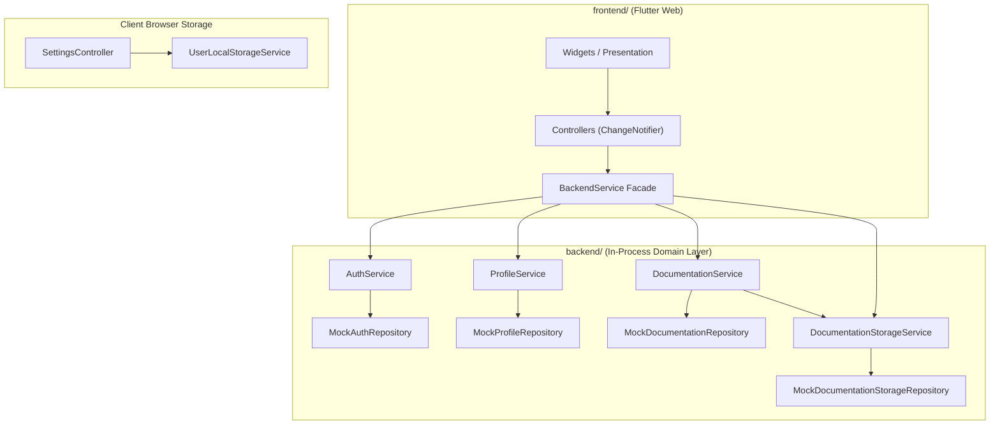

# SDD 03: Backend Architecture (Dart)

## 1. Document Control
- **Document Title:** System Design Document - Backend Architecture
- **Project:** Beyond the Horizon - Digital Companion & Rules Platform ("Beyond the Horizon App")
- **Author:** Henrique Schorr
- **Status:** Active
- **Version:** 0.2.0
- **Last Updated:** 2026-10-11

---

## 2. Role & Architectural Philosophy

The backend package is situated within the Beyond the Horizon App repository under beyond_the_horizon_app/backend/, supported by wire contracts in beyond_the_horizon_app/shared/. It acts as the business logic coordinator, repository manager, security validator, and guardian of rules compendium delivery.

In production, to satisfy the strict $0.00/month zero-cost requirement without server cold starts or container infrastructure costs, the backend operates as an **in-process backend package**: the Flutter Web client imports backend/ directly as a pure Dart package and calls its domain services via direct class.method() invocations passing typed shared DTOs. In this mode, no HTTP network hops occur. The standalone Shelf HTTP pipeline (bin/server.dart) is fully retained for automated testing, API validation, and CLI automation.

### 2.1 Core Architectural Principles

1. **In-Process & Dual-Mode Execution:** Exposes clean domain services callable in-process via zero-latency Dart class.method() calls for the Flutter Web frontend, while maintaining a lightweight Shelf HTTP pipeline for standalone server deployments, test suites, and CI/CD validation.
2. **Strict Architectural Boundary (Backend-Only External Communication):** Every database query, cloud storage interaction, external API integration, and business calculation originates strictly and exclusively in the backend package. Direct external network calls in the frontend package are strictly prohibited. The frontend interacts with domain data exclusively via the BackendService facade and shared DTOs.
3. **Frictionless Zero-Login Access:** Public rules compendium browsing, chapter searching, and Markdown content delivery are completely open to unauthenticated visitors without requiring registration or login.
4. **App Settings Localized Boundary:** Application display and audio settings (OP-09) are client-side local preferences managed directly by the frontend UserLocalStorageService in browser local storage, requiring zero backend database tables, endpoints, or network overhead.
5. **Decoupled Repositories Architecture:** Data access is strictly decoupled by domain into focused repository contracts (AuthRepository, ProfileRepository, DocumentationRepository, DocumentationStorageRepository). Domain services depend strictly on these abstract interfaces.
6. **Mock-First Architecture for Phase 1:** During Phase 1 development, the application operates against comprehensive in-memory Mock Repositories pre-seeded with realistic operative dossiers and localized Portuguese (pt-BR) core rulebook chapters. This allows instant offline-first development with zero cloud credentials, while preserving abstract contracts for seamless future cloud integration.
7. **Strict Request/Response DTO Suffixing:** All wire contracts in shared/ explicitly declare their role via RequestDto or ResponseDto suffixes, ensuring absolute clarity and preventing ambiguous data transfer models.
8. **Security & OWASP Top 10 Compliance:** Enforces character boundary validation, input sanitization, role modification guards, timing-safe comparison, sanitized error masking, and storage path traversal defense across all layers.

---

## 3. Technology Stack & Framework

| Component | Technology | Rationale |
| :--- | :--- | :--- |
| **Language & Runtime** | Dart (latest stable SDK) | High-performance, AOT/JIT compiled, shared strongly-typed models with Flutter frontend. |
| **HTTP Pipeline** | shelf & shelf_router | Official, minimalist Dart ecosystem standard for HTTP routing and middleware. Zero unnecessary magic. |
| **Dependency Injection** | get_it Service Locator | Centralized, pure Dart service locator for repositories, domain services, and route controllers with injectable constructor fallback standard. |
| **Data Repositories** | Decoupled Abstract Contracts & Mock Repositories | Resource segregation, zero God-objects, offline-first development with realistic in-memory seeds. |
| **JSON Serialization** | Handcrafted pure Dart toMap() / fromMap() | Avoids slow build runners, heavy code generation, and complex build scripts. |
| **Identifiers** | uuid package | RFC4122 compliant UUIDv4 generation for entities, sessions, and records. |
| **Cryptography** | crypto package | Standard SHA-256 and HMAC cryptographic hashing for tokens and security validations. |
| **Shared Wire Contracts** | shared/ pure Dart package | Strongly-typed, immutable DTOs and domain enums consumed by both frontend and backend. |

---

## 4. Decoupled Repositories Architecture

Rather than a monolithic data access layer, the backend segregates data operations into four focused repository contracts:

```mermaid
classDiagram
    class AuthRepository {
        <<interface>>
        +signInWithPassword(String email, String password) Future~AuthSessionResponseDto~
        +signUp(String email, String password, String displayName) Future~AuthSessionResponseDto~
        +signOut(String sessionToken) Future~void~
        +resetPasswordForEmail(String email) Future~void~
        +getUserSession(String sessionToken) Future~AuthSessionResponseDto?~
    }

    class ProfileRepository {
        <<interface>>
        +getProfileById(String id) Future~UserProfileResponseDto?~
        +updateProfile(String id, String displayName) Future~UserProfileResponseDto~
    }

    class DocumentationRepository {
        <<interface>>
        +listPublishedPages(String locale, DocumentationCategory category) Future~List~DocumentationPageSummaryResponseDto~~
        +getPageBySlug(String slug, String locale) Future~DocumentationPageDetailResponseDto?~
        +getPageById(String id, String locale) Future~DocumentationPageDetailResponseDto?~
        +getCategoryGroups(String locale) Future~List~DocumentationCategoryGroupResponseDto~~
        +getNavigationTree(String locale) Future~List~DocumentationNavigationNodeResponseDto~~
    }

    class DocumentationStorageRepository {
        <<interface>>
        +fetchMarkdownContent(String storagePath) Future~String~
        +getPublicStorageUrl(String storagePath) String
    }

    AuthRepository <|.. MockAuthRepository
    ProfileRepository <|.. MockProfileRepository
    DocumentationRepository <|.. MockDocumentationRepository
    DocumentationStorageRepository <|.. MockDocumentationStorageRepository
```



### 4.1 Repository Contracts & Method Signatures

#### 4.1.1 AuthRepository
Defines authentication workflows and session state management:
- **signInWithPassword:** Authenticates user credentials and returns an active AuthSessionResponseDto.
- **signUp:** Registers a new account, provisions an operative profile, and returns an AuthSessionResponseDto.
- **signOut:** Invalidates the provided session token.
- **resetPasswordForEmail:** Initiates password recovery workflow for the specified email address.
- **getUserSession:** Validates and resolves the session corresponding to an active session token.

#### 4.1.2 ProfileRepository
Defines operative dossier profile querying and updates:
- **getProfileById:** Retrieves the operative profile by user identifier.
- **updateProfile:** Updates display name, rejecting any direct role modification.

#### 4.1.3 DocumentationRepository (Public Zero-Login)
Defines catalog querying and hierarchical structure generation for compendium rules:
- **listPublishedPages:** Lists all published rulebook pages matching locale and optional category filter.
- **getPageBySlug:** Resolves a single page detail and its localized translation by route slug.
- **getPageById:** Resolves a single page detail and its localized translation by UUID.
- **getCategoryGroups:** Returns published pages pre-partitioned into category groups for the Compendium Hub dashboard.
- **getNavigationTree:** Returns a recursive chapter navigation tree for the compendium reading sidebar.

#### 4.1.4 DocumentationStorageRepository (Public Zero-Login)
Defines raw Markdown chapter retrieval and asset URL generation:
- **fetchMarkdownContent:** Downloads the UTF-8 Markdown text content from the specified storage path.
- **getPublicStorageUrl:** Constructs the canonical public edge URL for images and diagrams.

---

### 4.2 Mock Repositories & In-Memory Seed Data Strategy

In accordance with Phase 1 design, all repositories are implemented as in-memory Mock Repositories:

1. **MockAuthRepository & MockProfileRepository:**
   - Stores accounts and profiles in thread-safe in-memory maps.
   - Pre-seeded with a default active operative account:
     - User ID: 00000000-0000-4000-8000-000000000001
     - Email: operative.vance@beyondthehorizon.space
     - Display Name: Vance "Specter"
     - Role: UserRole.player
   - Simulates token generation with cryptographically secure random session tokens.
   - Supports runtime registration, signin, signout, and profile updates during local app execution.

2. **MockDocumentationRepository & MockDocumentationStorageRepository:**
   - Pre-seeded with canonical Beyond the Horizon compendium chapters in Portuguese (pt-BR), matching the game design repository:
     - **Regras Centrais:** Sistema de Resolução (resolucao), Fluxo de Combate (combate), Dano e Ferimentos (dano-ferimentos), Descanso e Sobrevivência (descanso).
     - **Personagens Jogáveis:** Espécies: Evoraz (evoraz), Korth (korth); Origens (origens); Atributos e Testes (atributos).
     - **Equipamento:** Armas de Fogo e Balística (armas-balisticas), Armas Brancas e Defesas (armas-brancas), Trajes e Blindagens (trajes).
     - **Ambientação:** Linha do Tempo da Expansão (linha-do-tempo), Corporações e Megagrupos (corporacoes).
   - Generates pre-grouped category structures (DocumentationCategoryGroupResponseDto) and collapsible sidebar trees (DocumentationNavigationNodeResponseDto) directly from seed collections.
   - MockDocumentationStorageRepository delivers rich, atmospheric Markdown chapters formatted with headings, tables, block callouts, and keyword tags.

---

### 4.3 Centralized Service Locator & Constructor Injection Fallback

Dependency injection is managed centrally via get_it in backend/lib/dependency_injection/service_locator.dart:

1. **Repository Registration:** Binds abstract repository interfaces to their mock implementations.
2. **Domain Service Registration:** Binds business services as lazy singletons with their repository dependencies injected.
3. **Route Handler Registration:** Binds route controller classes as lazy singletons with their respective services injected.
4. **Constructor Fallback Standard:** All domain services and route controllers retain public constructor parameters with fallback defaults to serviceLocator<T>():

```dart
class DocumentationService {
  final DocumentationRepository _documentationRepository;
  final DocumentationStorageService _documentationStorageService;

  DocumentationService({
    DocumentationRepository? documentationRepository,
    DocumentationStorageService? documentationStorageService,
  })  : _documentationRepository = documentationRepository ?? serviceLocator<DocumentationRepository>(),
        _documentationStorageService = documentationStorageService ?? serviceLocator<DocumentationStorageService>();
}
```

This guarantees that unit tests remain 100% decoupled and can inject mocks directly without initializing the global service locator container.

---

## 5. Component Structure

```tree
beyond_the_horizon_app/
├── shared/
│   ├── lib/
│   │   ├── enums/
│   │   │   ├── documentation_category.dart
│   │   │   ├── documentation_layout.dart
│   │   │   └── user_role.dart
│   │   ├── models/
│   │   │   ├── auth/
│   │   │   │   ├── auth_response_dto.dart
│   │   │   │   ├── auth_session_response_dto.dart
│   │   │   │   ├── password_reset_request_dto.dart
│   │   │   │   ├── sign_in_request_dto.dart
│   │   │   │   └── sign_up_request_dto.dart
│   │   │   ├── documentation/
│   │   │   │   ├── documentation_category_group_response_dto.dart
│   │   │   │   ├── documentation_navigation_node_response_dto.dart
│   │   │   │   ├── documentation_page_detail_response_dto.dart
│   │   │   │   └── documentation_page_summary_response_dto.dart
│   │   │   └── profiles/
│   │   │       ├── update_profile_request_dto.dart
│   │   │       └── user_profile_response_dto.dart
│   │   └── shared.dart
│   └── pubspec.yaml
└── backend/
    ├── bin/
    │   └── server.dart
    ├── lib/
    │   ├── backend.dart
    │   ├── config/
    │   │   └── server_config.dart
    │   ├── dependency_injection/
    │   │   └── service_locator.dart
    │   ├── domain/
    │   │   └── entities/
    │   │       ├── documentation_page.dart
    │   │       ├── documentation_page_translation.dart
    │   │       ├── documentation_page_view_item.dart
    │   │       └── user_profile.dart
    │   ├── middleware/
    │   │   ├── auth_middleware.dart
    │   │   ├── cors_middleware.dart
    │   │   ├── error_handler_middleware.dart
    │   │   └── rate_limiter_middleware.dart
    │   ├── repositories/
    │   │   ├── auth_repository.dart
    │   │   ├── documentation_repository.dart
    │   │   ├── documentation_storage_repository.dart
    │   │   ├── profile_repository.dart
    │   │   └── mock/
    │   │       ├── mock_auth_repository.dart
    │   │       ├── mock_documentation_repository.dart
    │   │       ├── mock_documentation_storage_repository.dart
    │   │       └── mock_profile_repository.dart
    │   ├── routes/
    │   │   ├── auth_routes.dart
    │   │   ├── documentation_routes.dart
    │   │   └── profile_routes.dart
    │   └── services/
    │       ├── auth_service.dart
    │       ├── documentation_service.dart
    │       ├── documentation_storage_service.dart
    │       └── profile_service.dart
    └── pubspec.yaml
```

---

## 6. Wire Contracts & Shared Library (shared/)

All wire contracts, DTOs, and domain enums reside in shared/ and enforce complete immutability (read-only final fields), pure Dart serialization (toMap() and fromMap()), and strict RequestDto or ResponseDto suffixing per Rule 19.

### 6.1 Domain Enums

#### 1. UserRole
Matches the public.user_role PostgreSQL enum:
- **player:** Standard operative player account.
- **facilitator:** Game master orchestrating campaigns and encounters.
- **admin:** Platform and rules curator.
- Serialization methods: fromDbString(String value) and toDbString().

#### 2. DocumentationCategory
Matches the public.documentation_category PostgreSQL enum:
- **presentation:** Vision, design pillars, setting introduction.
- **coreRules:** Core resolution, step-dice, combat flow, damage, rest, death.
- **playableCharacters:** Species profiles, origins, attributes, progression.
- **equipment:** Weapons, armor, suits, consumable gear.
- **companions:** Allies, symbionts, bio-drones, beasts.
- **worldbuilding:** Universe setting, corporations, factions, timeline.
- Serialization methods: fromDbString(String value), toDbString(), and localized display names.

#### 3. DocumentationLayout
Matches the public.documentation_layout PostgreSQL enum:
- **documentation:** Standard article reading view with table of contents.
- **species:** Species profile dossier layout.
- **origin:** Character origin provenance layout.
- **path:** Tactical progression and career path layout.
- **abilities:** Action and ability cards catalog.
- Serialization methods: fromDbString(String value) and toDbString().

---

### 6.2 Data Transfer Objects (DTOs)

#### 6.2.1 Authentication DTOs
- **SignUpRequestDto:** Encapsulates email, password, and optional displayName. Validates email format and minimum password length (8 characters).
- **SignInRequestDto:** Encapsulates email and password.
- **AuthSessionResponseDto:** Encapsulates userId, email, accessToken, refreshToken, and expiresAt timestamp.
- **AuthResponseDto:** Encapsulates active session (AuthSessionResponseDto) and operative profile (UserProfileResponseDto).
- **PasswordResetRequestDto:** Encapsulates email address for password recovery.

#### 6.2.2 Profile DTOs
- **UserProfileResponseDto:** Encapsulates id, displayName, role, createdAt, and updatedAt.
- **UpdateProfileRequestDto:** Encapsulates displayName. Enforces character length boundaries (display name 1 to 50 characters).

#### 6.2.3 Documentation DTOs (Option A Wire Contracts)
- **DocumentationPageSummaryResponseDto:** Lightweight catalog item carrying id, slug, category, layout, subcategory, sortOrder, locale, title, summary, storagePath, and updatedAt.
- **DocumentationPageDetailResponseDto:** Full article payload containing all summary fields plus the resolved UTF-8 markdownContent, createdAt, and updatedAt.
- **DocumentationCategoryGroupResponseDto:** Hub dashboard partition carrying category, localized category title, localized category description, and a list of DocumentationPageSummaryResponseDto articles.
- **DocumentationNavigationNodeResponseDto:** Recursive tree node for the collapsable reading sidebar carrying label, optional slug (null for category folders), isLeaf boolean, and child nodes (List<DocumentationNavigationNodeResponseDto>).

---

## 7. Domain Services Layer

Domain services encapsulate business logic, coordinate repository queries, perform OWASP input validation, and assemble complex response models.

### 7.1 AuthService
- **signUp(SignUpRequestDto request):** Validates email format via standard regex, enforces password complexity (minimum 8 characters), calls AuthRepository.signUp, and returns AuthResponseDto.
- **signIn(SignInRequestDto request):** Validates input presence, authenticates via AuthRepository.signInWithPassword, retrieves profile, and returns AuthResponseDto.
- **signOut(String sessionToken):** Invalidates session via AuthRepository.signOut.
- **requestPasswordReset(PasswordResetRequestDto request):** Validates email and dispatches recovery request via AuthRepository.resetPasswordForEmail.
- **validateSession(String sessionToken):** Validates token expiry and returns session state.

### 7.2 ProfileService
- **getProfile(String userId):** Retrieves operative profile via ProfileRepository.getProfileById. Returns null if not found.
- **updateProfile(String userId, UpdateProfileRequestDto request):**
  - Sanitizes and trims display name; enforces length between 1 and 50 characters.
  - Enforces role protection: clients cannot modify account role (rejection in domain logic matching database trigger).
  - Calls ProfileRepository.updateProfile and returns UserProfileResponseDto.

### 7.3 DocumentationService (Public Zero-Login)
- **listPages({String locale = 'pt-BR', DocumentationCategory? category}):** Returns published article summaries filtered by locale and optional category.
- **getPageBySlug(String slug, {String locale = 'pt-BR'}):** Resolves page metadata from DocumentationRepository, fetches raw Markdown content via DocumentationStorageService, and returns a consolidated DocumentationPageDetailResponseDto.
- **getCategoryGroups({String locale = 'pt-BR'}):** Calls DocumentationRepository.getCategoryGroups to return pre-partitioned category sections for the Compendium Hub dashboard.
- **getNavigationTree({String locale = 'pt-BR'}):** Calls DocumentationRepository.getNavigationTree to return the recursive chapter navigation tree for the reading sidebar.

### 7.4 DocumentationStorageService (Public Zero-Login)
- **getMarkdown(String storagePath):** Resolves Markdown chapter text via DocumentationStorageRepository with in-memory caching.
- **In-Memory Cache:** Maintains an in-memory map of storagePath to cached content with a configurable time-to-live (TTL: 10 minutes) and maximum capacity (100 items), eliminating repeated storage lookups during reading sessions.
- **invalidateCache(String? storagePath):** Clears the cache for a specific path or flushes the entire cache.

---

## 8. Standalone Shelf HTTP Pipeline & Route Controllers

For testing, CLI automation, and standalone execution, the backend provides a Shelf HTTP pipeline in bin/server.dart mounting route controllers.

### 8.1 API Endpoints Specification

#### 8.1.1 Public Zero-Login Compendium Endpoints

1. **List Compendium Pages**
   - **GET /api/compendium/pages**
   - Query Parameters: locale (default: pt-BR), category (optional).
   - Response: 200 OK with JSON array of DocumentationPageSummaryResponseDto.

2. **Get Compendium Page by Slug**
   - **GET /api/compendium/pages/<slug>**
   - Query Parameters: locale (default: pt-BR).
   - Response: 200 OK with DocumentationPageDetailResponseDto, or 404 Not Found.

3. **Get Compendium Category Groups (Hub View)**
   - **GET /api/compendium/categories**
   - Query Parameters: locale (default: pt-BR).
   - Response: 200 OK with JSON array of DocumentationCategoryGroupResponseDto.

4. **Get Compendium Navigation Tree (Sidebar View)**
   - **GET /api/compendium/tree**
   - Query Parameters: locale (default: pt-BR).
   - Response: 200 OK with JSON array of DocumentationNavigationNodeResponseDto.

#### 8.1.2 Authentication Endpoints

1. **Operative Registration**
   - **POST /api/auth/signup**
   - Payload: SignUpRequestDto JSON.
   - Response: 201 Created with AuthResponseDto.

2. **Operative Sign In**
   - **POST /api/auth/signin**
   - Payload: SignInRequestDto JSON.
   - Response: 200 OK with AuthResponseDto.

3. **Operative Sign Out**
   - **POST /api/auth/signout**
   - Headers: Authorization: Bearer <sessionToken>
   - Response: 204 No Content.

4. **Password Reset Request**
   - **POST /api/auth/recover**
   - Payload: PasswordResetRequestDto JSON.
   - Response: 200 OK with acknowledgement.

5. **Validate Session**
   - **GET /api/auth/session**
   - Headers: Authorization: Bearer <sessionToken>
   - Response: 200 OK with AuthSessionResponseDto.

#### 8.1.3 Profile Endpoints (Authenticated)

1. **Get Current Operative Profile**
   - **GET /api/profiles/me**
   - Headers: Authorization: Bearer <sessionToken>
   - Response: 200 OK with UserProfileResponseDto.

2. **Update Current Operative Profile**
   - **PUT /api/profiles/me**
   - Headers: Authorization: Bearer <sessionToken>
   - Payload: UpdateProfileRequestDto JSON.
   - Response: 200 OK with updated UserProfileResponseDto.

3. **Get Operative Profile by ID**
   - **GET /api/profiles/<id>**
   - Headers: Authorization: Bearer <sessionToken>
   - Response: 200 OK with UserProfileResponseDto, or 404 Not Found.

---

### 8.2 Middleware Pipeline

1. **corsMiddleware:** Configures CORS headers (Access-Control-Allow-Origin: *, Access-Control-Allow-Methods: GET, POST, PUT, DELETE, OPTIONS).
2. **errorHandlerMiddleware:** Intercepts unhandled exceptions, logs error details securely, and returns sanitized error payloads ({error: message}) without leaking raw stack traces (OWASP A05).
3. **authMiddleware:** Extracts Bearer session token from Authorization header and injects authenticated session context into request.context.
4. **rateLimiterMiddleware:** In-memory sliding-window rate limiter protecting mutating endpoints (/api/auth/signin, /api/auth/signup, /api/auth/recover) against brute-force attacks (OWASP A07).

---

## 9. In-Process Frontend Integration (BackendService Facade)

When running inside the Flutter Web application, the frontend interacts with backend domain services exclusively via the BackendService facade:



### 9.1 Facade Method Contracts
- **backendService.auth.signIn(SignInRequestDto):** In-process call returning Future<AuthResponseDto>.
- **backendService.auth.signUp(SignUpRequestDto):** In-process call returning Future<AuthResponseDto>.
- **backendService.auth.signOut():** In-process call invalidating current session.
- **backendService.profile.getProfile(String id):** In-process call returning Future<UserProfileResponseDto?>.
- **backendService.profile.updateProfile(UpdateProfileRequestDto):** In-process call returning Future<UserProfileResponseDto>.
- **backendService.compendium.getPages({String locale, DocumentationCategory? category}):** Zero-login in-process call returning Future<List<DocumentationPageSummaryResponseDto>>.
- **backendService.compendium.getPageBySlug(String slug, {String locale}):** Zero-login in-process call returning Future<DocumentationPageDetailResponseDto?>.
- **backendService.compendium.getCategoryGroups({String locale}):** Zero-login in-process call returning Future<List<DocumentationCategoryGroupResponseDto>>.
- **backendService.compendium.getNavigationTree({String locale}):** Zero-login in-process call returning Future<List<DocumentationNavigationNodeResponseDto>>.

---

## 10. Security & OWASP Top 10 Compliance

The backend architecture enforces the following security standards:

1. **A01 & A07 Access Control & Authentication:**
   - Profile mutations require verified session ownership matching auth.uid() = id.
   - Privilege escalation defense: attempts to alter account role from player to facilitator or admin are strictly rejected in domain logic.
   - Public compendium endpoints are strictly read-only, preventing unauthorized mutations.
2. **A02 Cryptographic Security:**
   - Cryptographic token generation utilizes CSPRNG byte sequences and standard HMAC-SHA256 hashing.
   - Token comparisons utilize timing-safe equality checks to eliminate timing side-channel vulnerabilities.
3. **A03 & A04 Injection & Insecure Design:**
   - String boundaries are strictly validated on all incoming DTO fields (display name 1 to 50 characters).
   - Input fields are trimmed and sanitized of leading/trailing whitespace.
4. **A05 Security Misconfiguration & Error Sanitization:**
   - In production execution, unhandled exceptions return sanitized, generic error descriptions.
   - Raw stack traces, database exceptions, and internal file paths are never exposed in responses or client logs.
5. **A07 Identification & Authentication Failures:**
   - Authentication endpoints (/api/auth/signin, /api/auth/signup, /api/auth/recover) are guarded by sliding-window rate limiting.
6. **A10 Path Traversal & SSRF Defense:**
   - Storage path resolution strictly prohibits outside directory traversal: paths containing parent directory segments (..) or protocol prefixes are rejected immediately.

---

## 11. Document References

- [01-sdd-overview.md](./01-sdd-overview.md) - System Design Document: Overview & Vision
- [02-sdd-database.md](./02-sdd-database.md) - System Design Document: Database Architecture
- [04-sdd-frontend.md](./04-sdd-frontend.md) - System Design Document: Frontend Architecture
- [open_points.md](./open_points.md) - Open Points & Roadmap Register (OP-01 & OP-03)
- [compendium_keywords_plan.md](./compendium_keywords_plan.md) - Master Keyword Overlay Engine Plan (OP-03A)
- [markdown_presentation_reference.md](./markdown_presentation_reference.md) - Markdown Presentation Engine & Layout Reference (OP-03B)
- [20261010000001_create_profiles_table.sql](../supabase/migrations/20261010000001_create_profiles_table.sql) - Migration 1: User Profiles & Role Enum
- [20261010000002_create_documentation_pages.sql](../supabase/migrations/20261010000002_create_documentation_pages.sql) - Migration 2: Documentation Pages & Storage Catalog
