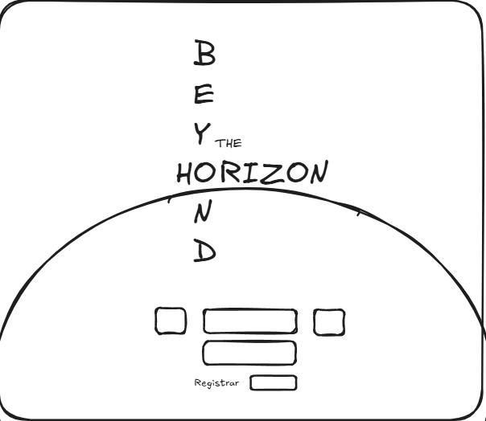
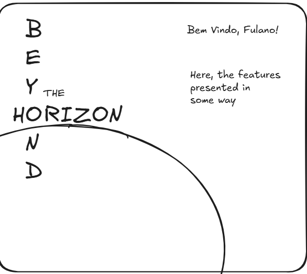
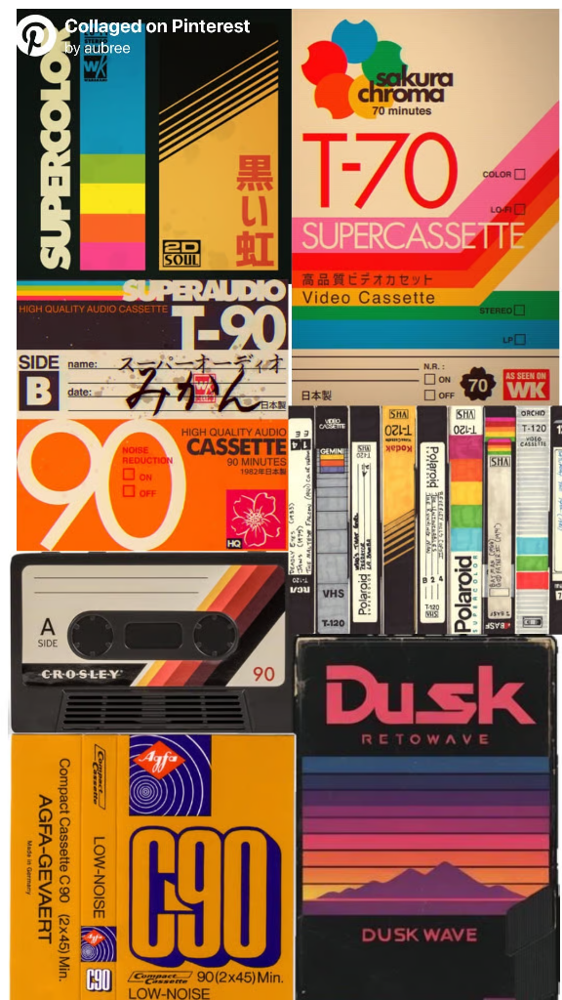

# SDD 04: Frontend Architecture & Design System (Flutter Web)

## 1. Document Control
- **Document Title:** System Design Document - Frontend Architecture & Visual Design System
- **Project:** Beyond the Horizon - Digital Companion & Rules Platform ("Beyond the Horizon App")
- **Author:** Henrique Schorr
- **Status:** Approved Baseline / Active
- **Version:** 0.2.1
- **Last Updated:** 2026-10-11

---

## 2. General Aesthetic & Visual Foundation

### 2.1 Aesthetic Philosophy
The visual identity of the Beyond the Horizon web client synthesizes three distinct design traditions:
1. **Industrial Cassette Futurism:** Rooted in late 1970s and 1980s magnetic tape cartridges, avionics instrumentation, molded ABS hardware chassis textures, chamfered framing, and warm-toned technical typography.
2. **Retro Telemetry Terminal:** Evoking deep-space observational monitoring stations, monospaced status readouts, blinking block carets, and tactile mechanical actuators.
3. **Cosmic Void Minimalism:** Deep charcoal and titanium canvas depths, disciplined negative space, deterministic starfields, and stark event horizon curvature.

### 2.2 Canvas & Materiality Shaders
The client architecture incorporates three specialized canvas shaders, adapting the high-performance canvas engine from the reference implementation in stories_app:
- **StarSurface:** A deterministic sub-pixel starfield generating 160 stars via a fixed pseudo-random seed (seed 42). Features central reading corridor attenuation to guarantee zero interference with text legibility, complemented by a subtle radial nebula wash.
- **GrainSurface:** A procedural analog risograph and photocopier toner stipple painter rendering 120 deterministic micro-pits and dust coordinates at fixed seed 64. Wrapped in a RepaintBoundary for zero per-frame repaint overhead.
- **CrtSurface:** An atmospheric cathode-ray tube monitor surface shader. While intentionally **inactive on default landing page and player dashboard screens** (to preserve clean, high-contrast cosmic void clarity), CrtSurface is codified in the core design system for future terminal telemetry displays, diagnostic consoles, character sheets, and user-toggleable CRT simulation via Terminal Settings. Features:
  - Horizontal cathode-ray scanlines at 4.0px spacing with calibrated alpha (0.18 in dark mode, 0.05 in light mode).
  - Subtle central phosphor glow luminescence (0.35 alpha).
  - Curved perimeter glass vignette darkening display edges and corners.
  - 260ms cathode-ray warm-up flicker sequence respecting user animation preferences.
  - Wrapped in a RepaintBoundary for zero animation overhead when stationary.

### 2.3 Target Platform Scope Boundary (Phase 1)
To guarantee optimal visual density, tactile telemetry ergonomics, and uncompromised geometric fidelity for the event horizon arc and command deck:
- **Supported Platforms (Phase 1):**
  1. **Web Desktop:** Viewports at or above 1024px width (standard 1080p, 1440p, and 4K displays).
  2. **Web Tablet:** Viewports at or above 768px width (iPad and Android tablets in portrait and landscape orientations).
- **Explicit Exclusion (Phase 1):**
  - **Smartphones / Mobile Viewports:** Strictly excluded from Phase 1 scope.
  - Viewports below 768px width display an atmospheric telemetry warning directing the operative to connect via a desktop or tablet station. Future smartphone views will be evaluated as dedicated companion views in subsequent phases.

---

## 3. Canonical Color Palette System

### 3.1 Single Universal Accent Token
The entire interface employs a single accent color across all interactive actuators, highlights, focus rims, and active states:

| Theme Mode | Swatch | Token Identifier | HEX Code | Functional Role in Interface |
| :---: | :--- | :--- | :--- | :--- |
| **Dark Mode** | <span style="display:inline-block;width:24px;height:24px;background:#FE6403;border:1px solid #777;border-radius:3px;"></span> | **accentOrange** | \#FE6403 | Cassette 90 Vibrant Orange: CTA borders, CTA text, active caret, focused node outlines. |
| **Light Mode** | <span style="display:inline-block;width:24px;height:24px;background:#C2410C;border:1px solid #777;border-radius:3px;"></span> | **accentOrangeLight** | \#C2410C | High-contrast Burnt Tape Orange calibrated for light cream surfaces (WCAG AAA compliant). |

### 3.2 Character Resilience Isolation
To prevent cognitive confusion between interface controls and narrative gameplay attributes:
- **Blue, Red, Yellow, and Purple are strictly reserved for character resilience stats.**
- These four chromatic hues are completely prohibited from being used as general UI accents, button highlights, or branding elements.
- The selection of Cassette 90 Vibrant Orange (\#FE6403) carries zero conflict with all four resilience attributes.

### 3.3 Dark Mode Base Surfaces & Typography (stories_app Reference)

| Swatch | Token Name | HEX Code | Functional Role in Beyond the Horizon App |
| :---: | :--- | :--- | :--- |
| <span style="display:inline-block;width:24px;height:24px;background:#101214;border:1px solid #777;border-radius:3px;"></span> | **darkBgCanvas** | \#101214 | Deep cosmic void canvas. Absorbs halation and prevents visual fatigue. |
| <span style="display:inline-block;width:24px;height:24px;background:#16191D;border:1px solid #777;border-radius:3px;"></span> | **darkBgSurface** | \#16191D | Chassis surface, navigation rail, panel containers, utility buttons. |
| <span style="display:inline-block;width:24px;height:24px;background:#20252C;border:1px solid #777;border-radius:3px;"></span> | **darkBgSurfaceElevated** | \#20252C | Elevated button chassis, popovers, modal dialogs, drawer panels. |
| <span style="display:inline-block;width:24px;height:24px;background:#0C0E10;border:1px solid #777;border-radius:3px;"></span> | **darkBgWell** | \#0C0E10 | Recessed input wells, terminal readout insets, text field backgrounds. |
| <span style="display:inline-block;width:24px;height:24px;background:#282E36;border:1px solid #777;border-radius:3px;"></span> | **darkBorderSubtle** | \#282E36 | 1px hairline perimeter seams, subtle cell dividers, input outlines. |
| <span style="display:inline-block;width:24px;height:24px;background:#444D5A;border:1px solid #777;border-radius:3px;"></span> | **darkBorderProminent** | \#444D5A | Prominent container framing, active input borders, button rims. |
| <span style="display:inline-block;width:24px;height:24px;background:#F0ECE1;border:1px solid #777;border-radius:3px;"></span> | **darkTextPrimary** | \#F0ECE1 | High-contrast titanium white display text, headers, brand mark. |
| <span style="display:inline-block;width:24px;height:24px;background:#C8C4B8;border:1px solid #777;border-radius:3px;"></span> | **darkTextSecondary** | \#C8C4B8 | Balanced reading body copy, lore paragraphs, descriptive text (~85% luminance). |
| <span style="display:inline-block;width:24px;height:24px;background:#7B8491;border:1px solid #777;border-radius:3px;"></span> | **darkTextMuted** | \#7B8491 | Muted telemetry metadata, timestamps, input placeholders, disabled states. |

### 3.4 Light Mode Base Surfaces & Typography (stories_app Reference)

| Swatch | Token Name | HEX Code | Functional Role in Beyond the Horizon App |
| :---: | :--- | :--- | :--- |
| <span style="display:inline-block;width:24px;height:24px;background:#F5F3ED;border:1px solid #777;border-radius:3px;"></span> | **lightBgCanvas** | \#F5F3ED | Warm bone-titanium field canvas for light mode. |
| <span style="display:inline-block;width:24px;height:24px;background:#FFFFFF;border:1px solid #777;border-radius:3px;"></span> | **lightBgSurface** | \#FFFFFF | Crisp ceramic surface for cards and panels. |
| <span style="display:inline-block;width:24px;height:24px;background:#FAF8F5;border:1px solid #777;border-radius:3px;"></span> | **lightBgSurfaceElevated** | \#FAF8F5 | Elevated surface for popovers and dialogs. |
| <span style="display:inline-block;width:24px;height:24px;background:#EAE5DA;border:1px solid #777;border-radius:3px;"></span> | **lightBgWell** | \#EAE5DA | Recessed bays, terminal readout wells, search insets. |
| <span style="display:inline-block;width:24px;height:24px;background:#DCD6C8;border:1px solid #777;border-radius:3px;"></span> | **lightBorderSubtle** | \#DCD6C8 | Machined 1px hairline structural seams. |
| <span style="display:inline-block;width:24px;height:24px;background:#B5AC9B;border:1px solid #777;border-radius:3px;"></span> | **lightBorderProminent** | \#B5AC9B | Anodized chassis framing and chamfered partitions. |
| <span style="display:inline-block;width:24px;height:24px;background:#121518;border:1px solid #777;border-radius:3px;"></span> | **lightTextPrimary** | \#121518 | Deep obsidian carbon primary text (WCAG AAA). |
| <span style="display:inline-block;width:24px;height:24px;background:#454C55;border:1px solid #777;border-radius:3px;"></span> | **lightTextSecondary** | \#454C55 | Slate carbon secondary prose and story synopses. |
| <span style="display:inline-block;width:24px;height:24px;background:#6C7480;border:1px solid #777;border-radius:3px;"></span> | **lightTextMuted** | \#6C7480 | Calibrated graphite telemetry metadata and timestamps. |

---

## 4. Typographic Hierarchy & Multi-Voice System

### 4.1 The Three Typographic Voices
The interface architecture establishes three distinct font voices, each serving a strict functional purpose:
1. **The Monumental & Hero Voice (Space Grotesk):**
   - Geometrically proportioned, retro-futuristic grotesque sans-serif with mechanical cadence.
   - Employed for the crossword brand mark (BEYOND THE HORIZON), dashboard welcome headlines (Bem-vindo, [Nome]!), section headers, and major action labels.
2. **The Machine & Tactical Voice (Space Mono):**
   - Fixed-pitch monospaced terminal typeface evoking telemetry data, status indicators, and mechanical data streams.
   - Employed for tactical action button text, operational status badges, input field headers, blinking block carets, hover tooltips, and RPG stat counters.
3. **The Editorial & Rules Lore Voice (Inter):**
   - High-legibility neutral grotesque engineered for extended reading comfort across all display pixel densities.
   - Employed for rules lore, compendium articles, descriptions, dialog bodies, and user communications.

### 4.2 Canonical Typographic Scale & Metrics

| Style Token | Font Family | Size | Weight | Tracking / Spacing | Line Height | Semantic Widget Name |
| :--- | :--- | :---: | :---: | :---: | :---: | :--- |
| **displayTitleLarge** | Space Grotesk | 32.0px | Bold (700) | -0.5px | 1.25 | DisplayTitleLargeText |
| **displayTitle** | Space Grotesk | 26.0px | Bold (700) | -0.2px | 1.15 | DisplayTitleText |
| **sectionTitle** | Space Grotesk | 18.0px | Bold (700) | -0.1px | 1.20 | SectionTitleText |
| **actionLabel** | Space Grotesk | 14.0px | Semi-Bold (600) | +0.5px | 1.10 | ActionLabelText |
| **navAnchor** | Space Grotesk | 14.0px | Semi-Bold (600) | +1.2px | 1.20 | NavAnchorText |
| **tacticalLabel** | Space Mono | 13.0px | Bold (700) | +1.2px | 1.20 | TacticalLabelText |
| **tacticalLabelHighlighted** | Space Mono | 13.0px | Bold (700) | +1.2px | 1.20 | TacticalLabelHighlightedText |
| **tacticalLabelSmall** | Space Mono | 11.5px | Bold (700) | +0.8px | 1.20 | TacticalLabelSmallText |
| **tacticalLabelSmallHighlighted** | Space Mono | 11.5px | Bold (700) | +0.8px | 1.20 | TacticalLabelSmallHighlightedText |
| **legend** / **telemetryMuted** | Space Mono | 11.5px | Regular (400) | +0.5px | 1.25 | LegendText |
| **legendHighlighted** | Space Mono | 11.5px | Regular (400) | +0.5px | 1.25 | LegendHighlightedText |
| **bodyLarge** | Inter | 18.0px | Regular (400) | 0.0px | 1.75 | BodyLargeText |
| **bodyMedium** | Inter | 16.0px | Regular (400) | 0.0px | 1.70 | BodyMediumText |
| **bodyProse** | Inter | 14.0px | Regular (400) | 0.0px | 1.60 | BodyProseText |
| **bodyProseSmall** | Inter | 11.5px | Regular (400) | 0.0px | 1.40 | BodyProseSmallText |

### 4.3 Rule 11 Compliance: Semantic Typography Widgets
In accordance with Rule 11 of AGENTS.md:
- **Prohibited: Raw Text(...) and inline TextStyle(...)**.
- All text in feature and shared code is instantiated strictly via dedicated semantic typography widgets (such as DisplayTitleText, TacticalLabelHighlightedText, BodyProseText).
- Ad-hoc sizing, arbitrary font size overrides, or custom letter spacing in widget calls are strictly prohibited.
- Highlighted text reacts dynamically to the active accent color (\#FE6403) via dedicated highlighted semantic widgets (such as TacticalLabelSmallHighlightedText, TacticalLabelHighlightedText).

---

## 5. Interactive Button Primitives & Universal Noise Texture Architecture

### 5.1 Universal Button Materiality Policy (Non-Text vs. Text Buttons)
Following the core design system rule:
1. **All Non-Text Buttons Incorporate GrainSurface:**
   - Every interactive actuator featuring a container chassis, background fill, or perimeter border (CTA action buttons, rounded-square utility icon buttons, and dashboard feature launchers) MUST incorporate the procedural GrainSurface analog toner grain noise texture.
   - Provides physical analog materiality reminiscent of molded ABS technical hardware and risograph-printed technical manuals.
2. **Text-Only Buttons Remain Untextured:**
   - Flat text action buttons (such as the Registrar secondary action) and inline typographic links are strictly excluded from noise texture, preserving crisp, clean font rendering.

### 5.2 Tactical Action Button (CTA Button Specification)
Standardized after stories_app TacticalActionButton:
- **Chassis Background:** darkBgSurfaceElevated (\#20252C), tinting to accentOrange (\#FE6403) at 16% opacity on hover.
- **Perimeter Seam:** 1px solid Cassette 90 Orange border (\#FE6403).
- **Typography:** Space Mono Bold uppercase, highlighted in Cassette 90 Orange (TacticalLabelSmallHighlightedText).
- **Surface Texture:** Wrapped in GrainSurface with dynamic accent color response on hover.
- **Glow Shadow:** BoxShadow(color: \#FE6403 at 0.25 alpha, blurRadius: 10, offset: Offset(0, 2)) on hover.
- **Tactile Micro-Feedback:** Scale 1.02 on hover, 0.98 on press, with 140ms easeOutCubic curve.

### 5.3 Rounded-Square Utility Icon Buttons
Standardized for flanking landing page actions and dashboard feature badges:
- **Dimensions:** 44px x 44px, with BorderRadius.circular(6.0).
- **Perimeter Seam:** 1px subtle border (\#444D5A), illuminating to accentOrange (\#FE6403) on hover.
- **Surface Texture:** Chassis fill darkBgSurface (\#16191D) wrapped in GrainSurface noise texture.
- **Interaction:** Pure icon presentation with directional micro-scale (1.04 on hover) and monospaced hover tooltips.

---

## 6. Canonical Logged-Out Landing Page Architecture

Below is the canonical structural design for the Logged-Out landing page:



### 6.1 Typographic Crossword Brand Mark & Apex Geometry
The monumental brand mark is structured as an off-center crossword puzzle sharing the letter O:

```
     B
     E
     Y  THE (4 sizes smaller)
 H - O - R - I - Z - O - N
--------------------------- (Event Horizon Apex)
     N
     D
```

- **Crossword Intersection:** Vertical B-E-Y-O-N-D intersects horizontal H-O-R-I-Z-O-N, sharing the first letter O of HORIZON.
- **Scale of 'THE':** The particle THE is rendered approximately **4 font sizes smaller** than the monumental letters of BEYOND and HORIZON (e.g., 14px vs 32px), tucked compactly to the right of the letter Y.
- **Horizon Apex Alignment:** The horizontal word HORIZON sits immediately above the top curvature apex of the black hole event horizon arc.
- **Submerged Letters 'N' & 'D':** Because the horizon curve passes directly under the word HORIZON, the remaining letters N and D of BEYOND are visibly positioned **inside the black hole void**, creating a literal visual metaphor of crossing beyond the horizon.

### 6.2 Parabolic Event Horizon Arc & Lateral Exit Rule
- The event horizon is rendered as a sweeping parabolic curve rising from the sides toward the central apex.
- **Lateral Exit Rule:** The arc's side endpoints exit strictly through the **left and right lateral edges of the viewport** (at approximately 65% to 70% viewport height), never through the bottom edge.

### 6.3 Access Console & Flanking Utility Buttons
Positioned inside the black hole void beneath the submerged letters:

```
+------+       +-----------------------+       +------+
| [📖] |       |  [ Email / Callsign ] |       | [⚙️] |
| Book |       +-----------------------+       | Gear |
| Icon |       |  [ Password ]         |       | Icon |
+------+       +-----------------------+       +------+
               | [Registrar] [SIGN IN] |
               +-----------------------+
```

1. **Flanking Utility Icon Buttons:**
   - **Left Button (Compêndio):** Rounded square with GrainSurface, displaying a clean Book icon. Pure icon presentation; displays hover tooltip: Compêndio // Regras Básicas (pt-BR) or Compendium // Core Rules (en). Zero-login access to public rules.
   - **Right Button (Configurações / Settings):** Rounded square with GrainSurface, displaying a Classic Gear icon. Displays hover tooltip: Configurações do Terminal (pt-BR) or Terminal Settings (en). Opens display preferences drawer (CRT scanlines toggle, audio volume, light/dark mode).
2. **Input Fields Stack:**
   - Recessed input well: Email / Callsign with 1px border (\#282E36) and dark well fill (\#0C0E10).
   - Recessed input well: Password with matching styling.
   - Text Caret: Blinking block caret (█) in accent orange (\#FE6403).
3. **Side-by-Side Action Row:**
   - Located directly beneath the password field as a balanced horizontal row:
   - **Left / Secondary: [ Registrar / Create Account ]:**
     - Flat text action button **without noise texture**, using subtle outline border and muted titanium typography (\#F0ECE1).
   - **Right / Primary: [ Entrar / Sign In ] (CTA Button):**
     - Full TacticalActionButton with GrainSurface noise texture, 1px orange border (\#FE6403), orange uppercase text, dark elevated background, hover glow, and 1.02 hover / 0.98 press micro-physics.

---

## 7. Canonical Logged-In Player Dashboard Architecture

Below is the canonical structural design for the Logged-In player dashboard:



### 7.1 Spatial Left-Glide Continuity
- Upon successful authentication, the centered crossword brand mark and black hole event horizon arc smoothly glide to the **Left Third of the screen**.
- The black hole curvature settles into the bottom-left quadrant, maintaining brand and atmospheric continuity rather than abruptly vanishing.

### 7.2 Player Command Deck (Right Side)
- **Direct Welcome Header:** Rendered in Space Grotesk Bold: Bem-vindo, [Nome]! (pt-BR) or Welcome, [Name]! (en). **No secondary metadata or status tags.**
- **The Five Features in Strict Priority Order:**
  - Each item is structured as a **rounded-square icon badge on the left (with GrainSurface noise texture) and the text label always showing clearly on its right**, with the entire interactive button surface wrapped in GrainSurface:
  1. **[Icon] Jogar Personagem (Play Character):**
     - If no active character exists: Dimmed / greyed-out state (\#7B8491) with helper tag: [ Nenhum personagem ativo ]. Clicking gently directs attention to Criar Personagem.
     - If an active character exists: Prominent active state with character callsign, species, and vitality meter, highlighted in Cassette 90 Orange (\#FE6403).
  2. **[Icon] Criar Personagem (Create Character):**
     - Always-active tactile launcher for the Step-by-Step Character Creation Wizard (OP-04).
  3. **[Icon] Compêndio (Compendium):**
     - Full interactive rules browser indexing core mechanics, species profiles, career paths, and equipment.
  4. **[Icon] Configurações (Settings):**
     - Terminal preferences drawer (shaders, audio volume, themes).
  5. **[Icon] Sair (Log Out):**
     - Session sign-out action that smoothly glides the layout back to the centered logged-out state.

---

## 8. State Management, Controllers & Architectural Boundaries

### 8.1 Presentation-Only StatelessWidgets (Rule 8 & 10)
- Screen and shell layouts are strictly StatelessWidgets.
- Controllers are resolved in **constructor initializer lists** (e.g., : controller = controller ?? serviceLocator&lt;T&gt;()), ensuring fields are non-nullable final T controller resolved once upon creation.
- Calling serviceLocator&lt;T&gt;() inside build() methods of pages and shell layouts is strictly prohibited.
- Building pages as StatefulWidgets solely to hold a controller in initState or call dispose is prohibited.

### 8.2 Controllers Hold State, Not Futures (Rule 10)
- Getters with lazy side-effects are prohibited.
- Controllers extend ChangeNotifier and hold resolved domain models, granular loading booleans (e.g., isLoading), and nullable error strings (e.g., errorMessage).
- Data fetching is triggered via explicit asynchronous methods (e.g., loadData(), refresh()).
- Widgets observe state via ListenableBuilder or AnimatedBuilder instead of FutureBuilder.

### 8.3 Backend-Only External Communication (Rule 14)
- Every external communication (Supabase database queries, Supabase Storage, third-party APIs) originates strictly and exclusively from the backend package.
- The frontend package is strictly limited to UI presentation, layout composition, user input handling, reactive state management, routing, and local client storage (UserLocalStorageService).
- Direct network calls from frontend to Supabase or external APIs are strictly prohibited. Frontend interacts with domain data exclusively via BackendService and shared DTOs.

### 8.4 DTO Naming & Explicit Request/Response Contracts (Rule 19)
- All Data Transfer Objects are explicitly suffixed with RequestDto or ResponseDto.
- Ambiguous, unqualified, or generic DTO names are prohibited.

### 8.5 Declarative Routing & Navigation Architecture (go_router)
The client application adopts **go_router** as its official declarative routing and deep-linking solution on Flutter Web:
1. **Canonical Route Map:**
   - **/**: LoggedOutLandingScreen (Public zero-login landing portal).
   - **/dashboard**: PlayerDashboardScreen (Guarded command deck for authenticated operatives).
   - **/in-construction**: InConstructionScreen (Atmospheric terminal destination for modules under active construction, accepting **?module=...** query parameters).
2. **Reactive Authentication Redirect Guards:**
   - GoRouter is initialized with refreshListenable bound to AuthController.
   - When an operative session is invalidated or signed out, GoRouter redirects protected routes back to **/**.
   - Deep-linking to protected views (such as **/dashboard**) while unauthenticated automatically redirects visitors to **/**.
3. **Decoupled Widget Callbacks (Rule 10):**
   - Sub-widgets do not directly invoke global navigation singletons.
   - Buttons receive plain callbacks (such as onTap) that invoke declarative routing in the parent scope.

### 8.6 In-Construction Module Destination Pattern
During early development phases, feature launchers whose underlying subsystem is still in progress (such as Compêndio, Jogar Personagem, and Criar Personagem) navigate to the dedicated atmospheric InConstructionScreen (*Módulo em Construção*). This screen presents terminal hazard styling, status telemetry codes (CODIGO_ESTADO_503_PLANNED), and a tactical return button to preserve interface coherence without dead-end clicks or broken layouts.

---

## 9. Researched Alternatives & Studied Layouts Archive

This section preserves all earlier layout iterations, wireframe concepts, and color moodboard research for archival and historical reference:

### 9.1 Studied Wireframe Layout Concepts

1. **Studied Alternative A: "The Astrometric Constellation & Event Horizon":**
   - Off-center crossword on left with corner event horizon arc, floating inputs in center, and vertical zigzag constellation line connecting 5 circular nodes on the right.
2. **Studied Alternative B: "The Centered Event Horizon Arc (Early Iteration)":**
   - Arc with bottom exit and navigation nodes attached directly along the curved rim. Superseded by the lateral-exiting event horizon dome with flanking rounded-square buttons.
3. **Studied Alternative C: "The Orbital Ellipsis Console":**
   - Centered orbital ellipse with planetary nodes orbiting the perimeter and login inside the ellipse center.
4. **Studied Alternative D: "The Modular Control Deck":**
   - 4-card modular instrument rack for feature showcase.
5. **Studied Alternative E: "The Classified Dossier & Archival Terminal":**
   - Asymmetric layout with prominent tangible dossier sheet and redaction bars.
6. **Studied Alternative F: "The Minimalist Rules Explorer & Live Radar":**
   - Centered rules search bar with category pills and live dice breakdown.

### 9.2 Moodboard Color Spectrum & Alternative Orange Variants

Extracted from reference moodboard (cassette_orange_moodboard.png):



| Swatch | Color Name | HEX Code | RGB | Location & Evaluation Notes |
| :---: | :--- | :--- | :--- | :--- |
| <span style="display:inline-block;width:24px;height:24px;background:#FE6403;border:1px solid #777;border-radius:3px;"></span> | **Cassette 90 Vibrant Orange** | \#FE6403 | 254, 100, 3 | **Selected Accent**: Dominant background of "90 HIGH QUALITY AUDIO CASSETTE". |
| <span style="display:inline-block;width:24px;height:24px;background:#EA9103;border:1px solid #777;border-radius:3px;"></span> | **Agfa Golden Mango Orange** | \#EA9103 | 234, 145, 3 | **Alternative Variant 2**: Golden-cadmium spine of AGFA-GEVAERT C90. Warmer, amber-toned. |
| <span style="display:inline-block;width:24px;height:24px;background:#E05624;border:1px solid #777;border-radius:3px;"></span> | **Terracotta / Burnt Tape Orange** | \#E05624 | 224, 86, 36 | **Alternative Variant 3**: Industrial chevron stripes on 2D Soul tape. Deeper rust/clay tone. |
| <span style="display:inline-block;width:24px;height:24px;background:#EF5949;border:1px solid #777;border-radius:3px;"></span> | **Sunset Coral / Lo-Fi Orange** | \#EF5949 | 239, 89, 73 | Gradient stripes on Crosley tape and Dusk Retrowave cover. |
| <span style="display:inline-block;width:24px;height:24px;background:#F1D0A2;border:1px solid #777;border-radius:3px;"></span> | **Manila Cardstock Cream** | \#F1D0A2 | 241, 208, 162 | Unbleached cardstock backing on Sakura Chroma T-70 and Crosley packaging. |
| <span style="display:inline-block;width:24px;height:24px;background:#14171A;border:1px solid #777;border-radius:3px;"></span> | **Chassis Charcoal Black** | \#14171A | 20, 23, 26 | Molded ABS cassette shell on Crosley and Dusk bodies. |
| <span style="display:inline-block;width:24px;height:24px;background:#008080;border:1px solid #777;border-radius:3px;"></span> | **VHS Tracking Teal** | \#008080 | 0, 128, 128 | Video cassette band on Sakura Chroma and Polaroid spines. |
| <span style="display:inline-block;width:24px;height:24px;background:#E6332A;border:1px solid #777;border-radius:3px;"></span> | **Retro Signal Red** | \#E6332A | 230, 51, 42 | Title lettering on T-70 SUPER CASSETTE and Agfa diamond logo. |
| <span style="display:inline-block;width:24px;height:24px;background:#F4C430;border:1px solid #777;border-radius:3px;"></span> | **Test Pattern Yellow** | \#F4C430 | 244, 196, 48 | Calibration stripe on Supercolor cassette. |

---

## 10. Document References

- [01-sdd-overview.md](./01-sdd-overview.md) - System Design Document: Overview
- [02-sdd-database.md](./02-sdd-database.md) - System Design Document: Database Architecture
- [03-sdd-backend.md](./03-sdd-backend.md) - System Design Document: Backend Architecture
- [open_points.md](./open_points.md) - Open Points & Decision Log
