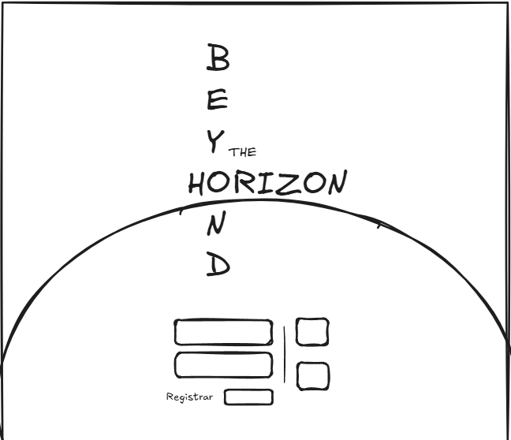
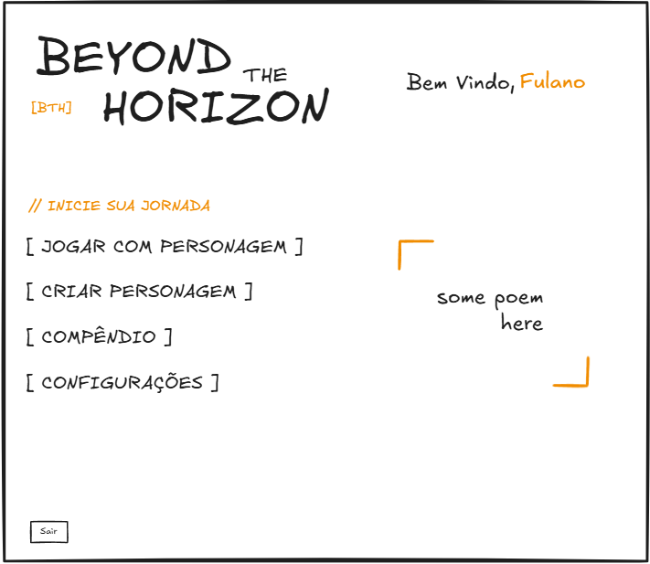
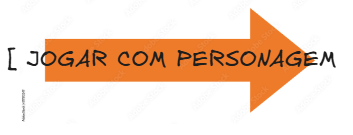

# SDD 04: Frontend Architecture & Design System (Flutter Web)

## 1. Document Control
- **Document Title:** System Design Document - Frontend Architecture & Visual Design System
- **Project:** Beyond the Horizon - Digital Companion & Rules Platform ("Beyond the Horizon App")
- **Author:** Henrique Schorr
- **Status:** Active
- **Version:** 0.3.0
- **Last Updated:** 2026-10-14

---

## 2. General Aesthetic & Visual Foundation

### 2.1 Aesthetic Philosophy
The visual design of the Beyond the Horizon client application follows a **Minimalist Brutalism** philosophy with an **Industrial and Cosmic Sci-Fi Horror** aesthetic, synthesizing three foundational design pillars:
1. **Minimalist Brutalism:** Inspired by Scandinavian minimal-brutalism (*Death in Space*, *Mothership*) and institutional monumentalism (Remedy Entertainment's *Control* and *Alan Wake 2*). Features stark structural geometry, monolithic uppercase typography, massive negative space balance, hard functional container framing, and utilitarian information density.
2. **Industrial Sci-Fi & The Used Future:** Rooted in late 1970s and 1980s cassette futurism (*Alien*)—molded ABS hardware textures, chamfered framing, procedural analog stipple grain, mechanical actuators, and monospaced telemetry readouts.
3. **Cosmic Sci-Fi Horror:** Deep charcoal void depths, disciplined negative space, deterministic sub-pixel starfields, and stark celestial horizon curvature.

For extensive cross-universe comparative research across *Alien*, *Fallout*, *Mothership*, *Death in Space*, and *Remedy*, as well as studied layout alternatives and color moodboards, refer to the auxiliary reference document: [studied_designs.md](./studied_designs.md).

### 2.2 Canvas & Materiality Shaders
The client architecture incorporates three specialized canvas shaders:
- **StarSurface:** A deterministic sub-pixel starfield with central reading corridor attenuation to guarantee zero interference with text legibility, complemented by a subtle radial nebula wash. Wrapped in a RepaintBoundary for zero per-frame repaint overhead.
- **GrainSurface:** A procedural analog risograph and photocopier toner stipple painter rendering deterministic micro-pits and dust coordinates. Wrapped in a RepaintBoundary for zero per-frame repaint overhead. Applied across all interactive containers, non-text buttons, and chassis panels.
- **CrtSurface:** An atmospheric cathode-ray tube monitor surface shader. Features:
  - Horizontal cathode-ray scanlines with configurable alpha.
  - Curved perimeter glass vignette darkening display edges and corners.
  - Wrapped in a RepaintBoundary for zero animation overhead when stationary.
  - Currently inactive on the default landing page to preserve clean, high-contrast cosmic void clarity. Its activation on future screens and interfaces remains to be determined.

### 2.3 Target Platform Scope Boundary (Phase 1)
To guarantee optimal visual density, tactile telemetry ergonomics, and uncompromised geometric fidelity:
- **Supported Platforms (Phase 1):**
  1. **Web Desktop:** Viewports at or above 1024px width.
  2. **Web Tablet:** Viewports at or above 768px width (in both portrait and landscape orientations).
- **Explicit Exclusion (Phase 1):**
  - **Smartphones / Mobile Viewports:** Strictly excluded from Phase 1 scope.
  - Viewports below 768px width display an atmospheric telemetry warning directing the operative to connect via a desktop or tablet station. Future smartphone views will be evaluated as dedicated companion views in subsequent phases.

---

## 3. Canonical Color Palette System

The application interface is strictly and exclusively constrained to the Dark Mode Base Surfaces & Typography palette and the Single Universal Accent Token (#FE6403). No other chromatic hues or ad-hoc colors are permitted in the application UI. The only exceptions authorized to contain custom colors are the procedural canvas shaders and painters (such as starfield alpha attenuation, glass vignette gradients, and celestial arc glow).

### 3.1 Strict Palette Immutability & Prohibition of Opacity Manipulation
All color tokens in AppColors must be applied exactly as defined in the design token system without programmatic runtime alterations:
- **Prohibited in UI Code:** withAlpha, withOpacity, withValues, Color.alphaBlend, and any other programmatic opacity or alpha attenuation methods on color tokens are strictly forbidden across application widgets, containers, borders, icons, and text.
- **Pure Solid Colors:** All interactive borders, chassis containers, text fields, and icons must use the pure solid color values defined in AppColors.
- **No Blurry Colored Washes:** Low-alpha box shadows and glowing halo washes are prohibited in UI layouts, preserving the unyielding structural crispness of Minimalist Brutalism.
- **Shader & Structural Divider Exemption:** The ONLY components authorized to compute or attenuate colors via alpha or opacity are the procedural canvas shaders and painters (StarSurface, GrainSurface, CrtSurface, and EventHorizonArc), and the structural console seam (VerticalSeamDivider for its vertical edge fade gradient).

### 3.2 Single Universal Accent Token
The entire interface employs a single accent color across all interactive actuators, highlights, focus rims, and active states:

| Theme Mode | Swatch | Token Identifier | HEX Code | Functional Role in Interface |
| :---: | :--- | :--- | :--- | :--- |
| **Dark Mode** | <span style="display:inline-block;width:24px;height:24px;background:#FE6403;border:1px solid #777;border-radius:3px;"></span> | **accentOrange** | #FE6403 | Cassette 90 Vibrant Orange: CTA borders, CTA text, active caret, focused node outlines, illuminated seams. |
| **Light Mode (Reference)** | <span style="display:inline-block;width:24px;height:24px;background:#C2410C;border:1px solid #777;border-radius:3px;"></span> | **accentOrangeLight** | #C2410C | High-contrast Burnt Tape Orange calibrated for light cream surfaces (technical token reference only). |

### 3.3 Dark Mode Base Surfaces & Typography

| Swatch | Token Name | HEX Code | Functional Role in Beyond the Horizon App |
| :---: | :--- | :--- | :--- |
| <span style="display:inline-block;width:24px;height:24px;background:#101214;border:1px solid #777;border-radius:3px;"></span> | **darkBgCanvas** | #101214 | Deep cosmic void canvas. Absorbs halation and prevents visual fatigue. |
| <span style="display:inline-block;width:24px;height:24px;background:#16191D;border:1px solid #777;border-radius:3px;"></span> | **darkBgSurface** | #16191D | Chassis surface, navigation rail, panel containers, utility buttons. |
| <span style="display:inline-block;width:24px;height:24px;background:#20252C;border:1px solid #777;border-radius:3px;"></span> | **darkBgSurfaceElevated** | #20252C | Elevated button chassis, popovers, modal dialogs, drawer panels. |
| <span style="display:inline-block;width:24px;height:24px;background:#0C0E10;border:1px solid #777;border-radius:3px;"></span> | **darkBgWell** | #0C0E10 | Recessed input wells, terminal readout insets, text field backgrounds. |
| <span style="display:inline-block;width:24px;height:24px;background:#282E36;border:1px solid #777;border-radius:3px;"></span> | **darkBorderSubtle** | #282E36 | Hairline perimeter seams, subtle cell dividers, input outlines. |
| <span style="display:inline-block;width:24px;height:24px;background:#444D5A;border:1px solid #777;border-radius:3px;"></span> | **darkBorderProminent** | #444D5A | Prominent container framing, active input borders, button rims. |
| <span style="display:inline-block;width:24px;height:24px;background:#F0ECE1;border:1px solid #777;border-radius:3px;"></span> | **darkTextPrimary** | #F0ECE1 | High-contrast titanium white display text, headers, brand mark. |
| <span style="display:inline-block;width:24px;height:24px;background:#C8C4B8;border:1px solid #777;border-radius:3px;"></span> | **darkTextSecondary** | #C8C4B8 | Balanced reading body copy, lore paragraphs, descriptive text. |
| <span style="display:inline-block;width:24px;height:24px;background:#7B8491;border:1px solid #777;border-radius:3px;"></span> | **darkTextMuted** | #7B8491 | Muted telemetry metadata, timestamps, input placeholders, disabled states. |

### 3.4 Optional Technical Light Mode Tokens (Reference Only)
While AppColors retains light mode definitions for future theme research, the active application interface is strictly bound to the dark mode palette.

| Swatch | Token Name | HEX Code | Functional Role in Reference System |
| :---: | :--- | :--- | :--- |
| <span style="display:inline-block;width:24px;height:24px;background:#F5F3ED;border:1px solid #777;border-radius:3px;"></span> | **lightBgCanvas** | #F5F3ED | Warm bone-titanium field canvas for light mode. |
| <span style="display:inline-block;width:24px;height:24px;background:#FFFFFF;border:1px solid #777;border-radius:3px;"></span> | **lightBgSurface** | #FFFFFF | Crisp ceramic surface for cards and panels. |
| <span style="display:inline-block;width:24px;height:24px;background:#FAF8F5;border:1px solid #777;border-radius:3px;"></span> | **lightBgSurfaceElevated** | #FAF8F5 | Elevated surface for popovers and dialogs. |
| <span style="display:inline-block;width:24px;height:24px;background:#EAE5DA;border:1px solid #777;border-radius:3px;"></span> | **lightBgWell** | #EAE5DA | Recessed bays, terminal readout wells, search insets. |
| <span style="display:inline-block;width:24px;height:24px;background:#DCD6C8;border:1px solid #777;border-radius:3px;"></span> | **lightBorderSubtle** | #DCD6C8 | Hairline structural seams. |
| <span style="display:inline-block;width:24px;height:24px;background:#B5AC9B;border:1px solid #777;border-radius:3px;"></span> | **lightBorderProminent** | #B5AC9B | Anodized chassis framing and chamfered partitions. |
| <span style="display:inline-block;width:24px;height:24px;background:#121518;border:1px solid #777;border-radius:3px;"></span> | **lightTextPrimary** | #121518 | Deep obsidian carbon primary text. |
| <span style="display:inline-block;width:24px;height:24px;background:#454C55;border:1px solid #777;border-radius:3px;"></span> | **lightTextSecondary** | #454C55 | Slate carbon secondary prose and story synopses. |
| <span style="display:inline-block;width:24px;height:24px;background:#6C7480;border:1px solid #777;border-radius:3px;"></span> | **lightTextMuted** | #6C7480 | Calibrated graphite telemetry metadata and timestamps. |

---

## 4. Typographic Hierarchy & Multi-Voice System

### 4.1 The Three Typographic Voices
The interface architecture establishes three distinct font voices, each serving a strict functional purpose:
1. **The Monumental & Hero Voice (Space Grotesk):**
   - Geometrically proportioned, retro-futuristic grotesque sans-serif with monumental architectural cadence (inspired by Remedy's environmental lettering).
   - Employed for the crossword brand mark (BEYOND THE HORIZON), monumental headlines, section headers, and major action labels.
2. **The Machine & Tactical Voice (Space Mono):**
   - Fixed-pitch monospaced terminal typeface evoking telemetry data, status indicators, and mechanical data streams.
   - Employed for tactical action button text, operational status badges, input field headers, blinking block carets, hover tooltips, and selectable error displays.
3. **The Editorial & Rules Lore Voice (Inter):**
   - High-legibility neutral grotesque engineered for extended reading comfort across all display pixel densities.
   - Employed for rules lore, codex articles, descriptions, dialog bodies, and user communications.

### 4.2 Typographic Scale & Metrics

| Style Token | Font Family | Size | Weight | Tracking / Spacing | Line Height | Default Color Token | Semantic Widget Name |
| :--- | :--- | :---: | :---: | :---: | :---: | :--- | :--- |
| **monumentalTitle** | Space Grotesk | 64.0px | Bold (700) | +4.0px | 1.00 | AppColors.darkTextPrimary | MonumentalText |
| **monumentalSmall** | Space Grotesk | 16.0px | Bold (700) | +4.0px | 1.00 | AppColors.darkTextPrimary | MonumentalSmallText |
| **displayTitleLarge** | Space Grotesk | 32.0px | Bold (700) | -0.5px | 1.25 | AppColors.darkTextPrimary | DisplayTitleLargeText |
| **displayTitle** | Space Grotesk | 26.0px | Bold (700) | -0.2px | 1.15 | AppColors.darkTextPrimary | DisplayTitleText |
| **sectionTitle** | Space Grotesk | 18.0px | Bold (700) | -0.1px | 1.20 | AppColors.darkTextPrimary | SectionTitleText |
| **actionLabelLarge** | Space Grotesk | 18.0px | Bold (700) | +0.5px | 1.20 | AppColors.darkTextPrimary | ActionLabelLargeText |
| **actionLabelLargeInverted** | Space Grotesk | 18.0px | Bold (700) | +0.5px | 1.20 | AppColors.darkBgCanvas | ActionLabelLargeInvertedText |
| **actionLabel** | Space Grotesk | 14.0px | Semi-Bold (600) | +0.5px | 1.10 | AppColors.darkTextPrimary | ActionLabelText |
| **actionLabelHighlighted** | Space Grotesk | 14.0px | Semi-Bold (600) | +0.5px | 1.10 | AppColors.accentOrange | ActionLabelHighlightedText |
| **actionLabelMuted** | Space Grotesk | 14.0px | Semi-Bold (600) | +0.5px | 1.10 | AppColors.darkTextSecondary | ActionLabelMutedText |
| **actionLabelSmall** | Space Grotesk | 12.0px | Semi-Bold (600) | +0.8px | 1.20 | AppColors.darkTextSecondary | ActionLabelSmallText |
| **actionLabelSmallHighlighted** | Space Grotesk | 12.0px | Semi-Bold (600) | +0.8px | 1.20 | AppColors.accentOrange | ActionLabelSmallHighlightedText |
| **navAnchor** | Space Grotesk | 14.0px | Semi-Bold (600) | +1.2px | 1.20 | AppColors.darkTextSecondary | NavAnchorText |
| **navAnchorHighlighted** | Space Grotesk | 14.0px | Semi-Bold (600) | +1.2px | 1.20 | AppColors.accentOrange | NavAnchorHighlightedText |
| **fieldLabel** | Space Mono | 11.5px | Bold (700) | +0.8px | 1.20 | AppColors.darkTextSecondary | FieldLabelText |
| **fieldLabelHighlighted** | Space Mono | 11.5px | Bold (700) | +0.8px | 1.20 | AppColors.accentOrange | FieldLabelHighlightedText |
| **fieldLabelMuted** | Space Mono | 11.5px | Bold (700) | +0.8px | 1.20 | AppColors.darkTextMuted | FieldLabelMutedText |
| **fieldInput** | Space Mono | 12.0px | Bold (700) | +0.8px | 1.20 | AppColors.darkTextSecondary | FieldInputText |
| **legend** / **telemetryMuted** | Space Mono | 11.5px | Regular (400) | +0.5px | 1.25 | AppColors.darkTextMuted | LegendText |
| **legendHighlighted** | Space Mono | 11.5px | Regular (400) | +0.5px | 1.25 | AppColors.accentOrange | LegendHighlightedText / SelectableErrorText |
| **bodyMedium** | Inter | 16.0px | Regular (400) | 0.0px | 1.70 | AppColors.darkTextSecondary | BodyMediumText |
| **bodyProse** | Inter | 14.0px | Regular (400) | 0.0px | 1.60 | AppColors.darkTextSecondary | BodyProseText |

### 4.3 Rule 11 Compliance: Semantic Typography Widgets
In accordance with Rule 11 of AGENTS.md:
- **Prohibited: Raw Text(...) and inline TextStyle(...)**.
- All text in feature and shared code is instantiated strictly via dedicated semantic typography widgets (such as MonumentalText, DisplayTitleText, ActionLabelLargeText, ActionLabelHighlightedText, ActionLabelSmallText, FieldLabelHighlightedText, BodyProseText).
- Ad-hoc sizing, arbitrary font size overrides, or custom letter spacing in widget calls are strictly prohibited.
- Highlighted text reacts dynamically to the active accent color (#FE6403) via dedicated highlighted semantic widgets (such as ActionLabelHighlightedText, ActionLabelSmallHighlightedText, NavAnchorHighlightedText, FieldLabelHighlightedText, SelectableErrorText).

---

## 5. Interactive Button Primitives & Universal Noise Texture Architecture

### 5.1 Universal Button Materiality Policy
1. **All Non-Text Buttons Incorporate GrainSurface:**
   - Every interactive actuator featuring a container chassis, background fill, or perimeter border MUST incorporate the procedural GrainSurface analog toner grain noise texture.
   - Provides physical analog materiality reminiscent of molded ABS technical hardware and risograph-printed technical manuals.
2. **Text-Only Buttons Remain Untextured:**
   - Flat text action buttons (such as the Register secondary action) and inline typographic links are strictly excluded from noise texture, preserving crisp, clean font rendering.

### 5.2 Tactical Action Button (CTA Button Specification)
- **Chassis Background:** Elevated dark surface, subtly tinting toward accent orange on hover.
- **Perimeter Seam:** Solid accent orange border.
- **Typography:** Space Grotesk Semi-Bold uppercase, highlighted in accent orange (ActionLabelHighlightedText).
- **Surface Texture:** Wrapped in GrainSurface with dynamic accent color response on hover.
- **Visual Feedback:** Accent glow shadow on hover and tactile scale feedback on hover and press.

### 5.3 Rounded-Square Utility Icon Buttons
- **Chassis Background:** Dark surface container wrapped in GrainSurface noise texture.
- **Perimeter Seam:** Subtle chassis border illuminating to accent orange on hover.
- **Interaction:** Icon presentation with subtle tactile micro-scale feedback and monospaced hover tooltips.

---

## 6. Logged-Out Landing Page Architecture

Below is the structural design for the Logged-Out landing page:

<p align="center">
  
</p>

### 6.1 Typographic Crossword Brand Mark & Apex Geometry
The monumental brand mark is structured as an off-center crossword puzzle sharing the letter O:

```
     B
     E
     Y  THE (4 sizes smaller)
 H - O - R - I - Z - O - N
--------------------------- (Event Horizon Apex)
     N
     D
```

- **Crossword Intersection:** Vertical B-E-Y-O-N-D intersects horizontal H-O-R-I-Z-O-N, sharing the first letter O of HORIZON.
- **Scale of 'THE':** The particle THE is rendered approximately 4 font sizes smaller than the monumental letters of BEYOND and HORIZON (monumentalSmall vs monumentalTitle), tucked compactly to the right of the letter Y.
- **Horizon Apex Alignment:** The horizontal word HORIZON sits immediately above the top curvature crest of the black hole event horizon arc.
- **Submerged Letters 'N' & 'D':** Because the horizon curve passes directly under the word HORIZON, the remaining letters N and D of BEYOND are visibly positioned inside the black hole void, creating a literal visual metaphor of crossing beyond the horizon.

### 6.2 Spherical Event Horizon Arc & Viewport Trajectory
- The event horizon is rendered as a sweeping circular celestial arc whose crest sits beneath the brand mark word HORIZON.
- **Viewport Trajectory:** Both left and right trajectories extend downward, crossing through the lower and bottom viewport edges, creating a dramatic celestial dome that frames the access console within the singularity void. This reflects the exact circular arc geometry implemented in _EventHorizonArcPainter.

### 6.3 Access Console & Side-by-Side Utility Layout
Positioned inside the black hole void beneath the submerged letters:

```
+-----------------------+   |   [📖]
|  [ Email / Callsign ] |   |
+-----------------------+   |
|  [ Password ]         |   |
+-----------------------+   |   [⚙️]
| [Register]  [SIGN IN] |   |
+-----------------------+   |
```

1. **Horizontal Layout Distribution (Side-by-Side):**
   - **Login Block (Left):** Contains the recessed email and password input fields, selectable error display, and the balanced action row ([Register] secondary action and [SIGN IN] primary tactical button).
   - **Vertical Divider Seam Line (Center):** A vertical hairline border line with subtle edge fade gradients, stretching across the intrinsic height of the login block.
   - **Stacked Utility Icon Actions (Right):** Codex and Settings rendered vertically one below the other as rounded-square tactile icon buttons wrapped in GrainSurface noise texture with illuminated borders and animated hover glow.
2. **Input Fields Stack:**
   - Recessed input well: Email / Callsign with subtle border and dark well fill. Field labels use secondary titanium text.
   - Recessed input well: Password with matching styling.
   - Text Caret: Blinking block caret (█) in accent orange (#FE6403).
   - Error States: Contextual authentication errors illuminate field borders in accent orange and display selectable error diagnostics in legend highlighted monospaced type.
3. **Action Row:**
   - Located directly beneath the password field:
   - **Secondary: [ Register / Create Account ]:** Flat text action button without noise texture, using subtle outline border and muted titanium typography.
   - **Primary: [ Sign In ] (CTA Button):** TacticalActionButton with GrainSurface noise texture, accent orange border, orange uppercase text, dark elevated background, hover glow, and tactile micro-physics.

---

## 7. Authenticated Player Home Page Architecture (Command Deck)

Below is the canonical structural design for the Authenticated Player Home Page (Command Deck):

<p align="center">
  
</p>

### 7.1 Typographic Brand Mark & Vertical O-Alignment Geometry
The brand mark on the Command Deck is structured as two horizontal lines with mathematical alignment:

```
Column:    [0]     [1]     [2]     [3]     [4]     [5]     [6]     [7]     [8]
Row 1:      B       E       Y       O       N       D             THE
Row 2:   [    B T H    ]    H       O       R       I       Z       O       N
                                    |
                            (Vertical Alignment)
```

- **Vertical O-Alignment:** The single letter O in BEYOND (column 3, 4th letter) and the first letter O in HORIZON (column 3, 2nd letter) align on the exact vertical axis.
- **[BTH] Telemetry Badge:** Placed to the left of H on Row 2, rendered in Space Mono Bold uppercase in accent orange (#FE6403).
- **Particle THE:** Rendered in monumentalSmall type tucked compactly alongside BEYOND above HORIZON.
- **Typography:** Space Grotesk Bold uppercase using AppTypography.monumentalTitle (MonumentalText) wrapped in a responsive scaler preserving proportions down to tablet viewports.

### 7.2 Tactical Navigation Menu with Hand-Drawn Accent Arrow
Positioned on the middle-left under the tactical telemetry subtitle // BEGIN YOUR JOURNEY (resolved via AppLocalizations, AppTypography.fieldLabelHighlighted / FieldLabelHighlightedText in #FE6403):

<p align="center">
  
</p>

1. **Rest State:**
   - Items: [ PLAY WITH CHARACTER ], [ CREATE CHARACTER ], [ CODEX ], [ SETTINGS ].
   - Enclosed by solid brackets in AppColors.darkBorderProminent.
   - Text uses Space Grotesk Bold 18px (AppTypography.actionLabelLarge / ActionLabelLargeText) in titanium white (#F0ECE1).
2. **Hover State:**
   - The trailing bracket ] vanishes.
   - An organic, hand-drawn styled accent orange arrow (#FE6403) emerges behind the text from the opening bracket [.
   - The arrow shaft covers approximately 90% of the text width, terminating in a sharp, stylized right-facing arrowhead just past the final letter.
   - Text color inverts to AppColors.darkBgCanvas (#101214) over the orange arrow (AppTypography.actionLabelLargeInverted / ActionLabelLargeInvertedText), producing electrifying brutalist contrast and crisp readability.
   - Surface texture: The arrow body incorporates procedural GrainSurface analog toner stipple for a tangible risograph / felt-tip marker materiality.

### 7.3 Randomized Lore Epigraph Box & Pure Geometric Framing
Positioned in the middle-right quadrant. The widget executes a single-row random query directly in PostgreSQL via the database RPC function get_random_lore_epigraph upon page load.

#### Universal Epigraph Specifications (Identical for All Types)
- **Content Typography:** Inter Regular 16px (AppTypography.bodyMedium / BodyMediumText in #C8C4B8).
- **Attribution Source:** Strictly right-aligned directly beneath the frame in Space Mono Regular 11.5px (AppTypography.legend / LegendText in #7B8491) prefixed by an em-dash (—).
- **Rich Markdown Formatting:** Uniformly supports multi-line breaks, internal text alignments, and solid black [REDACTED] blocks (rendered as solid dark rectangles masking classified text) across all five domain types.
- **Zero Text in Frames:** Frames contain zero text labels. The geometric frame shape and the attribution source uniquely identify the domain type.

#### Type-Specific Geometric Framing
The only differentiator across domain types is the geometric framing silhouette:

1. **Type: quote / poem (Literary Epigraph Framing):**
   - Asymmetric diagonal corner brackets: Top-Left ┌ and Bottom-Right ┘ in AppColors.accentOrange (#FE6403).

2. **Type: document (Vertical Folio Sheet Framing):**
   - Derived directly from the institutional case file design:
   - Top cap: 3-sided inverted-U bar (┌────────────┐) with side flanges extending downward.
   - Bottom cap: 3-sided upright-U bar (└────────────┘) with side flanges extending upward.
   - Middle sides are completely open, evoking a physical dossier page.

3. **Type: transmission (Deep Space Radio Interception):**
   - Four-corner reticle marks (┌ ┐ top and └ ┘ bottom) with open perimeter edges in AppColors.accentOrange (#FE6403).

4. **Type: news (Corporate Ticker Double Horizontal Bars):**
   - Solid double horizontal bars across top and bottom (═════════════). Open on left and right edges.

### 7.4 Operative Greeting & Session Termination ([ ⏻ SIGN OUT ])
1. **Operative Greeting (Top-Right):**
   - Prefix: "Welcome, " using AppTypography.displayTitle (DisplayTitleText, 26px, titanium white #F0ECE1, resolved via AppLocalizations).
   - Operative Callsign / Name: "[Callsign]" using AppTypography.displayTitleLarge tinted in AppColors.accentOrange (#FE6403).
2. **Session Termination (Bottom-Left Corner):**
   - Anchored at the bottom-left coordinate of the viewport.
   - Styled as a low-profile bracketed utility actuator: [ ⏻ SIGN OUT ].
   - Uses Space Grotesk Semi-Bold 12.0px (AppTypography.actionLabelSmall / ActionLabelSmallText in rest state, illuminating to ActionLabelSmallHighlightedText on hover).
   - Border in AppColors.darkBorderSubtle, illuminating to AppColors.accentOrange on hover with tactile micro-physics.
   - Completely decoupled from primary game navigation to prevent accidental session termination while keeping the bottom-right quadrant open for upcoming character and creature artwork (OP-02B).

---

## 8. State Management, Controllers & Architectural Boundaries

### 8.1 Presentation-Only StatelessWidgets (Rule 8 & 10)
- Screen and shell layouts are strictly StatelessWidgets or stateful widgets without business logic.
- Controllers are resolved via constructor dependency injection, ensuring fields are non-nullable final T controller resolved once upon creation.
- Calling serviceLocator[T]() inside build() methods of pages and shell layouts is strictly prohibited.
- Building pages as StatefulWidgets solely to hold a controller in initState or call dispose is prohibited.

### 8.2 Controllers Hold State, Not Futures (Rule 10)
- Getters with lazy side-effects are prohibited.
- Controllers extend ChangeNotifier and hold resolved domain models, granular loading booleans (such as isLoading), and nullable error strings (such as errorMessage).
- Data fetching is triggered via explicit asynchronous methods (such as loadData(), refresh()).
- Widgets observe state via ListenableBuilder or AnimatedBuilder instead of FutureBuilder.

### 8.3 Backend-Only External Communication (Rule 14)
- Every external communication (Supabase database queries, Supabase Storage, third-party APIs) originates strictly and exclusively from the backend package.
- The frontend package is strictly limited to UI presentation, layout composition, user input handling, reactive state management, routing, and local client storage (UserLocalStorageService).
- Direct network calls from frontend to Supabase or external APIs are strictly prohibited. Frontend interacts with domain data exclusively via BackendService and shared DTOs.

### 8.4 DTO Naming & Explicit Request/Response Contracts (Rule 19)
- All Data Transfer Objects are explicitly suffixed with RequestDto or ResponseDto.
- Ambiguous, unqualified, or generic DTO names are prohibited.

### 8.5 Declarative Routing & Navigation Architecture (go_router)
The client application adopts **go_router** as its official declarative routing and deep-linking solution on Flutter Web:
1. **Route Map:**
   - **/**: LoggedOutLandingScreen (Public zero-login landing portal).
   - **/dashboard**: Guarded authenticated session destination placeholder.
   - **/in-construction**: InConstructionScreen (Atmospheric terminal destination for modules under active construction, accepting ?module=... query parameters).
2. **Reactive Authentication Redirect Guards:**
   - GoRouter is initialized with refreshListenable bound to AuthController.
   - When an operative session is invalidated or signed out, GoRouter redirects protected routes back to **/**.
   - Deep-linking to protected views while unauthenticated automatically redirects visitors to **/**.
3. **Decoupled Widget Callbacks (Rule 10):**
   - Sub-widgets do not directly invoke global navigation singletons.
   - Buttons receive plain callbacks (such as onTap) that invoke declarative routing in the parent scope.

### 8.6 In-Construction Module Destination Pattern
During early development phases, feature launchers whose underlying subsystem is still in progress navigate to the dedicated atmospheric InConstructionScreen (*Module in Construction*). This screen presents terminal hazard styling, status telemetry codes (STATUS_CODE_503_PLANNED), and a tactical return button to preserve interface coherence without dead-end clicks or broken layouts.

---

## 9. Alternative Designs

This section preserves earlier layout iterations and wireframe concepts explored during design discovery:

### Studied Alternative A: The Astrometric Constellation & Event Horizon
- An off-center crossword brand mark on the left with a corner event horizon arc.
- Floating authentication inputs in the screen center.
- A vertical zigzag constellation conduit line connecting five circular interactive nodes on the right.
- *Evaluation:* Visually striking, but the zigzag constellation line competed heavily with the crossword mark and lacked the functional density needed for compact desktop viewports.

### Studied Alternative B: The Centered Event Horizon Arc (Early Iteration)
- A centered arc with bottom exit points and navigation nodes attached directly along the curved rim.
- *Evaluation:* Superseded by the downward-sweeping spherical event horizon dome with flanking rounded-square buttons, which provided superior geometric stability and cleaner spatial separation.

### Studied Alternative C: The Orbital Ellipsis Console
- Centered orbital ellipse with planetary nodes orbiting the perimeter and authentication inputs positioned inside the ellipse center.
- *Evaluation:* Overly decorative and gamified; conflicted with the austere brutalist aesthetic and felt closer to a mobile space game than an industrial companion tool.

### Studied Alternative D: The Modular Control Deck
- A 4-card modular instrument rack displaying system features in equal-sized grid blocks.
- *Evaluation:* Clean and organized, but lacked the monumental visual impact of the black hole event horizon void.

### Studied Alternative E: The Classified Dossier & Archival Terminal
- An asymmetric layout with a tangible dossier folder, redaction bars, paperclip graphics, and typewriter typography.
- *Evaluation:* Strongly evocative of Remedy's *Control*, but too document-centric for a primary public landing screen. Preserved as a strong candidate for future codex and facilitator secret handout modules.

### Studied Alternative F: The Minimalist Rules Explorer & Live Radar
- Centered rules search bar with category pills and a live dice simulation radar.
- *Evaluation:* Optimized for rules lookup, but lacked the thematic gravity needed for the primary landing gateway.

### Studied Alternative G: The 2x2 Avionics Telemetry Grid
- A 2x2 grid of equal-sized modular tiles with shared borders, top-right rocker switches, and bottom barcode telemetry.
- *Evaluation:* Explored during cassette-futurism card studies before prioritizing the decoupled single-purpose architecture.

### Studied Alternative H: The Hi-Fi Tape Transport Deck (Linear Cassette Rack)
- Horizontal tape transport deck styling with mechanical push-down play/eject keys and analog VU needle meters.
- *Evaluation:* High tactile delight, but too literal of an audio cassette metaphor for a general sci-fi companion. Elements of its button materiality were adapted into the TacticalActionButton primitive.

---

## 10. Document References

- [Open Points & Roadmap Register](./open_points.md) - Project roadmap and open points register
- [01-sdd-overview.md](./01-sdd-overview.md) - System Design Document: Overview
- [02-sdd-database.md](./02-sdd-database.md) - System Design Document: Database Architecture
- [03-sdd-backend.md](./03-sdd-backend.md) - System Design Document: Backend Architecture
- [studied_designs.md](./studied_designs.md) - Studied Designs, Comparative Research & Visual Archives

