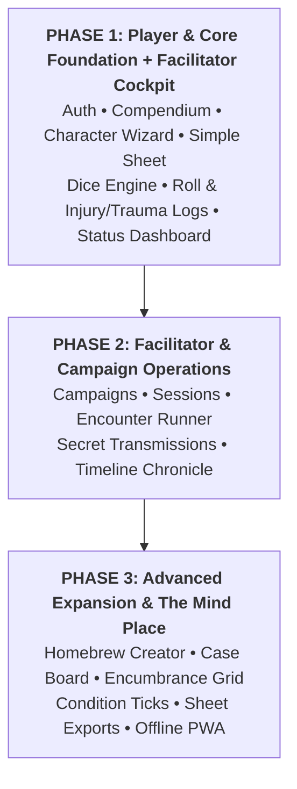

# Open Points (OP) & Roadmap Register: Beyond the Horizon App

- **Document Title:** Open Points & Roadmap Register
- **Project:** Beyond the Horizon - Digital Companion & Rules Platform ("Beyond the Horizon App")
- **Author:** Henrique Schorr
- **Last Updated:** 2026-10-11
- **Documentation Standard:** All technical features, architectural milestones, and companion toolsets are tracked here in strict order of importance across three release phases. System Design Documents ([01-sdd-overview.md](./01-sdd-overview.md), [02-sdd-database.md](./02-sdd-database.md), [03-sdd-backend.md](./03-sdd-backend.md), [04-sdd-frontend.md](./04-sdd-frontend.md)) remain the canonical technical references.

---

## 1. Status Lifecycle Definitions

Every Open Point (OP) progresses through the following standardized lifecycle states:

- **OPEN:** Backlog item defined and prioritized; design and implementation not yet started.
- **Designing:** Architectural design, database schemas, repository contracts, and service specifications actively being designed in SDDs.
- **Designed:** Complete architectural design, database tables, and wire contracts authored and approved in SDDs; ready for code implementation.
- **In Progress:** Active code implementation underway across shared, backend, or frontend packages.
- **DONE:** Fully implemented, verified with static analysis, tested, and accepted.

---

## 2. Release Phasing Matrix

---

## 3. Phase 1: Player & Core Foundation + Facilitator Status Cockpit (High Priority)

The goal of Phase 1 is to deliver a functional, essential play and reference experience: allowing players to sign up, read the rules, build a character, and play with an interactive digital character sheet, while equipping the Facilitator with a live status cockpit to monitor all party members and tracking every dice roll and sustained injury/trauma in real-time.

| ID | Feature / Module | Domain | Status | Priority | Description & Deliverables |
| :--- | :--- | :--- | :--- | :--- | :--- |
| **OP-01** | **User Creation, Auth & Session Management** | Auth / Backend / UI | **Designing** | **P1 (Highest)** | User registration with email/password, session persistence via Supabase Auth & local storage, password recovery, and secure JWT handling. (Database schema & RLS policies designed; Backend architecture actively in design). |
| **OP-02** | **Landing Pages (Public & Authenticated Command Center)** | Frontend / Routing | **Designed** | **P1** | • **Logged-Out Landing Page**: Monumental typographic crossword brand mark (Beyond the Horizon sharing the letter O), sweeping event horizon parabolic arc exiting laterally through screen edges, flanking zero-login utility buttons (Compêndio book icon on the left, Settings gear icon on the right) with GrainSurface, and side-by-side action row with the tactile sign-in CTA button (see 04-sdd-frontend.md). • **Logged-In Dashboard**: Smooth left-glide spatial continuity docking the brand mark and black hole into the left third of the screen, clean direct operative greeting (Bem-vindo, [Nome]!) without secondary metadata, and the five prioritized feature buttons (Jogar Personagem, Criar Personagem, Compêndio, Configurações, Sair) with GrainSurface (see 04-sdd-frontend.md). |
| **OP-03** | **Documentation Pages & Storage Catalog** | Compendium / Database | **Designing** | **P1** | Digital rulebook catalog indexing manuscript chapters, storage-backed Markdown pages, category sorting, and bilingual translation architecture. (Database schema, joined view & storage bucket designed; Backend architecture actively in design). |
| **OP-03A** | **Compendium Master Keyword Overlay Engine** | Compendium / Backend / UI | **Designed** | **P1** | Master keyword registry (public.compendium_keywords), parent-child taxonomy, inflection aliases, and 0ms in-memory hover tooltips (see compendium_keywords_plan.md). |
| **OP-03B** | **Markdown Presentation Engine & Layout Renderer** | Compendium / Frontend | **Designed** | **P1** | Specialized layout composition (documentation, species, origin, path, abilities), section callouts, storage image caching, and atmospheric typography (see markdown_presentation_reference.md). |
| **OP-03C** | **Documentation Markdowns Creation from bth_game** | Compendium / Content | **OPEN** | **P1** | Extraction, conversion, and authoring of official rulebook Markdown chapters from the Beyond the Horizon game vault (bth_game) into the documentation storage catalog (pt-BR), covering core rules, species, equipment, companions, and universe lore. |
| **OP-04** | **Step-by-Step Character Creation Wizard** | Characters / Frontend | **OPEN** | **P1** | Guided creation flow: species selection, origin background, attribute allocation, ability picking, starting equipment loadout, and automated derivation of combat stats. |
| **OP-05** | **Interactive Character Play Sheet (Simple Sheet)** | Characters / UI / State | **OPEN** | **P1** | Digital personnel dossier character sheet: live HP/vitality tracking, stress/wounds tracks, attributes, equipped weapons/gear, ability execution, and injury/trauma management. |
| **OP-06** | **Core Dice Roller Engine** | Frontend / Shared | **OPEN** | **P1** | Polyhedral and custom formula dice roller with automated stat modifier injection, advantage/disadvantage handling, and clean visual result popups. |
| **OP-07** | **Real-Time Roll & Injury/Trauma Audit Log** | Logs / Realtime / UI | **OPEN** | **P1** | Chronological live audit feed logging each dice roll outcome, formula breakdown, and real-time alerts whenever any character sustains an injury, trauma, or severe affliction. |
| **OP-08** | **Facilitator Character Status Dashboard** | Facilitator / UI / Realtime | **OPEN** | **P1** | Single-screen GM cockpit displaying the real-time status of all active player characters (vitality, stress, sustained injuries, traumas, armor, and active conditions) at a glance. |
| **OP-09** | **Application Configurations & Display Settings** | Settings / Frontend | **OPEN** | **P1** | User preferences: retro CRT scanline toggle, phosphor bloom, UI theme accents (Weyland Amber vs. FBC Cold Fluorescent), font size scaling, and audio volume. |
| **OP-10** | **E-mail Management & Communications** | Backend / Auth / Email | **OPEN** | **P1** | Transactional email workflows: password reset verification links, account confirmation, author and facilitator alerts, and email delivery service integration. |
| **OP-11** | **UI Animations & Atmospheric Transitions** | Frontend / UI / Theme | **OPEN** | **P1** | Immersive atmospheric animations: tactile CRT scanline bloom transitions, classified dossier opening wipes, alert status chromatic shifts, and subtle screen micro-interactions. |

---

## 4. Phase 2: Facilitator & Game Operations (Medium Priority)

The goal of Phase 2 is to expand into comprehensive multiplayer campaign management, live session lobbies, and combat encounter orchestration for the Facilitator.

| ID | Feature / Module | Domain | Status | Priority | Description & Deliverables |
| :--- | :--- | :--- | :--- | :--- | :--- |
| **OP-12** | **Campaign & One-Shot Game Creation** | Games / Backend / UI | **OPEN** | **P2** | Facilitator game creation suite: campaign titles, premises, scheduling metadata, player roster management, and shareable player invite codes/links. |
| **OP-13** | **Live Session Orchestration & Lobby** | Sessions / Realtime | **OPEN** | **P2** | Real-time session lobby tracking connected participants, game clock/session timer, live status sync, and session objective trackers. |
| **OP-14** | **Tactical Encounter Management** | Encounters / Backend / UI | **OPEN** | **P2** | Combat/hazard encounter runner: turn-order initiative sorting, threat/adversary stat cards, live monster HP/armor adjustments, and environmental event triggers. |
| **OP-15** | **Secret Transmissions & Classified Handouts** | Messaging / UI | **OPEN** | **P2** | Facilitator dispatch of encrypted sensor logs, private audio transcripts, or classified notes directly to individual player screens. |
| **OP-16** | **GM Hidden Dice Rolling** | Dice / Facilitator | **OPEN** | **P2** | Private dice toggle allowing the Facilitator to roll secret checks that hide formulas and outcomes from player logs. |
| **OP-17** | **Session Narrative Chronicle & Story Events** | Logs / Database / UI | **OPEN** | **P2** | Expanded campaign timeline recording session summaries, major narrative plot points, NPC discoveries, and story milestones. |

---

## 5. Phase 3: Advanced Expansion & The Mind Place (Nice-to-Haves)

The goal of Phase 3 is to elevate the platform with specialized tactical depth, investigative tools inspired by Remedy Entertainment, and offline convenience.

| ID | Feature / Module | Domain | Status | Priority | Description & Deliverables |
| :--- | :--- | :--- | :--- | :--- | :--- |
| **OP-18** | **Homebrew & Custom Content Creator** | Compendium / Backend | **OPEN** | **P3 (Future)** | In-app creation suite enabling Facilitators to build custom abilities, homebrew species, bespoke equipment, and original threats scoped to their campaigns. |
| **OP-19** | **The Mind Place / Investigative Case Board** | Campaign / Canvas UI | **OPEN** | **P3 (Future)** | Tactile *Alan Wake 2*-inspired cork/concrete operations board where Facilitators link threat dossiers, clues, NPC Polaroids, and plot nodes with red relationship threads. |
| **OP-20** | **Interactive Hover Tooltips & Slide-Out Drawers** | UI Primitives / Compendium | **OPEN** | **P3 (Future)** | Hover/tap micro-interactions across character sheets and encounter views that open instant rules text without leaving the current view. |
| **OP-21** | **Slot-Based Inventory & Encumbrance Grid** | Characters / Inventory | **OPEN** | **P3 (Future)** | Visual grid inventory management calculating weight, encumbrance penalties, ammo clips, and biological symbiont integration. |
| **OP-22** | **Automated Condition & Affliction Ticks** | Combat / State | **OPEN** | **P3 (Future)** | Turn-based status effect automation (Bleeding, Radiation, Cyber-Shock, Panic) applying damage, stress, or stat penalties at start-of-turn. |
| **OP-23** | **Character Sheet Offline Export (PDF & Markdown)** | Export / File Generation | **OPEN** | **P3 (Future)** | High-contrast printable PDF character sheet generator and clean Obsidian-compatible Markdown export for offline paper play and vault syncing. |
| **OP-24** | **Progressive Web App (PWA) Offline Caching** | PWA / Service Workers | **OPEN** | **P3 (Future)** | Client-side cache and service worker synchronization enabling uninterrupted character play and dice rolling during offline in-person table sessions. |

---

## 6. Architectural Alignment & Cross-References

- **System Overview & Aesthetic Foundation:** [01-sdd-overview.md](./01-sdd-overview.md)
- **Database Schema & RLS Policies:** [02-sdd-database.md](./02-sdd-database.md)
- **In-Process Backend Services:** [03-sdd-backend.md](./03-sdd-backend.md)
- **Frontend Architecture & Design Tokens:** [04-sdd-frontend.md](./04-sdd-frontend.md)
- **Remedy Aesthetic Study (*Control* & *Alan Wake*):** [remedy_design_reference.md](./references/remedy_design_reference.md)
- **Industrial Sci-Fi Comparative Report:** [shared_design_trends_comparative_report.md](./references/shared_design_trends_comparative_report.md)
