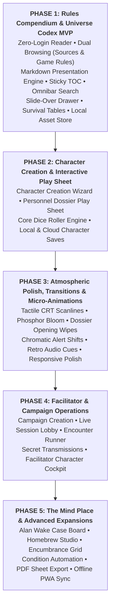

# Project Planner & Roadmap Register: Beyond the Horizon App

- **Document Title:** Project Planner & Roadmap Register
- **Project:** Beyond the Horizon - Digital Companion & Rules Platform ("Beyond the Horizon App")
- **Author:** Henrique Schorr
- **Last Updated:** 2026-10-20
- **Documentation Standard:** All technical features, architectural milestones, and companion toolsets are tracked here as tracer-bullet tickets in strict order of importance across five release phases. System Design Documents (01-sdd-overview.md, 02-sdd-database.md, 03-sdd-backend.md, 04-sdd-frontend.md) and GLOSSARY.md remain the canonical technical references.

---

## 1. Status Lifecycle Definitions

Every ticket progresses through the following standardized lifecycle states:

- **open:** Backlog item defined and prioritized; design and implementation not yet started.
- **in-progress:** Active implementation underway across packages.
- **blocked:** Cannot proceed until prerequisite tickets in Blocked By land.
- **done:** Fully implemented, verified with static analysis, tested, and accepted.

---

## 2. Release Phasing Matrix

---

## 3. Phase 1: Rules Compendium & Universe Codex MVP (High Priority)

The goal of Phase 1 is to deliver a frictionless, high-aesthetic digital reference platform for the Beyond the Horizon universe, executed in sequential milestones: (1) UI Prototyping Foundation, (2) Landing Page, Auth & Guest Navigation Revisit, (3) Lore Epigraphs Engine Revisit, (4) Player Home Command Deck Revisit, (5) Database Schema & TOC Redesign, (6) Guidebook Content Authoring & Seeds, (7) Reader UI Prototyping, (8) Presentation Engine Implementation, (9) Structured Database Catalogs, (10) Keyword Tooltip Engine, (11) Compendium Database & Drawer, (12) Omnibar & Display Preferences, and (13) Codex Integration & E2E Routing.

| Number | Ticket | Domain | Status | Priority | Blocked By | Scope & Deliverables |
| :--- | :--- | :--- | :--- | :--- | :--- | :--- |
| **0001** | [0001: Prototype UI Ideation Skill](./tickets/0001-prototype-ui-ideation-skill.md) | Tooling / Workflow | **done** | **P1 (Prerequisite)** | None | Create skills/prototype/SKILL.md defining interactive wireframing workflows, ASCII layouts, and UI ideation routines before building frontend widgets. |
| **0002** | [0002: Landing Page, Authentication & Guest Access Console](./tickets/0002-landing-page-auth-and-guest-access.md) | Frontend / Auth / UI | **done** | **P1** | 0001 | Revisit and modernize the public Landing Page portal with typographic crossword brand mark, event horizon arc, registration/login dialogs, and guest menu items. |
| **0003** | [0003: Lore Epigraphs and Archival Transmissions Engine](./tickets/0003-epigraph-lore-transmissions.md) | Database / Backend / UI Primitives | **done** | **P1** | 0002 | Revisit the worldbuilding lore epigraph system: database schema, random selection query, pure DTO services, and 4 geometric framing styles for Command Deck embedding. |
| **0004** | [0004: Player Home Command Deck & Session Experience](./tickets/0004-player-home-command-deck.md) | Frontend / UI / State | **open** | **P1** | 0003 | Revisit and polish the authenticated Player Home (Command Deck) layout: balanced two-column grid, brand mark, tactical menu, user session controls, and Lore Epigraph box. |
| **0005** | [0005: Codex Database Schema and TOC Architecture](./tickets/0005-codex-database-schema-and-toc.md) | Database / Supabase | **open** | **P1 (Highest)** | 0004 | Author migration establishing public.codex_pages, translations, and dedicated Table of Contents table public.codex_index; provision codex storage bucket. |
| **0006** | [0006: Codex Guidebook Content and Seed Ingestion](./tickets/0006-codex-guidebook-content-and-seeds.md) | Content / Database | **open** | **P1** | 0005 | Author initial guidebook chapters in content/codex/; create database seed entries in supabase/seeds/codex_seed.sql. |
| **0007** | [0007: Codex Reader Layout Prototyping](./tickets/0007-codex-reader-ui-prototyping.md) | UI Prototyping / Design | **open** | **P1** | 0001, 0006 | Interactively wireframe and validate the desktop reading layout, sticky TOC accordion, and ~70ch typography measure using the prototype skill. |
| **0008** | [0008: Codex Presentation Engine and Chapter Reader](./tickets/0008-codex-presentation-engine-and-reader.md) | Frontend / Codex | **open** | **P1** | 0007 | Implement the Swiss brutalist Markdown renderer and linear reader view (/codex/sources/:slug) bound to public.codex_index with scrollspy and pagination. |
| **0009** | [0009: Database Structured Content and YAML Catalogs](./tickets/0009-database-structured-content-and-catalogs.md) | Database / Architecture | **open** | **P1** | 0008 | Establish content/database/ with YAML dictionaries for Survival Tables, Character Foundation, Equipment, and Keywords. |
| **0010** | [0010: Universal Keyword Hover Tooltip Engine](./tickets/0010-universal-keyword-hover-tooltip-engine.md) | Frontend / UI Primitives | **open** | **P1** | 0009 | In-process keyword registry and instant hover card widget operating across the entire application (Codex, Wizard, Play Sheet). |
| **0011** | [0011: Codex Compendium Filterable Databases and Drawer](./tickets/0011-codex-compendium-filterable-databases.md) | Frontend / Compendium | **open** | **P1** | 0009, 0010 | Searchable grid views (/codex/rules/:category) and non-destructive Slide-Over Drawer for inspecting full entity dossiers. |
| **0012** | [0012: Global Omnibar and Local Display Preferences](./tickets/0012-codex-omnibar-and-local-preferences.md) | Frontend / Navigation | **open** | **P1** | 0008, 0011 | Global Cmd+K quick-jump search palette and local storage display preferences (font scale, column measure, basic theme). |
| **0013** | [0013: Codex Integration and End-to-End Routing](./tickets/0013-codex-integration-and-e2e-routing.md) | Frontend / Routing | **open** | **P1** | 0008, 0012 | Wire revisited landing page and player home CODEX buttons to /codex; verify authentication and epigraphs remain non-blocking. |

---

## 4. Phase 2: Character Creation & Interactive Play Sheet (Medium-High Priority)

The goal of Phase 2 is to equip players with complete digital character agency: guided step-by-step creation, a tactile personnel dossier sheet, automated attribute calculation, and integrated dice rolling.

| Number | Scope & Deliverables | Target Architecture |
| :--- | :--- | :--- |
| **0014** | Step-by-Step Character Creation Wizard (Species selection, Origin, Path, attribute allocation, starting gear, and automated stat derivation). | Frontend / Characters / State |
| **0015** | Interactive Personnel Dossier Play Sheet (Real-time Vitality, Stress, equipped weapons, ability execution, and active Injury/Trauma tracking). | Frontend / UI / Controllers |
| **0016** | Core Dice Roller Engine (Polyhedral and custom formula roller, advantage/disadvantage handling, and clean visual result popups). | Frontend / Shared / Logic |
| **0017** | Character Dossier Persistence (Local client storage for offline sessions and optional Supabase cloud syncing for authenticated accounts). | Backend / Local Storage / DB |

---

## 5. Phase 3: Atmospheric Polish, Transitions & Micro-Animations (Medium Priority)

The goal of Phase 3 is to elevate the platform with cinematic industrial brutalism: tactile CRT scanline bloom, classified dossier wipes, chromatic shifts, and subtle retro audio cues across the Codex and Character Sheet.

| Number | Scope & Deliverables | Target Architecture |
| :--- | :--- | :--- |
| **0018** | Display Settings & Visual Enhancements (CRT scanline shader toggle, phosphor bloom intensity, UI theme accents, and typography scaling). | Settings / Frontend / Shaders |
| **0019** | Atmospheric UI Transitions & Animations (Classified dossier opening wipes, alert status chromatic shifts, and subtle screen micro-interactions). | Frontend / UI / Theme |
| **0020** | Atmospheric Staging & Environmental Immersion (Graphic anchors, procedural stipple dissolution, and ambient analog terminal hums). | Frontend / Artwork / Audio |
| **0021** | Comprehensive Multi-Device Ergonomics (Refined responsive breakpoint redistribution for tablet portrait/landscape and desktop wide formats). | Frontend / UI / Responsive |

---

## 6. Phase 4: Facilitator & Campaign Operations (Medium-Low Priority)

The goal of Phase 4 is to provide the Facilitator with full session running command: campaign lobbies, encounter tracking, secret player transmissions, and a live party cockpit.

| Number | Scope & Deliverables | Target Architecture |
| :--- | :--- | :--- |
| **0022** | Campaign & One-Shot Game Creation (Facilitator game suite, premise descriptions, player roster management, and shareable join links). | Games / Backend / UI |
| **0023** | Live Session Orchestration & Lobby (Real-time participant presence, session timers, and shared objective trackers). | Sessions / Realtime |
| **0024** | Tactical Encounter Runner (Turn-order initiative sorting, adversary stat cards, live monster adjustments, and environmental hazards). | Encounters / Backend / UI |
| **0025** | Secret Transmissions & Classified Handouts (Encrypted sensor logs, private transcripts, and classified notes dispatched directly to player screens). | Messaging / UI / Realtime |
| **0026** | Facilitator Live Party Cockpit & Hidden Rolls (Single-screen GM cockpit monitoring party vitality, stress, and sustained injuries in real-time). | Facilitator / UI / Realtime |

---

## 7. Phase 5: The Mind Place & Advanced Expansions (Nice-to-Haves)

The goal of Phase 5 is to introduce tactile investigative depth, homebrew content creation, and offline table convenience.

| Number | Scope & Deliverables | Target Architecture |
| :--- | :--- | :--- |
| **0027** | The Mind Place / Investigative Case Board (Alan Wake 2-inspired cork and concrete operations board linking clues, NPC dossiers, and plot threads). | Campaign / Canvas UI |
| **0028** | Homebrew & Custom Content Studio (In-app creation suite enabling Facilitators to build custom abilities, species, and equipment). | Codex / Backend |
| **0029** | Slot-Based Inventory & Encumbrance Grid (Visual slot grid calculating weight thresholds, ammo clips, and biological symbionts). | Characters / Inventory |
| **0030** | Automated Condition & Affliction Ticks (Turn-based status effect automation applying bleeding, radiation, or panic penalties at round starts). | Combat / State |
| **0031** | Character Sheet Offline Export (High-contrast printable PDF character sheets and clean Obsidian-compatible Markdown export). | Export / File Generation |
| **0032** | Progressive Web App (PWA) Offline Synchronization (Service worker caching and background sync enabling complete offline table play). | PWA / Service Workers |

---

## 8. Architectural Alignment & Cross-References

- **System Overview & Aesthetic Foundation:** [01-sdd-overview.md](./01-sdd-overview.md)
- **Database Schema & RLS Policies:** [02-sdd-database.md](./02-sdd-database.md)
- **In-Process Backend Services:** [03-sdd-backend.md](./03-sdd-backend.md)
- **Frontend Architecture & Design Tokens:** [04-sdd-frontend.md](./04-sdd-frontend.md)
- **Live Domain Glossary:** [GLOSSARY.md](./GLOSSARY.md)
- **Architecture Decision Records:**
  - [ADR 0001: Codex-First Scope and 5-Phase Lifecycle](./decisions/0001-codex-first-scope-and-phasing.md)
  - [ADR 0002: Dual Browsing Information Architecture](./decisions/0002-dual-browsing-codex-architecture.md)
  - [ADR 0003: Obsidian-Native Markdown and YAML Content Pipeline](./decisions/0003-obsidian-native-markdown-yaml-content-pipeline.md)
- **Comparative Research & Aesthetic Studies:**
  - [Studied Designs & Comparative Research Archive](./studied_designs.md)
  - [D&D Beyond Information Architecture Reference](./references/site/dndbeyond_design_reference.md)
  - [Remedy Aesthetic Study (Control & Alan Wake)](./references/aesthetic/remedy_design_reference.md)
