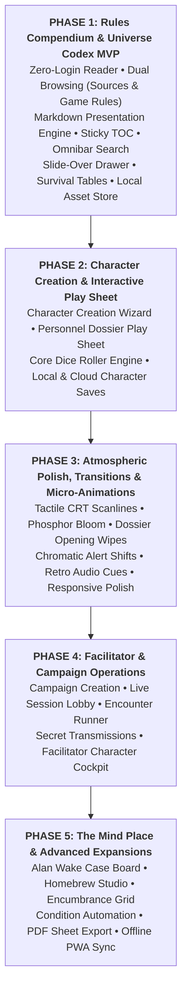

# Project Planner & Roadmap Register: Beyond the Horizon App

- **Document Title:** Project Planner & Roadmap Register
- **Project:** Beyond the Horizon - Digital Companion & Rules Platform ("Beyond the Horizon App")
- **Author:** Henrique Schorr
- **Last Updated:** 2026-10-23
- **Documentation Standard:** All technical features, architectural milestones, and companion toolsets are tracked here as tracer-bullet tickets in strict order of importance across five release phases. System Design Documents (01-sdd-overview.md, 02-sdd-database.md, 03-sdd-backend.md, 04-sdd-frontend.md) and GLOSSARY.md remain the canonical technical references.

---

## 1. Status Lifecycle Definitions

Every ticket progresses through the following standardized lifecycle states:

- **open:** Backlog item defined and prioritized; design and implementation not yet started.
- **in-progress:** Active implementation underway across packages.
- **blocked:** Cannot proceed until prerequisite tickets in Blocked By land.
- **done:** Fully implemented, verified with static analysis, tested, and accepted.

---

## 2. Release Phasing Matrix

---

## 3. Phase 1: Rules Compendium & Universe Codex MVP (High Priority)

The goal of Phase 1 is to deliver a frictionless, high-aesthetic digital reference platform for the Beyond the Horizon universe, executed in four iterative milestones:
1. **Milestone 1A: Core Rules End-to-End**: Information architecture, Core Rules authoring, schema and TOC derivation, YAML frontmatter enrichment, seed ingestion, reader layout prototyping, and presentation engine implementation on screen.
2. **Milestone 1B: Evo'raz Character Foundation**: Complete Evo'raz species dossier authoring, specialized Page Presentations (Species, Origin, Path) and tactile Ability Cards, and reader integration.
3. **Milestone 1C: Full Codex Content Expansion**: Complete system content authoring (remaining species, equipment, survival tables, worldbuilding) and comprehensive database ingestion.
4. **Milestone 1D: Interactive Overlays, Compendium Databases & Global Search**: Universal keyword tooltip engine, compendium filterable database views, Slide-Over Drawer, global Omnibar, and end-to-end application routing.

| Number | Ticket | Domain | Status | Priority | Blocked By | Scope & Deliverables |
| :--- | :--- | :--- | :--- | :--- | :--- | :--- |
| **0001** | [0001: Prototype UI Ideation Skill](./tickets/0001-prototype-ui-ideation-skill.md) | Tooling / Workflow | **done** | **P1 (Prerequisite)** | None | Create skills/prototype/SKILL.md defining interactive wireframing workflows, ASCII layouts, and UI ideation routines before building frontend widgets. |
| **0002** | [0002: Landing Page, Authentication & Guest Access Console](./tickets/0002-landing-page-auth-and-guest-access.md) | Frontend / Auth / UI | **done** | **P1** | 0001 | Revisit and modernize the public Landing Page portal with typographic crossword brand mark, event horizon arc, registration/login dialogs, and guest menu items. |
| **0003** | [0003: Lore Epigraphs and Archival Transmissions Engine](./tickets/0003-epigraph-lore-transmissions.md) | Database / Backend / UI Primitives | **done** | **P1** | 0002 | Revisit the worldbuilding lore epigraph system: database schema, random selection query, pure DTO services, and 4 geometric framing styles for Command Deck embedding. |
| **0004** | [0004: Player Home Command Deck & Session Experience](./tickets/0004-player-home-command-deck.md) | Frontend / UI / State | **done** | **P1** | 0003 | Revisit and polish the authenticated Player Home (Command Deck) layout: balanced two-column grid, brand mark, tactical menu, user session controls, and Lore Epigraph box. |
| **0005** | [0005: Codex Information Architecture and Chapter Organization](./tickets/0005-codex-information-architecture-and-organization.md) | Design / Content / Codex | **open** | **P1 (Highest)** | 0004 | Analyze Beyond the Horizon rules and award-winning TTRPG documentation references (Break!!, Daggerheart, Mythic Bastionland, Shadowdark, Warhammer Fantasy) to define master TOC and reading sequence. |
| **0006** | [0006: Core Rules Content Authoring and Syntax Calibration](./tickets/0006-core-rules-content-authoring-and-syntax-calibration.md) | Content / Design / Codex | **open** | **P1** | 0005 | Author Core Rules chapters in content/codex/core_rules/ (pt-BR canonical source) using text engine syntax grammar; calibrate layout tokens and stage diagram assets in content/codex/assets/. |
| **0007** | [0007: Codex Database Schema and TOC Architecture](./tickets/0007-codex-database-schema-and-toc.md) | Database / Supabase | **open** | **P1** | 0006 | Author migration establishing public.codex_pages, translations, and dedicated Table of Contents table public.codex_index calibrated from real Core Rules structure; provision storage bucket. |
| **0008** | [0008: Core Rules YAML Frontmatter Enrichment](./tickets/0008-core-rules-yaml-frontmatter-enrichment.md) | Content / Tooling / Codex | **open** | **P1** | 0007 | Prepend standardized YAML frontmatter headers (slug, title, parent, order, category, reading_time, tags) to all Core Rules files in content/codex/core_rules/. |
| **0009** | [0009: Codex Database Seed Ingestion & Tooling](./tickets/0009-codex-database-seed-ingestion.md) | Database / Tooling / Backend | **open** | **P1** | 0008 | Create automated ingestion tooling and author supabase/seeds/codex_seed.sql to populate public.codex_pages and public.codex_index; configure asset bundling in pubspec.yaml. |
| **0010** | [0010: Codex Reader Layout Prototyping](./tickets/0010-codex-reader-ui-prototyping.md) | UI Prototyping / Design | **open** | **P1** | 0001, 0009 | Wireframe and validate desktop reading layout, sticky TOC accordion, ~70ch typography measure, and responsive views using the prototype skill. |
| **0011** | [0011: Codex Presentation Engine and Core Rules Reader](./tickets/0011-codex-presentation-engine-and-core-rules-reader.md) | Frontend / Codex | **open** | **P1** | 0010 | Implement Swiss brutalist Markdown renderer and linear reader view (/codex/sources/:slug) bound to public.codex_index with scrollspy and pagination, verifying on screen. |
| **0012** | [0012: Evo'raz Character Foundation Content Authoring](./tickets/0012-evoraz-character-foundation-authoring.md) | Content / Codex | **open** | **P1** | 0011 | Author complete Evo'raz Species dossier, affiliated Origins, tactical Paths, and tactical Abilities in content/codex/ (pt-BR canonical source). |
| **0013** | [0013: Specialized Page Presentations and Ability Cards](./tickets/0013-specialized-page-presentations-and-ability-cards.md) | Frontend / UI Primitives / Codex | **open** | **P1** | 0012 | Build dedicated Page Presentations (tailored page templates for Species, Origins, and Paths) and tactile Ability Card widgets embedded within the reader. |
| **0014** | [0014: Character Foundation DB Ingestion and Integration](./tickets/0014-character-foundation-db-ingestion-and-integration.md) | Database / Frontend / Codex | **open** | **P1** | 0013 | Prepend frontmatter to Evo'raz files, ingest records into public.codex_pages and public.codex_index, and verify full reading integration in the app. |
| **0015** | [0015: Complete System Content Authoring](./tickets/0015-complete-system-content-authoring.md) | Content / Codex | **open** | **P1** | 0014 | Author all remaining species, equipment tables and cards, survival hazard tables, and deep universe lore in content/codex/ with complete YAML frontmatter. |
| **0016** | [0016: Full Codex Database Ingestion and Reader Verification](./tickets/0016-full-codex-db-ingestion-and-reader-verification.md) | Database / Frontend / Codex | **open** | **P1** | 0015 | Ingest complete compendium chapters into Supabase; verify full Table of Contents navigation and asset resolution in the reader. |
| **0017** | [0017: Universal Keyword Tooltip Engine and Custom Tags](./tickets/0017-universal-keyword-tooltip-engine.md) | Frontend / UI Primitives / Codex | **open** | **P1** | 0016 | Design and implement universal keyword tooltip engine across the app, evaluating custom Markdown tags versus automated scanners, with 0ms in-memory hover resolution. |
| **0018** | [0018: Compendium Filterable Databases and Slide-Over Drawer](./tickets/0018-compendium-filterable-databases-and-drawer.md) | Database / Frontend / Compendium | **open** | **P1** | 0017 | Searchable grid views (/codex/rules/:category) and non-destructive Slide-Over Drawer for inspecting full entity dossiers, recovery protocols, and tactical traits. |
| **0019** | [0019: Global Omnibar and Local Display Preferences](./tickets/0019-codex-omnibar-and-local-preferences.md) | Frontend / Navigation | **open** | **P1** | 0011, 0018 | Global Cmd+K quick-jump search palette and client-side display preferences (reading column measure, font scaling, basic theme preferences). |
| **0020** | [0020: Codex Integration and End-to-End Routing](./tickets/0020-codex-integration-and-e2e-routing.md) | Frontend / Routing | **open** | **P1** | 0011, 0019 | Wire landing page and player home CODEX buttons to /codex; verify authentication and epigraphs remain non-blocking. |

---

## 4. Phase 2: Character Creation & Interactive Play Sheet (Medium-High Priority)

The goal of Phase 2 is to equip players with complete digital character agency: guided step-by-step creation, a tactile personnel dossier sheet, automated attribute calculation, and integrated dice rolling.

| Number | Scope & Deliverables | Target Architecture |
| :--- | :--- | :--- |
| **0021** | Step-by-Step Character Creation Wizard (Species selection, Origin, Path, attribute allocation, starting gear, and automated stat derivation). | Frontend / Characters / State |
| **0022** | Interactive Personnel Dossier Play Sheet (Real-time Vitality, Stress, equipped weapons, ability execution, and active Injury/Trauma tracking). | Frontend / UI / Controllers |
| **0023** | Core Dice Roller Engine (Polyhedral and custom formula roller, advantage/disadvantage handling, and clean visual result popups). | Frontend / Shared / Logic |
| **0024** | Character Dossier Persistence (Local client storage for offline sessions and optional Supabase cloud syncing for authenticated accounts). | Backend / Local Storage / DB |

---

## 5. Phase 3: Atmospheric Polish, Transitions & Micro-Animations (Medium Priority)

The goal of Phase 3 is to elevate the platform with cinematic industrial brutalism: tactile CRT scanline bloom, classified dossier wipes, chromatic shifts, and subtle retro audio cues across the Codex and Character Sheet.

| Number | Scope & Deliverables | Target Architecture |
| :--- | :--- | :--- |
| **0025** | Display Settings & Visual Enhancements (CRT scanline shader toggle, phosphor bloom intensity, UI theme accents, and typography scaling). | Settings / Frontend / Shaders |
| **0026** | Atmospheric UI Transitions & Animations (Classified dossier opening wipes, alert status chromatic shifts, and subtle screen micro-interactions). | Frontend / UI / Theme |
| **0027** | Atmospheric Staging & Environmental Immersion (Graphic anchors, procedural stipple dissolution, and ambient analog terminal hums). | Frontend / Artwork / Audio |
| **0028** | Comprehensive Multi-Device Ergonomics (Refined responsive breakpoint redistribution for tablet portrait/landscape and desktop wide formats). | Frontend / UI / Responsive |

---

## 6. Phase 4: Facilitator & Campaign Operations (Medium-Low Priority)

The goal of Phase 4 is to provide the Facilitator with full session running command: campaign lobbies, encounter tracking, secret player transmissions, and a live party cockpit.

| Number | Scope & Deliverables | Target Architecture |
| :--- | :--- | :--- |
| **0029** | Campaign & One-Shot Game Creation (Facilitator game suite, premise descriptions, player roster management, and shareable join links). | Games / Backend / UI |
| **0030** | Live Session Orchestration & Lobby (Real-time participant presence, session timers, and shared objective trackers). | Sessions / Realtime |
| **0031** | Tactical Encounter Runner (Turn-order initiative sorting, adversary stat cards, live monster adjustments, and environmental hazards). | Encounters / Backend / UI |
| **0032** | Secret Transmissions & Classified Handouts (Encrypted sensor logs, private transcripts, and classified notes dispatched directly to player screens). | Messaging / UI / Realtime |
| **0033** | Facilitator Live Party Cockpit & Hidden Rolls (Single-screen GM cockpit monitoring party vitality, stress, and sustained injuries in real-time). | Facilitator / UI / Realtime |

---

## 7. Phase 5: The Mind Place & Advanced Expansions (Nice-to-Haves)

The goal of Phase 5 is to introduce tactile investigative depth, homebrew content creation, and offline table convenience.

| Number | Scope & Deliverables | Target Architecture |
| :--- | :--- | :--- |
| **0034** | The Mind Place / Investigative Case Board (Alan Wake 2-inspired cork and concrete operations board linking clues, NPC dossiers, and plot threads). | Campaign / Canvas UI |
| **0035** | Homebrew & Custom Content Studio (In-app creation suite enabling Facilitators to build custom abilities, species, and equipment). | Codex / Backend |
| **0036** | Slot-Based Inventory & Encumbrance Grid (Visual slot grid calculating weight thresholds, ammo clips, and biological symbionts). | Characters / Inventory |
| **0037** | Automated Condition & Affliction Ticks (Turn-based status effect automation applying bleeding, radiation, or panic penalties at round starts). | Combat / State |
| **0038** | Character Sheet Offline Export (High-contrast printable PDF character sheets and clean Obsidian-compatible Markdown export). | Export / File Generation |
| **0039** | Progressive Web App (PWA) Offline Synchronization (Service worker caching and background sync enabling complete offline table play). | PWA / Service Workers |

---

## 8. Architectural Alignment & Cross-References

- **System Overview & Aesthetic Foundation:** [01-sdd-overview.md](./01-sdd-overview.md)
- **Database Schema & RLS Policies:** [02-sdd-database.md](./02-sdd-database.md)
- **In-Process Backend Services:** [03-sdd-backend.md](./03-sdd-backend.md)
- **Frontend Architecture & Design Tokens:** [04-sdd-frontend.md](./04-sdd-frontend.md)
- **Live Domain Glossary:** [GLOSSARY.md](./GLOSSARY.md)
- **Architecture Decision Records:**
  - [ADR 0001: Codex-First Scope and 5-Phase Lifecycle](./decisions/0001-codex-first-scope-and-phasing.md)
  - [ADR 0002: Dual Browsing Information Architecture](./decisions/0002-dual-browsing-codex-architecture.md)
  - [ADR 0003: Obsidian-Native Markdown and YAML Content Pipeline](./decisions/0003-obsidian-native-markdown-yaml-content-pipeline.md)
  - [ADR 0007: Content-First Codex Authoring, Page Presentations, and Phased Roadmap](./decisions/0007-content-first-codex-authoring-and-schema-derivation.md)
- **Comparative Research & Aesthetic Studies:**
  - [Studied Designs & Comparative Research Archive](./studied_designs.md)
  - [D&D Beyond Information Architecture Reference](./references/site/dndbeyond_design_reference.md)
  - [Remedy Aesthetic Study (Control & Alan Wake)](./references/aesthetic/remedy_design_reference.md)
  - [TTRPG Documentation Reference Library](./references/documentation/)
