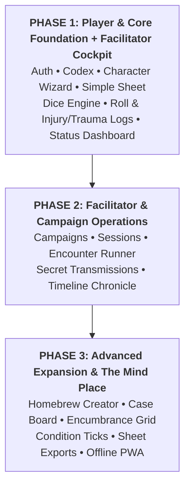

# Project Planner & Roadmap Register: Beyond the Horizon App

- **Document Title:** Project Planner & Roadmap Register
- **Project:** Beyond the Horizon - Digital Companion & Rules Platform ("Beyond the Horizon App")
- **Author:** Henrique Schorr
- **Last Updated:** 2026-10-19
- **Documentation Standard:** All technical features, architectural milestones, and companion toolsets are tracked here as tracer-bullet tickets in strict order of importance across three release phases. System Design Documents ([01-sdd-overview.md](./01-sdd-overview.md), [02-sdd-database.md](./02-sdd-database.md), [03-sdd-backend.md](./03-sdd-backend.md), [04-sdd-frontend.md](./04-sdd-frontend.md)) and [GLOSSARY.md](./GLOSSARY.md) remain the canonical technical references.

---

## 1. Status Lifecycle Definitions

Every ticket progresses through the following standardized lifecycle states:

- **open:** Backlog item defined and prioritized; design and implementation not yet started.
- **in-progress:** Active implementation underway across packages.
- **blocked:** Cannot proceed until prerequisite tickets in Blocked By land.
- **done:** Fully implemented, verified with static analysis, tested, and accepted.

---

## 2. Release Phasing Matrix

---

## 3. Phase 1: Player & Core Foundation + Facilitator Status Cockpit (High Priority)

The goal of Phase 1 is to deliver a functional, essential play and reference experience: allowing players to sign up, read the rules, build a character, and play with an interactive digital character sheet, while equipping the Facilitator with a live status cockpit to monitor all party members and tracking every dice roll and sustained injury/trauma in real-time.

| Number | Ticket | Domain | Status | Priority | Blocked By | Scope & Deliverables |
| :--- | :--- | :--- | :--- | :--- | :--- | :--- |
| **0001** | [0001: User Creation, Auth & Session Management](./tickets/0001-user-auth-session.md) | Auth / Backend / UI | **Designing** | **P1 (Highest)** | None | User registration with email/password, session persistence via Supabase Auth and local storage, password recovery, and secure JWT handling across client and server. |
| **0002** | [0002: Landing Pages & Player Home Command Deck](./tickets/0002-landing-pages-command-deck.md) | Frontend / Routing | **In Progress** | **P1** | None | Decoupled landing portal and authenticated Player Home (Command Deck) featuring monumental typographic crossword brand mark, tactical menu with organic arrow hover interaction, and session controls. |
| **0003** | [0003: Lore Epigraphs & Archival Transmissions Catalog](./tickets/0003-lore-epigraphs-catalog.md) | Database / Backend / UI | **In Progress** | **P1** | None | Relational lore database tables (public.lore_epigraphs), custom enum, randomized PostgreSQL RPC selection, full CRUD repository, and four pure geometric framing widgets. |
| **0004** | [0004: Atmospheric Graphic Staging](./tickets/0004-atmospheric-graphic-staging.md) | Frontend / Artwork | **open** | **P1** | 0002 | Bottom-right quadrant graphic anchor staging large character/monster illustrations with procedural alpha/toner stipple dissolve into darkBgCanvas (#101214) layered behind epigraph framing. |
| **0005** | [0005: Documentation Pages & Storage Catalog](./tickets/0005-documentation-storage-catalog.md) | Codex / Database | **Designing** | **P1** | 0001 | Digital rulebook catalog indexing manuscript chapters, storage-backed Markdown pages, category sorting, and bilingual translation architecture. |
| **0006** | [0006: Codex Master Keyword Overlay Engine](./tickets/0006-codex-keyword-overlay-engine.md) | Codex / Backend / UI | **Designed** | **P1** | 0005 | Master keyword registry (public.compendium_keywords), parent-child taxonomy, inflection aliases, and 0ms in-memory hover tooltips. |
| **0007** | [0007: Markdown Presentation Engine & Layout Renderer](./tickets/0007-markdown-presentation-renderer.md) | Codex / Frontend | **Designed** | **P1** | 0005, 0006 | Specialized layout composition (documentation, species, origin, abilities), section callouts, storage image caching, and atmospheric typography. |
| **0008** | [0008: Documentation Markdowns Creation from bth_game](./tickets/0008-rulebook-markdown-content.md) | Codex / Content | **open** | **P1** | 0007 | Extraction, conversion, and authoring of official rulebook Markdown chapters from bth_game into the documentation storage catalog (pt-BR). |
| **0009** | [0009: Step-by-Step Character Creation Wizard](./tickets/0009-character-creation-wizard.md) | Characters / Frontend | **open** | **P1** | 0001 | Guided character creation flow: species selection, origin background, attribute allocation, ability picking, starting equipment loadout, and automated stat derivation. |
| **0010** | [0010: Interactive Character Play Sheet](./tickets/0010-character-play-sheet.md) | Characters / UI / State | **open** | **P1** | 0009 | Digital personnel dossier character sheet: live HP/vitality tracking, stress/wounds tracks, attributes, equipped weapons/gear, ability execution, and injury/trauma management. |
| **0011** | [0011: Core Dice Roller Engine](./tickets/0011-core-dice-roller-engine.md) | Frontend / Shared | **open** | **P1** | None | Polyhedral and custom formula dice roller with automated stat modifier injection, advantage/disadvantage handling, and clean visual result popups. |
| **0012** | [0012: Real-Time Roll & Injury/Trauma Audit Log](./tickets/0012-realtime-roll-injury-log.md) | Logs / Realtime / UI | **open** | **P1** | 0010, 0011 | Chronological live audit feed logging each dice roll outcome, formula breakdown, and real-time alerts whenever any character sustains an injury or trauma. |
| **0013** | [0013: Facilitator Character Status Dashboard](./tickets/0013-facilitator-status-dashboard.md) | Facilitator / UI / Realtime | **open** | **P1** | 0010, 0012 | Single-screen GM cockpit displaying the real-time status of all active player characters (vitality, stress, sustained injuries, traumas, armor, and conditions) at a glance. |
| **0014** | [0014: Application Configurations & Display Settings](./tickets/0014-display-settings-preferences.md) | Settings / Frontend | **open** | **P1** | None | User preferences: retro CRT scanline toggle, phosphor bloom, UI theme accents (Weyland Amber vs. FBC Cold Fluorescent), font size scaling, and audio volume. |
| **0015** | [0015: E-mail Management & Communications](./tickets/0015-email-management.md) | Backend / Auth / Email | **open** | **P1** | 0001 | Transactional email workflows: password reset verification links, account confirmation, author and facilitator alerts, and email delivery service integration. |
| **0016** | [0016: UI Animations & Atmospheric Transitions](./tickets/0016-ui-animations-transitions.md) | Frontend / UI / Theme | **open** | **P1** | 0002 | Immersive atmospheric animations: tactile CRT scanline bloom transitions, classified dossier opening wipes, alert status chromatic shifts, and screen micro-interactions. |
| **0017** | [0017: Responsive Layout Adaptation & Multi-Device Scaling](./tickets/0017-responsive-layout-adaptation.md) | Frontend / UI / Responsive | **open** | **P1** | 0002, 0010 | Comprehensive responsive breakpoint architecture for tablets, desktops, and wide-format displays with adaptive menus and flexible grid redistribution. |

---

## 4. Phase 2: Facilitator & Game Operations (Medium Priority)

The goal of Phase 2 is to expand into comprehensive multiplayer campaign management, live session lobbies, and combat encounter orchestration for the Facilitator.

| Number | Ticket | Domain | Status | Priority | Blocked By | Scope & Deliverables |
| :--- | :--- | :--- | :--- | :--- | :--- | :--- |
| **0018** | [0018: Campaign & One-Shot Game Creation](./tickets/0018-campaign-game-creation.md) | Games / Backend / UI | **open** | **P2** | 0001, 0010 | Facilitator game creation suite: campaign titles, premises, scheduling metadata, player roster management, and shareable player invite codes/links. |
| **0019** | [0019: Live Session Orchestration & Lobby](./tickets/0019-live-session-lobby.md) | Sessions / Realtime | **open** | **P2** | 0018 | Real-time session lobby tracking connected participants, game clock/session timer, live status sync, and session objective trackers. |
| **0020** | [0020: Tactical Encounter Management](./tickets/0020-tactical-encounter-management.md) | Encounters / Backend / UI | **open** | **P2** | 0019 | Combat/hazard encounter runner: turn-order initiative sorting, threat/adversary stat cards, live monster HP/armor adjustments, and environmental event triggers. |
| **0021** | [0021: Secret Transmissions & Classified Handouts](./tickets/0021-secret-transmissions-handouts.md) | Messaging / UI | **open** | **P2** | 0019 | Facilitator dispatch of encrypted sensor logs, private audio transcripts, or classified notes directly to individual player screens. |
| **0022** | [0022: GM Hidden Dice Rolling](./tickets/0022-gm-hidden-dice-rolling.md) | Dice / Facilitator | **open** | **P2** | 0011, 0019 | Private dice toggle allowing the Facilitator to roll secret checks that hide formulas and outcomes from player logs. |
| **0023** | [0023: Session Narrative Chronicle & Story Events](./tickets/0023-session-narrative-chronicle.md) | Logs / Database / UI | **open** | **P2** | 0019 | Expanded campaign timeline recording session summaries, major narrative plot points, NPC discoveries, and story milestones. |

---

## 5. Phase 3: Advanced Expansion & The Mind Place (Nice-to-Haves)

The goal of Phase 3 is to elevate the platform with specialized tactical depth, investigative tools inspired by Remedy Entertainment, and offline convenience.

| Number | Ticket | Domain | Status | Priority | Blocked By | Scope & Deliverables |
| :--- | :--- | :--- | :--- | :--- | :--- | :--- |
| **0024** | [0024: Homebrew & Custom Content Creator](./tickets/0024-homebrew-content-creator.md) | Codex / Backend | **open** | **P3** | 0005, 0018 | In-app creation suite enabling Facilitators to build custom abilities, homebrew species, bespoke equipment, and original threats scoped to their campaigns. |
| **0025** | [0025: The Mind Place / Investigative Case Board](./tickets/0025-mind-place-case-board.md) | Campaign / Canvas UI | **open** | **P3** | 0019 | Tactile Alan Wake 2-inspired cork/concrete operations board where Facilitators link threat dossiers, clues, NPC Polaroids, and plot nodes with red relationship threads. |
| **0026** | [0026: Interactive Hover Tooltips & Slide-Out Drawers](./tickets/0026-interactive-hover-tooltips.md) | UI Primitives / Codex | **open** | **P3** | 0006, 0010 | Hover/tap micro-interactions across character sheets and encounter views that open instant rules text without leaving the current view. |
| **0027** | [0027: Slot-Based Inventory & Encumbrance Grid](./tickets/0027-inventory-encumbrance-grid.md) | Characters / Inventory | **open** | **P3** | 0010 | Visual grid inventory management calculating weight, encumbrance penalties, ammo clips, and biological symbiont integration. |
| **0028** | [0028: Automated Condition & Affliction Ticks](./tickets/0028-condition-affliction-ticks.md) | Combat / State | **open** | **P3** | 0010 | Turn-based status effect automation (Bleeding, Radiation, Cyber-Shock, Panic) applying damage, stress, or stat penalties at start-of-turn. |
| **0029** | [0029: Character Sheet Offline Export (PDF & Markdown)](./tickets/0029-character-sheet-offline-export.md) | Export / File Generation | **open** | **P3** | 0010 | High-contrast printable PDF character sheet generator and clean Obsidian-compatible Markdown export for offline paper play and vault syncing. |
| **0030** | [0030: Progressive Web App (PWA) Offline Caching](./tickets/0030-pwa-offline-caching.md) | PWA / Service Workers | **open** | **P3** | 0010 | Client-side cache and service worker synchronization enabling uninterrupted character play and dice rolling during offline in-person table sessions. |

---

## 6. Architectural Alignment & Cross-References

- **System Overview & Aesthetic Foundation:** [01-sdd-overview.md](./01-sdd-overview.md)
- **Database Schema & RLS Policies:** [02-sdd-database.md](./02-sdd-database.md)
- **In-Process Backend Services:** [03-sdd-backend.md](./03-sdd-backend.md)
- **Frontend Architecture & Design Tokens:** [04-sdd-frontend.md](./04-sdd-frontend.md)
- **Live Domain Glossary:** [GLOSSARY.md](./GLOSSARY.md)
- **Remedy Aesthetic Study (Control & Alan Wake):** [remedy_design_reference.md](./references/aesthetic/remedy_design_reference.md)
- **Studied Designs & Comparative Research Archive:** [studied_designs.md](./studied_designs.md)
