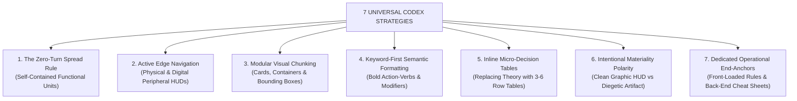

# The Modern Codex Revolution: Master Design Reference
*A cross-system comparative study of Information Architecture, Layout Paradigms, Cognitive Ergonomics, and Lore/Rule Presentation across the 2024–2026 Award-Winning Tabletop RPGs.*

---

## Executive Summary: The 2024–2026 Design Paradigm Shift

Between 2024 and 2026, tabletop roleplaying game publishing underwent its most radical graphic design and user-experience revolution since the birth of the hobby. For decades, roleplaying rulebooks modeled themselves after **19th-century academic encyclopedias or legal codes**: dense, three-column walls of justified serif text, buried mechanical exceptions, endless page-flipping during combat, and disconnected spell lists spanning dozens of pages.

The five systems analyzed in this research initiative—**Break!! RPG**, **Daggerheart**, **Mythic Bastionland**, **Shadowdark RPG**, and **Warhammer Fantasy Roleplay 4e**—won the highest industry design honors (including multiple ENNIE Awards for *Product of the Year*, *Best Layout and Design*, and *Best Game*) because they treated the physical rulebook and digital codex not as passive novels, but as **high-performance operational instruments**.

```
┌─────────────────────────────────────────────────────────────────────────┐
│                      THE 2024–2026 DESIGN REVOLUTION                    │
├─────────────────────────────────────────────────────────────────────────┤
│  TRADITIONAL TTRPG DESIGN (1990-2020)  │  MODERN CODEX DESIGN (2024-2026)│
├────────────────────────────────────────┼────────────────────────────────┤
│ • Dense, continuous flowing text blocks│ • Modular, self-contained units│
│ • Rules span across awkward page turns │ • Strict Zero-Turn Spread rule │
│ • Buried mechanical clauses in prose   │ • Bold keyword-first semantics │
│ • Generic chapter headers and folios   │ • Active edge thumb HUDs       │
│ • Math-heavy tables & abstract formulas│ • Visual infographics & pips   │
│ • Fluff and crunch blended randomly    │ • Surgical lore segregation    │
│ • Page-flipping during encounters      │ • Instant 5-second retrieval   │
└────────────────────────────────────────┴────────────────────────────────┘
```

---

## 1. Master Comparative Design Matrix

The following matrix synthesizes the structural, ergonomic, and aesthetic choices of the five prize-winning systems:

| Design Dimension | *Break!! RPG* | *Daggerheart* | *Mythic Bastionland* | *Shadowdark RPG* | *Warhammer Fantasy 4e* |
|---|---|---|---|---|---|
| **Primary Accolades** | ENNIE 2024 Gold: Best Layout & Design | 2024/2025 Industry Acclaim: Card-Spread Hybrid | 2024/2025 Acclaim: Minimalist Chivalric OSR | ENNIE 2024 Gold Sweep: Product of Year, Best Layout | Multi-ENNIE Winner: Best Production, Supplement |
| **Physical Format** | Standard 8.5 x 11 (463 pages) | Standard 8.5 x 11 (415 pages) | Compact A4/Letter (212 pages) | Digest Size 5.5 x 8.5 (183 pages) | Standard 8.5 x 11 (Two 190p volumes) |
| **Spread Philosophy** | Hard 2-page self-contained spreads | 2-page asymmetrical dossier spreads | Strict 2-page "Oddpoch" per Knight/Myth | Strict Zero-Turn spread for all rules/monsters | Symmetrical career spreads + master tables |
| **Grid Architecture** | 2-column modular card containers (`#F3F2F7`) | 1/3 dark dossier + 2/3 light editorial rules | Symmetrical 2-column with snapping art plates | 1-col and 2-col high-contrast digest grid | 2-column narrative + full-width bottom tables |
| **Edge Navigation** | Active vertical thumb index + sub-chapter pills | Bottom running footer + gold ribbon badges | Heraldic coin medallion folio + vine border | Shifted black/grey chapter thumb tabs | Running top heraldic shield + ribbon banner |
| **Typographic System** | Futura / Gotham + Inter + DIN Pro numerals | Eveleth + Questa Slab + Overpass + Minion | Gothic Blackletter + Roman Small Caps + Garamond | Gothic Blackletter + Century Gothic / Montserrat | Caslon Antique + Trajan Pro + Plantin Serif |
| **Color Strategy** | High-saturation Pop Neon (Magenta/Cyan/Yellow) | Hope Gold (`#EAA023`) vs Fear Violet (`#5D337E`) | Moss Stone Wash (`#E6EAE4`) + Tapestry Green | Monochromatic Black & White (`#000000` / `#FFFFFF`)| Weathered Imperial Parchment + Verdigris Teal |
| **Lore Presentation** | Isolated to isometric world atlas & field guides | Conversational onboarding: "Play this if you..." | Ultra-succinct poetic verse (2-4 sentences max) | Italic sensory descriptions + in-world quotes | Diegetic tavern songs, plaques & gossip quotes |
| **Rules Presentation** | Semantic bullets (`▶`, `▷`, `⚠`, `ⓘ`) | Feature tiers (`■ Foundation / Specialization`) | Embedded d6/d12 micro-decision tables | Bold lead-ins (`DC 12.`, `Benefit.`, `Stabilize.`)| Detailed social-strata career progression grids |
| **Tactical Retrieval** | 10-page dedicated cheat sheets in appendix | Physical & digital modular Domain Cards | Single-spread reference with zero page-turning | 5-second monster statblocks & inside-cover HUD | Master contact matrices with page cross-links |

---

## 2. The 7 Universal Design Strategies of Award-Winning RPGs

Across all five award-winning systems, seven fundamental design strategies consistently emerge. These seven strategies constitute the foundational building blocks of modern codex design:



---

### Strategy 1: The Zero-Page-Turn Spread Rule (The Self-Contained Unit)
Every single one of these prize winners rejects the traditional practice of letting rules spill arbitrarily from the bottom of one page onto the next.
- In **Shadowdark**, not a single spell, monster, or hazard rule crosses a page turn. When a GM opens to the *Hydra* or *Fireball*, everything required to run that element is 100% visible without lifting a hand.
- In **Mythic Bastionland**, every one of the 52 Knightly Orders and 30 Myths occupies exactly one open two-page spread ("The Oddpoch").
- In **Break!!**, complex procedures (such as *Fight Procedure* or *Journey*) are partitioned into modular companion cards that resolve across the left and right facing pages.

> **Codex Takeaway**: In digital and application design, this translates to the **Single-Viewport Principle**: all data required to execute an action must fit within the active screen or drawer without vertical scroll disruption.

---

### Strategy 2: Active Edge Navigation & Peripheral HUDs
The edges of the page are no longer treated as passive empty margins; they are engineered as active **Wayfinding Heads-Up Displays**:
- **Break!!'s Thumb Bleed Index**: A running vertical list of all chapter sections permanently visible on the outer edge, with the active chapter highlighted in a vibrant magenta bounding pill and the sub-topic highlighted below it. Fanning the pages with a thumb allows the reader to jump to any rule in under two seconds.
- **Shadowdark's Shifting Thumb Tabs**: High-contrast black/grey edge tabs that visually shift downward as the user advances through Chapters I to V.
- **Daggerheart's Chapter Footers & Domain Spine Tabs**: Colored ribbon tags indicating class domains directly along the binding edge.

> **Codex Takeaway**: Digital documentation should feature a persistent, low-profile breadcrumb or vertical rail that dynamically highlights active scroll positions and allows instant jumping between nested sub-systems.

---

### Strategy 3: Modular Visual Chunking & Card Containers
Dense text on an unbordered page causes cognitive fatigue. Modern codices package data into **distinct visual containers**:
- **Break!!** wraps mechanics in soft-cornered rounded rectangles with subtle background tinting (`#F3F2F7`) and distinct pill headers.
- **Daggerheart** uses an asymmetrical two-tone layout: a dark slate dossier card on the left for immutable identity, paired with an airy editorial rule pane on the right.
- **Shadowdark** frames every distinct item and rule under an inverted black woodcut banner block.
- **Warhammer Fantasy** frames career progressions and contact archetypes in antique ironwork-embossed grid cells.

> **Codex Takeaway**: Never present rules as unbordered, free-floating text. Wrap atomic concepts inside container cards with distinct background fills, subtle borders, and prominent title headers.

---

### Strategy 4: Keyword-First Semantic Formatting
When players scan text during active play, they do not read sentences from left to right; their eyes dart across the page searching for **action anchors**. Modern systems format text specifically for this visual scanning pattern:
- **Shadowdark's Keyword Lead-Ins**: Every paragraph starts with a bolded action verb or condition:
  - `Benefit.`
  - `DC 15.`
  - `Stabilize.`
  - `Distraction.`
- **Break!!'s Glyphic Bullet Hierarchy**:
  - `▶` = Mandatory core rule.
  - `▷` = Optional modifier or branch.
  - `⚠` = GM alert or dangerous exception.
  - `ⓘ` = Direct page cross-reference link.
- **Daggerheart's Feature Pips**:
  - `■ Foundation Feature`
  - `■ Specialization Feature`
  - `■ Mastery Feature`

> **Codex Takeaway**: Lead every operational rule with a bold semantic tag or icon. Avoid buried requirements inside compound narrative sentences.

---

### Strategy 5: Inline Micro-Decision Tables
Rather than explaining mathematical possibilities in abstract paragraphs, award-winning games embed **compact 3-row to 6-row decision tables** directly beneath the relevant rule heading:
- In **Mythic Bastionland**, under *Taxes, Tithes, & Levies*, instead of three paragraphs describing economic instability, McDowall places the `INCREASED COLLECTIONS` table:
  - `1`: Immediate misrule.
  - `2-3`: Coffers filled, but take a Crisis.
  - `4-6`: Vassals pay willingly, mostly.
- In **Shadowdark**, under *Dying*, a 2-line table explains the death timer and stabilization threshold.
- In **Warhammer Fantasy**, under *Entertainer*, a single grid summarizes Origins, Skill Bonuses, Trappings, Contacts, and Talents.

> **Codex Takeaway**: If an action has branching outcomes, format it as a tabular matrix rather than a block of conditional prose.

---

### Strategy 6: The Two Materiality Camps (Graphic HUD vs Diegetic Artifact)
The 2024–2026 winners split into two deliberate aesthetic philosophies, both highly successful when executed with absolute commitment:

```
┌───────────────────────────────────────┬───────────────────────────────────────┐
│     CAMP A: THE GRAPHIC HUD           │     CAMP B: THE DIEGETIC ARTIFACT     │
│     (Break!! / Shadowdark)            │     (Mythic Bastionland / Warhammer)  │
├───────────────────────────────────────┼───────────────────────────────────────┤
│ • Clean, geometric sans-serif type    │ • Classical Roman serif & Blackletter │
│ • High contrast (Stark White / Neon)  │ • Muted parchment & moss stone washes │
│ • Video-game UI icons & status meters │ • Illuminated vines & heraldic ribbons│
│ • Floating rounded cards & tabs       │ • Antique ironwork frames & wax seals │
│ • Objective, instructive tone         │ • Atmospheric in-universe chronicles  │
└───────────────────────────────────────┴───────────────────────────────────────┘
```

Both camps strictly avoid the bland middle ground (generic desktop-publishing fantasy books). Either the book leans completely into becoming a **high-speed tactical interface**, or it leans completely into becoming an **in-universe historical relic**.

---

### Strategy 7: Front-Loaded Loading & Back-End Operational Cheat Sheets
The physical book and digital codex are treated as non-linear search engines:
- **Shadowdark's Inside Cover HUD**: The very first interior page (Page 3) presents the core game dials (DC scale, Distance, Dying, Morale).
- **Break!!'s 10-Page Cheat-Sheet Appendix**: Section VI contains complete procedural cheat sheets for all eight game systems (Travel, Dungeon Exploration, Fight, Negotiation, Downtime). Players who understand the basic game never need to open the main body of the book during a session.
- **Warhammer's Contact Matrices**: Master compendium tables that map dozens of NPC archetypes directly to exact profile pages.

---

## 3. The 5 Codex Archetypes & Design Personalities

```
┌────────────────────────────────────────────────────────────────────────┐
│                        THE 5 CODEX ARCHETYPES                          │
├────────────────────────────────────────────────────────────────────────┤
│ 1. THE VIDEO-GAME DATABOOK (Break!! RPG)                               │
│    Bright pop neon, rounded container cards, edge thumb indexing,      │
│    silhouette size scaling, heart pips, procedural cheat sheets.       │
│                                                                        │
│ 2. THE MODERN EDITORIAL HYBRID (Daggerheart)                           │
│    Asymmetrical split spreads (dark identity dossier vs light rules),  │
│    modular card trays, Hope/Fear duality tokens, Dutch slab serifs.    │
│                                                                        │
│ 3. THE ILLUMINATED CHIVALRIC MINIMALIST (Mythic Bastionland)           │
│    Strict 2-page Oddpoch spreads, illuminated Celtic vine borders,     │
│    moss-stone wash, d6 micro-tables, poetic brevity, woodblock art.    │
│                                                                        │
│ 4. THE COGNITIVE ERGONOMICS PURIST (Shadowdark RPG)                    │
│    Compact digest size, zero-turn spread mandate, pure black-and-white │
│    contrast, woodcut banners, 5-second monster statblocks.             │
│                                                                        │
│ 5. THE LIVING DIEGETIC CHRONICLE (Warhammer Fantasy 4e)                │
│    Weathered imperial parchment, verdigris copper filigree, 4-tier     │
│    social career progressions, full-bleed narrative prologue plaques.  │
└────────────────────────────────────────────────────────────────────────┘
```

---

## 4. Deep-Dive Reference Index

Each system analyzed in this master study has a dedicated, exhaustive technical reference document available in the codex archive:

1. [Break!! RPG Documentation Reference](./break_rpg_documentation_reference.md)
   - *Video-Game UI, Pop Neon Palettes, Edge Thumb Navigation, Silhouette Infographics, and the 8-Procedure Appendix Engine.*
2. [Daggerheart Documentation Reference](./daggerheart_documentation_reference.md)
   - *Editorial-Card Hybrid Spreads, Asymmetrical Dossiers, Hope & Fear Duality, Nine Domain Jewel Tones, and Intent-Based Onboarding.*
3. [Mythic Bastionland Documentation Reference](./mythic_bastionland_documentation_reference.md)
   - *Strict 2-Page Oddpoch Spreads, Illuminated Foliage Borders, Moss-Stone Canvas, Micro-Decision Tables, and Chivalric Compression.*
4. [Shadowdark RPG Documentation Reference](./shadowdark_documentation_reference.md)
   - *Digest Ergonomics, Zero-Turn Spread Mandate, Monochromatic High Contrast, Woodcut Banners, and 5-Second Monster Cards.*
5. [Warhammer Fantasy Roleplay Documentation Reference](./warhammer_fantasy_documentation_reference.md)
   - *In-Universe Weathered Artifacts, Caslon Antique Typography, 4-Tier Social Career Grids, and Diegetic Folk Song Boxes.*
