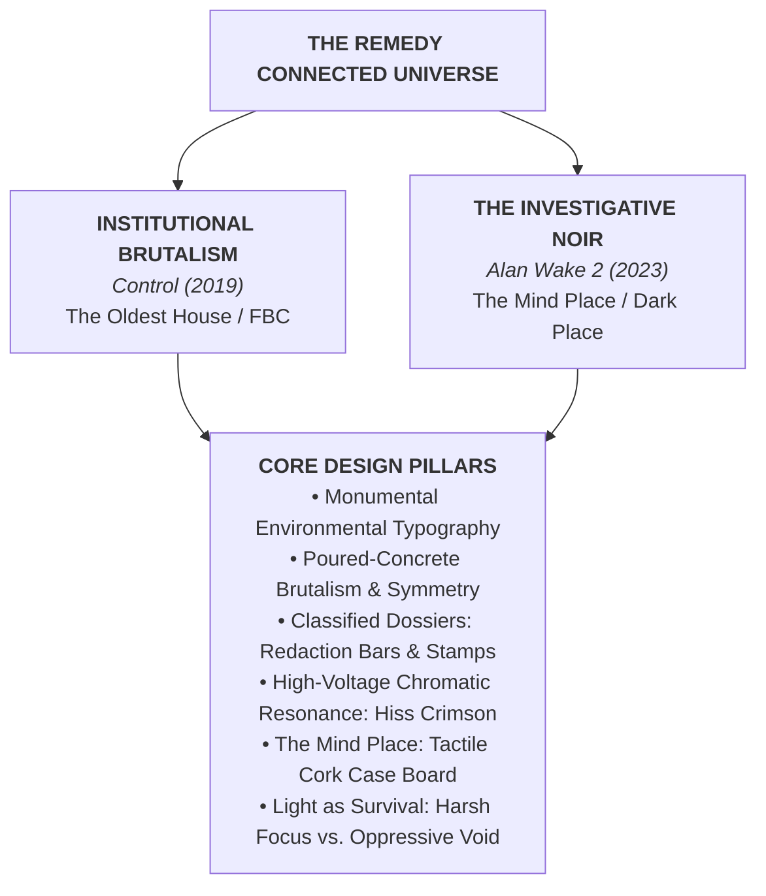

# The Bureaucratic Uncanny & Nightmarish Chiaroscuro: Aesthetic Reference for Remedy's *Control* and *Alan Wake*
*A detailed architectural and visual design study exploring the atmospheric brutalism, classified documentation, monumental typography, and investigative mechanics of the Remedy Connected Universe.*

---

## Executive Summary

Remedy Entertainment's connected universe—anchored by the Federal Bureau of Control in ***Control* (2019)** and the dark psychological mystery of ***Alan Wake* (2010)** and ***Alan Wake 2* (2023)**—presents one of the most distinctive design languages in contemporary interactive media.

Where traditional sci-fi leans on futuristic gadgetry or post-apocalyptic rusted metal, Remedy constructs a world of **The Bureaucratic Uncanny**: mid-century institutional brutalism colliding with cosmic, inexplicable anomalies.

---

## 1. Visual & Spatial Pillars

### 1.1 Monumental Environmental Typography
One of the most celebrated graphic signatures of *Control* is its **cinematic in-world typography**:
- **Architectural Scale:** Location headers, sector names, and quarantine alerts are not rendered as delicate floating HUD tags; they are projected directly onto environmental geometry as colossal, clean, geometric sans-serif statements (`EXECUTIVE SECTOR`, `THE PANOPTICON`, `CENTRAL RESEARCH`, `DIRECTOR'S SUITE`).
- **Typographic Weight:** Pure uppercase, extra-bold/black weight grotesque sans-serif (reminiscent of *Helvetica Neue Black*, *DIN Pro*, or *Space Grotesk Bold*).
- **Application in Companion App:** Screen headers, encounter banners, and campaign sector transitions should evoke this same unyielding, monolithic authority.

### 1.2 The Oldest House: Institutional Brutalism
- **Materiality:** Poured concrete walls with visible formwork seams, bush-hammered stone textures, dark mahogany executive paneling, brushed brass hardware, and polished terrazzo floors.
- **Symmetry & Oppression:** Cavernous rooms characterized by intense one-point perspective and monumental scale that dwarfs human occupants.
- **Anti-Digital Bureaucracy:** Because modern electronics break down inside the Oldest House, technology is frozen in the late 1960s to mid-1970s: slide projectors, reel-to-reel magnetic audio recorders, rotary telephones, pneumatic dispatch tubes, and vacuum-tube terminal consoles.

### 1.3 The Classified Dossier & Redacted Records
- **Physical Documents:** Case files presented on aged manila cardstock with typewriter typography (Courier / Olivetti), staples, paperclips, and ink bleed.
- **Redaction Graphic Device:** Blacked-out text bars (`████████`) hiding classified terms, names, and coordinates. This serves both as an aesthetic signature and as an interactive mechanic for hidden GM secrets, undiscovered lore, and encrypted transmissions.
- **Administrative Stamps:** High-contrast angled rubber stamps in red or black ink: `CLASSIFIED`, `AWE - ALTERED WORLD EVENT`, `CONFIDENTIAL`, `CONTAINED`, `APPROVED`.

### 1.4 High-Voltage Chromatic Resonance (The Hiss Crimson vs. Cold Fluorescent)
- **Normal Institutional State:** Muted concrete gray (`#242629`), aged paper (`#E8E2D2`), and pale cold fluorescent white (`#E2E8F0`).
- **Resonance Breach (The Hiss):** Saturated, high-voltage crimson red (`#E51B24`) bathing entire architectural halls in emergency light, accompanied by suspended levitating silhouettes and reality distortion.
- **The Astral Inversion:** Pure white astral void contrasting against impossible, obsidian-black geometric monoliths (The Board's inverted pyramid).
- **Application in Companion App:** Use the clean institutional state for general compendium browsing, but transition to the high-voltage Crimson resonance when an active combat encounter or mortal danger state begins.

### 1.5 The Mind Place & The Case Board (*Alan Wake 2*)
- **Tactile Investigation Space:** Saga Anderson's Mind Place is a physical mental room featuring a large wooden Case Board where clues, Polaroids, witness statements, and manuscript excerpts are pinned and connected with red yarn.
- **Narrative Deduction:** Players physically drag and connect clues to formulate deductions and unlock new story beats.
- **Application in Companion App:** An ideal reference for the **Facilitator Campaign & Encounter Board**, allowing GMs to link threats, NPC dossiers, location cards, and secret objectives visually.

### 1.6 Light as Survival & Analog Distortion
- **High-Contrast Chiaroscuro:** Inky black shadows punctured by blinding directional light sources (flashlight beams, road flares, neon motel signs).
- **Analog Glitch:** Television static, CRT scanlines, chromatic aberration on alert states, lens flares, and subtle camera film grain.

---

## 2. Color Palette Matrix

| Token Name | Hex Code | Visual Swatch | Thematic Source & Role |
| :--- | :--- | :---: | :--- |
| **`Carbon Void`** | `#101214` |  | Deepest shadow / base screen canvas (non-pure black). |
| **`Concrete Ash`** | `#222428` |  | Primary surface card / Brutalist concrete tile backdrop. |
| **`Office Slate`** | `#363A40` |  | Elevated borders, dividers, and inactive interactive fields. |
| **`Cold Fluorescent`**| `#E2E8F0` |  | Primary high-contrast titles & architectural display text. |
| **`Weathered Paper`** | `#C8C2B4` |  | Dossier body prose, rules text, and readability standard. |
| **`Hiss Crimson`** | `#E51B24` |  | Primary alert accent, active encounter state, critical HP danger. |
| **`Hazchem Amber`** | `#DE6B16` |  | Warning indicators, cassette telemetry, secondary buttons. |
| **`Dossier Manila`** | `#C2AD88` |  | Character record tabs, classified file badges, archive markers. |
| **`Astral White`** | `#F8FAFC` |  | Focused beam / active selection / sharp telemetry reticles. |

---

## 3. Typographic System

| Role | Font Family Candidates | Styling | Remedy Visual Reference |
| :--- | :--- | :--- | :--- |
| **Monolithic Display** | `Space Grotesk`, `Helvetica Neue`, `DIN Pro` | Uppercase, Bold (700-900), wide tracking | *Control* room title cards (`MAINTENANCE`, `EXECUTIVE`) |
| **Classified / Dossier** | `Special Elite`, `Courier Prime`, `Space Mono`| Monospace, regular, typewriter texture | FBC Altered Item case files, Alan Wake manuscript pages |
| **UI Telemetry & Stats** | `Space Mono`, `JetBrains Mono` | Tabular figures, tight tracking | Terminal readouts, timecodes, dice formulas |
| **Editorial Prose** | `Inter`, `Newsreader` | Balanced serif/sans prose, high legibility | Compendium rules, manuscript chapters, ability descriptions |

---

## 4. UI Component Architecture for *Beyond the Horizon App*

1. **Hero Screen Banners:** Clean uppercase typography spanning the full view width, anchored with thin technical rule dividers (`---`).
2. **Character Sheet as Personnel Dossier:**
   - Polaroids or high-contrast silhouette portraits.
   - Form fields modeled as official bureau clearance forms.
   - Angled stamp indicators for species, clearance level, and status (e.g., `ACTIVE OPERATIVE`, `CRITICAL STRESS`, `MIA`).
3. **Facilitator's Case Board (Campaign & Encounter Center):**
   - Cork or dark concrete canvas where threats, active combatants, and scenario objectives are arrayed as cards connected by directional pins or vector lines.
4. **Interactive Redaction Mechanic:**
   - Secret Facilitator lore entries appear as redacted black boxes (`████████`) on player screens until the Facilitator clicks "Declassify" or sends a secret transmission.
5. **Combat Encounter State Shift:**
   - When entering an active combat encounter, the application header and telemetry smoothly shift from calm institutional slate/amber into the **Hiss Crimson** pulse, instantly conveying high stakes to players and Facilitators alike.
