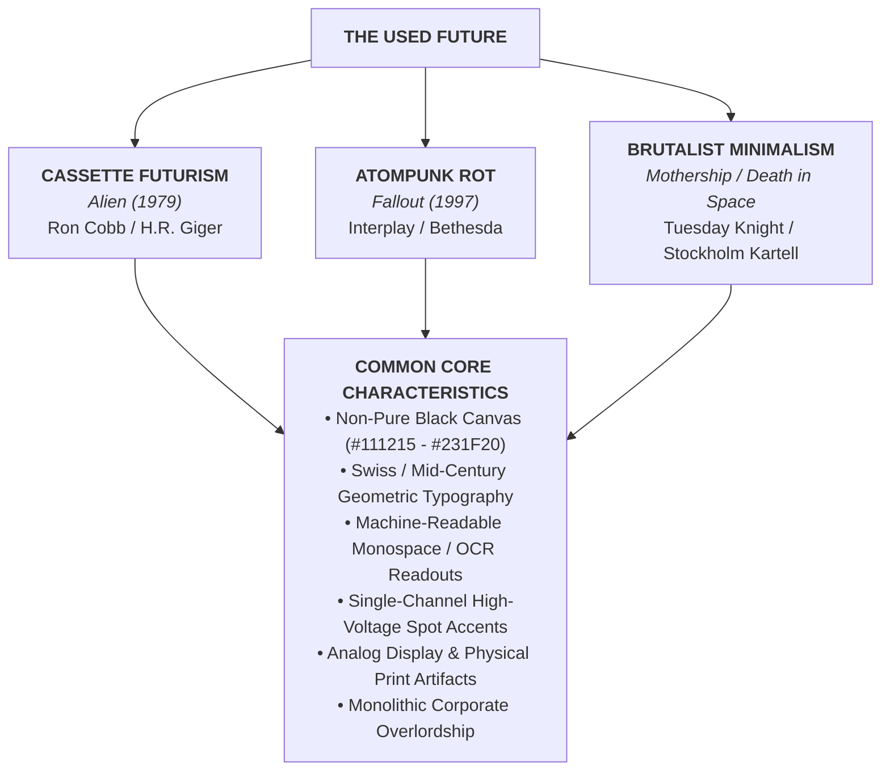

# The Industrial Entropic Future: Shared Aesthetic DNA Across *Alien*, *Fallout*, *Mothership*, and *Death in Space*
*A comparative analysis of the recurring design trends, color theory, typography, and materiality uniting the most influential retro-futuristic and industrial sci-fi universes.*

---

## Executive Summary

While spanning distinct genres—cosmic body horror (*Alien*), atomic retro-apocalypse (*Fallout*), brutalist survival horror (*Mothership*), and cosmic nihilism (*Death in Space*)—these four properties share an unmistakable, deeply interconnected visual DNA.

Together, they represent the antithesis of sterile, utopian "clean sci-fi" (such as *Star Trek* or contemporary Cupertino-style consumer minimalism). Instead, they champion **The Used Future**, **Entropic Industrial Decay**, and **Bureaucratic Corporate Horror**.



---

## 1. Comparative Matrix

| Axis | *Alien* Franchise | *Fallout* Series | *Mothership RPG* | *Death in Space RPG* |
|---|---|---|---|---|
| **Sub-Genre** | Cassette Futurism & Biomechanical Horror | Atompunk Retro-Futurism & Nuclear Decay | Brutalist Space Survival & Cosmic Panic | Scandinavian Minimal-Brutalism & Junk-Tech |
| **Corporate Antagonist** | Weyland-Yutani (*"Building Better Worlds"*) | Vault-Tec, RobCo, Nuka-Cola Corp | Generic Megacorps & Indentured Charters | Dying Mining Consortiums & Wreck Salvagers |
| **Canvas Background** | Nostromo Ivory / Iron Black | Weathered Tin / Caliche Sand | Technical Cement Grey / Carbon Off-Black | Tenebris Void Rich Black / Charcoal |
| **Dominant UI Phosphor** | Amber Phosphor / P31 Green | Pip-Boy Green / Mojave Amber | Hazard Orange / Vector Cyan | Acid Neon Yellow / Scrap Orange |
| **Primary Display Font** | **Helvetica Black** / **Futura Bold** | **Overseer** / **Futura Condensed** | **Argon** / **Futura Heavy** | **Neue Haas Grotesk** / **Druk** |
| **Terminal / Monospace Font** | **Moore Computer** / Matrix OCR | **Monofonto** / **Fixedsys** | **OCR-A** / **Source Code Pro** | **Space Mono** / **Letter Gothic** |
| **Physical Materiality** | Diamond vinyl, ABS plastic, lubricant | Bakelite, chrome, corrugated tin, rust | Risograph ink, newsprint, xerox grain | Welded hull scrap, photocopier toner dust |

---

## 2. Shared Color Theory Trends

### Trend 1: The Rejection of Pure Black (`#000000`)
None of these properties use flat digital `#000000` for backgrounds. Pure black creates visual halation (glowing/vibrating text) on screens and muddy over-saturation in physical CMYK printing. Instead, all four employ rich, textured off-blacks:
* *Alien*: Sub-Level Cast Iron (<span style="display:inline-block;width:12px;height:12px;background:#2B3238;border:1px solid #777;border-radius:2px;vertical-align:middle;margin-right:4px;"></span>`#2B3238`) and Xenomorph Chitin Black (<span style="display:inline-block;width:12px;height:12px;background:#0C0D0E;border:1px solid #777;border-radius:2px;vertical-align:middle;margin-right:4px;"></span>`#0C0D0E`).
* *Fallout*: Cathode Tube Glass Black (<span style="display:inline-block;width:12px;height:12px;background:#14171A;border:1px solid #777;border-radius:2px;vertical-align:middle;margin-right:4px;"></span>`#14171A`) and T-60 Armor Steel (<span style="display:inline-block;width:12px;height:12px;background:#384148;border:1px solid #777;border-radius:2px;vertical-align:middle;margin-right:4px;"></span>`#384148`).
* *Mothership*: Matte Carbon Off-Black (<span style="display:inline-block;width:12px;height:12px;background:#111215;border:1px solid #777;border-radius:2px;vertical-align:middle;margin-right:4px;"></span>`#111215`).
* *Death in Space*: Tenebris Void Rich Black (<span style="display:inline-block;width:12px;height:12px;background:#231F20;border:1px solid #777;border-radius:2px;vertical-align:middle;margin-right:4px;"></span>`#231F20`).

---

### Trend 2: The Softening of Pure White (`#FFFFFF`)
Pure `#FFFFFF` is deliberately reserved for acute graphic accents or stark vector linework. Continuous reading surfaces and body text are softened to reduce optical fatigue:
* *Alien*: Nostromo Ivory (<span style="display:inline-block;width:12px;height:12px;background:#D6CBB7;border:1px solid #777;border-radius:2px;vertical-align:middle;margin-right:4px;"></span>`#D6CBB7`) and Acoustic Mother Padding (<span style="display:inline-block;width:12px;height:12px;background:#E3DAC9;border:1px solid #777;border-radius:2px;vertical-align:middle;margin-right:4px;"></span>`#E3DAC9`).
* *Fallout*: Enamel Appliance Cream (<span style="display:inline-block;width:12px;height:12px;background:#E8E3D9;border:1px solid #777;border-radius:2px;vertical-align:middle;margin-right:4px;"></span>`#E8E3D9`).
* *Mothership*: Technical Cement Grey (<span style="display:inline-block;width:12px;height:12px;background:#EBEBEB;border:1px solid #777;border-radius:2px;vertical-align:middle;margin-right:4px;"></span>`#EBEBEB`) and Industrial Manila (<span style="display:inline-block;width:12px;height:12px;background:#EAE5D9;border:1px solid #777;border-radius:2px;vertical-align:middle;margin-right:4px;"></span>`#EAE5D9`).
* *Death in Space*: Chalk Bone Subtitle (<span style="display:inline-block;width:12px;height:12px;background:#E8E6E7;border:1px solid #777;border-radius:2px;vertical-align:middle;margin-right:4px;"></span>`#E8E6E7`) and Bleached Bone Grey (<span style="display:inline-block;width:12px;height:12px;background:#EDEDED;border:1px solid #777;border-radius:2px;vertical-align:middle;margin-right:4px;"></span>`#EDEDED`).

---

### Trend 3: Single-Channel High-Voltage Spot Accents
In each universe, interfaces avoid multi-colored decorative gradients. Instead, they rely on a single monochrome primary channel paired with an emergency strobe color:
* **The Cathode Amber / Gold Continuum**:
  * *Alien* MU/TH/UR Amber (<span style="display:inline-block;width:12px;height:12px;background:#E5851E;border:1px solid #777;border-radius:2px;vertical-align:middle;margin-right:4px;"></span>`#E5851E`) &rarr; *Fallout: New Vegas* Pip-Boy Amber (<span style="display:inline-block;width:12px;height:12px;background:#FFB642;border:1px solid #777;border-radius:2px;vertical-align:middle;margin-right:4px;"></span>`#FFB642`) &rarr; *Alien: Isolation* Cathode Amber (<span style="display:inline-block;width:12px;height:12px;background:#FFB000;border:1px solid #777;border-radius:2px;vertical-align:middle;margin-right:4px;"></span>`#FFB000`).
* **The P31 Terminal Green Continuum**:
  * *Alien* Motion Tracker Green (<span style="display:inline-block;width:12px;height:12px;background:#8FD694;border:1px solid #777;border-radius:2px;vertical-align:middle;margin-right:4px;"></span>`#8FD694`) &rarr; *Fallout 3 / 4* Pip-Boy Green (<span style="display:inline-block;width:12px;height:12px;background:#1BFD9C;border:1px solid #777;border-radius:2px;vertical-align:middle;margin-right:4px;"></span>`#1BFD9C`) &rarr; *Alien: Isolation* Sevastopol Phosphor (<span style="display:inline-block;width:12px;height:12px;background:#39FF14;border:1px solid #777;border-radius:2px;vertical-align:middle;margin-right:4px;"></span>`#39FF14`).
* **The Industrial Warning Alarm**:
  * *Alien* Self-Destruct Crimson (<span style="display:inline-block;width:12px;height:12px;background:#CC1100;border:1px solid #777;border-radius:2px;vertical-align:middle;margin-right:4px;"></span>`#CC1100`) &rarr; *Fallout* V.A.T.S. Red (<span style="display:inline-block;width:12px;height:12px;background:#FF3B30;border:1px solid #777;border-radius:2px;vertical-align:middle;margin-right:4px;"></span>`#FF3B30`) &rarr; *Mothership* Panic Orange (<span style="display:inline-block;width:12px;height:12px;background:#FF5500;border:1px solid #777;border-radius:2px;vertical-align:middle;margin-right:4px;"></span>`#FF5500`) &rarr; *Death in Space* Astronaut Crimson (<span style="display:inline-block;width:12px;height:12px;background:#C6252A;border:1px solid #777;border-radius:2px;vertical-align:middle;margin-right:4px;"></span>`#C6252A`) and Scrap Orange (<span style="display:inline-block;width:12px;height:12px;background:#FF5E13;border:1px solid #777;border-radius:2px;vertical-align:middle;margin-right:4px;"></span>`#FF5E13`).

---

## 3. Shared Typographic Trends

```
[ THE TWO TYPOGRAPHIC LAYERS OF INDUSTRIAL SCI-FI ]
==========================================================================
LAYER 1: THE CORPORATE VOICE           LAYER 2: THE MACHINE VOICE
Helvetica / Futura / Univers      ⟷    OCR-A / Monofonto / Moore Computer
(Clean, unfeeling, bureaucratic)       (Chunky, fixed-pitch, telegraphic)
```

### Trend 1: Swiss Neo-Grotesque & Mid-Century Geometric Hegemony
Across all four settings, the human corporate apparatus speaks through classic 20th-century European sans-serifs:
* **Helvetica** dominates corporate signage in *Alien* and general documentation in *Mothership*.
* **Futura** anchors *Aliens*, *Fallout* marketing manuals, and *Mothership* control spreads.
* **Neue Haas Grotesk / Univers** commands *Death in Space* titles and *Alien* interior bulkhead markings.

### Trend 2: Machine-Readable Monospace (The Terminal Dialect)
When technology communicates directly with humans, text switches to fixed-pitch, optical-character recognition fonts:
* **Moore Computer & Dot-Matrix**: *Alien*'s MU/TH/UR 6000 interface.
* **Monofonto**: *Fallout*'s RobCo terminals and Pip-Boy system dialog.
* **OCR-A / OCR-B**: *Mothership*'s system telemetry and *Alien RPG*'s company dossiers.
* **Space Mono**: *Death in Space*'s ship repair tables and void corruption charts.

### Trend 3: Dense Information Chunking & Bracket Syntax
All four universes reject loose, airy fantasy formatting. They package data into tight, modular clusters:
* Thin-line or heavy-line bordered boxes enclosing critical stats.
* Bracketed interactive notation: `[1d10]`, `[EJECT]`, `[OK]`, `[V.A.T.S.]`.
* Flowcharts and decision trees instead of sprawling explanatory prose.

---

## 4. Shared Textures & Materiality

### Trend 1: The Cathode Ray Tube (CRT) Experience
All four universes assume computing technology peaked with the vacuum tube and cathode ray:
* Heavy, thick spherical glass with visible optical refraction around the bezel.
* Interlaced horizontal scanlines, beam defocus, and refresh sync flicker.
* Persistent phosphor ghosting (trails left behind as text or radar blips move across the screen).

### Trend 2: Heavy Analog Switchgear
Touchscreens are virtually non-existent:
* Mechanical click-switches, heavy spring toggles, and stepped keycaps.
* Physical keycard slots, magnetic tape reels, and cylindrical brass keys for authentication.
* Stamped sheet metal, riveted copper, cast iron, and molded Bakelite/ABS plastic.

### Trend 3: Print & Document Distress
When viewed in print or publication form, all four properties emulate physical paper that has endured decades of trauma:
* Coarse risograph halftones, photocopier toner speckling, and print plate misregistration (*Mothership*, *Death in Space*).
* Simulated black marker redactions (*"CLASSIFIED"*, *"EYES ONLY"*).
* Weathered paper edges, grease stains, and 35mm optical film grain (*Alien*, *Fallout*).

---

## 5. Shared Geometric Forms, Silhouettes & Spatial Anatomy

Beyond color and typography, all four properties share a disciplined geometric dialect rooted in the tension between **modular industrial containers** and **analog circular dials/celestial bodies**:

### Trend 1: The Rectangular Modular Chassis & Chamfered Angles
* **Enclosed Control Boxes**: Interfaces avoid "floating" content. Everything is packaged in hard-bordered rectangular cells, diagnostic control tables, or rack-mounted server chassis.
* **The 45° Chamfer**: Instead of modern rounded corners (`border-radius`), industrial bezels, corridor bulkheads, and warning plaques clip corners at 45° angles (*Alien*, *Mothership*). This communicates structural reinforcement and ballistic plate manufacturing.

### Trend 2: The Celestial & The Analog Circle (Planets, Gauges, Orbits)
* **Planetary Spheres in the Vacuum**: In *Death in Space*, cosmic bodies are rendered as stark circular silhouettes hanging in total blackness, ringed by 1px orbital trajectories.
* **The Analog Rotary Dial & Gear**: In *Fallout*, circular needle gauges, rotary radio dials, and circular Vault gear-doors define the interaction model.
* **Radar PPI Sweeps**: In *Alien*, 360° circular radar scopes with concentric range circles anchor navigation.
* **Flowchart Vertices**: In *Mothership*, circular step nodes (`①`) and circular stress pips provide visual punctuation against strict rectangular tables.

### Trend 3: Technical Registration & Alignment Markers
* **Corner Brackets & Crosshairs**: Panels are anchored with hairline corner brackets (`[ ]`) and registration crosshairs (`+`) at coordinate intersections (*Death in Space*, *Mothership*).

---

## 6. Synthesis: The Universal Formula for Entropic Sci-Fi Design

If you are creating an interface, branding system, or game layout within this lineage, follow these core principles:

1. **The Canvas**: Never use pure black (`#000000`) or pure white (`#FFFFFF`). Set your background to a textured off-black (<span style="display:inline-block;width:12px;height:12px;background:#111215;border:1px solid #777;border-radius:2px;vertical-align:middle;margin-right:4px;"></span>`#111215` to `<span style="display:inline-block;width:12px;height:12px;background:#231F20;border:1px solid #777;border-radius:2px;vertical-align:middle;margin-right:4px;"></span>`#231F20`) or a muted paper grey (<span style="display:inline-block;width:12px;height:12px;background:#EBEBEB;border:1px solid #777;border-radius:2px;vertical-align:middle;margin-right:4px;"></span>`#EBEBEB` to `<span style="display:inline-block;width:12px;height:12px;background:#EAE5D9;border:1px solid #777;border-radius:2px;vertical-align:middle;margin-right:4px;"></span>`#EAE5D9`).
2. **The Color Role**: Restrict UI screens to single-channel monochrome (Cathode Amber <span style="display:inline-block;width:12px;height:12px;background:#FFB000;border:1px solid #777;border-radius:2px;vertical-align:middle;margin-right:4px;"></span>`#FFB000` or Phosphor Green <span style="display:inline-block;width:12px;height:12px;background:#1BFD9C;border:1px solid #777;border-radius:2px;vertical-align:middle;margin-right:4px;"></span>`#1BFD9C`). Reserve intense orange/red (<span style="display:inline-block;width:12px;height:12px;background:#FF5500;border:1px solid #777;border-radius:2px;vertical-align:middle;margin-right:4px;"></span>`#FF5500` / `<span style="display:inline-block;width:12px;height:12px;background:#C6252A;border:1px solid #777;border-radius:2px;vertical-align:middle;margin-right:4px;"></span>`#C6252A`) strictly for urgent threats, panic, and structural failure.
3. **The Form & Geometry**: Balance **rectangular modular chassis** (wireframes, 45° chamfers, bracketed panels) with **circular focal points** (celestial planetary spheres, orbital rings, analog rotary dials, radar sweeps).
4. **The Type Pairing**: Pair a rigid, authoritative Swiss sans (**Helvetica**, **Futura**, **Univers**) for corporate structure with a machine-readable monospace (**OCR-A**, **Monofonto**, **Space Mono**) for data, telemetry, and terminal prompts.
5. **The Interface Tactility**: Replace floating flat buttons with bounded outline boxes, bracketed syntax (`[ ]`), CRT scanlines, and physical mechanical feedback.
