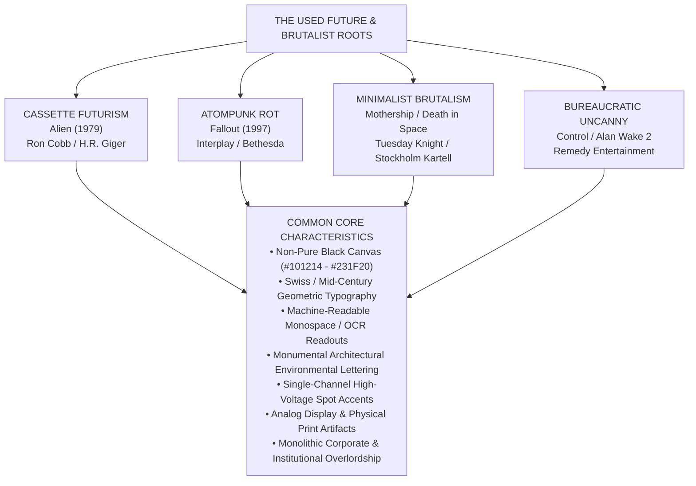

# Studied Designs, Comparative Research & Visual Archives
*A comprehensive visual design reference synthesizing comparative analyses of influential retro-futuristic and industrial sci-fi universes, Remedy institutional brutalism, studied wireframe layout evolutions, and color palette explorations for Beyond the Horizon.*

---

## 1. Document Control
- **Document Title:** Studied Designs, Comparative Research & Visual Archives
- **Project:** Beyond the Horizon - Digital Companion & Rules Platform ("Beyond the Horizon App")
- **Author:** Henrique Schorr
- **Status:** Active Reference
- **Version:** 0.2.0
- **Last Updated:** 2026-10-14

---

## 2. Part 1: Shared Industrial, Brutalist & Entropic Sci-Fi DNA

### 2.1 Executive Summary
While spanning distinct genres—cosmic body horror (*Alien*), atomic retro-apocalypse (*Fallout*), brutalist space survival (*Mothership*), cosmic nihilism (*Death in Space*), and bureaucratic cosmic horror (*Remedy's Control and Alan Wake 2*)—these universes share an unmistakable, deeply interconnected visual DNA.

Together, they represent the absolute antithesis of sterile, utopian "clean sci-fi" (such as *Star Trek* or contemporary Cupertino-style consumer minimalism). Instead, they champion **The Used Future**, **Entropic Industrial Decay**, **The Bureaucratic Uncanny**, and **Monolithic Institutional Authority**.

Each universe is examined in depth in its dedicated reference study:
- [Alien Aesthetic Reference](./references/alien_design_reference.md)
- [Death in Space Aesthetic Reference](./references/death_in_space_design_reference.md)
- [Fallout Aesthetic Reference](./references/fallout_design_reference.md)
- [Mothership Aesthetic Reference](./references/mothership_design_reference.md)
- [Remedy Aesthetic Reference](./references/remedy_design_reference.md)

---

### 2.2 Comparative Design Matrix

| Axis | [*Alien* Franchise](./references/alien_design_reference.md) | [*Fallout* Series](./references/fallout_design_reference.md) | [*Mothership RPG*](./references/mothership_design_reference.md) | [*Death in Space RPG*](./references/death_in_space_design_reference.md) | [*Remedy Entertainment*](./references/remedy_design_reference.md) |
|---|---|---|---|---|---|
| **Sub-Genre** | Cassette Futurism & Biomechanical Horror | Atompunk Retro-Futurism & Nuclear Decay | Brutalist Space Survival & Cosmic Panic | Scandinavian Minimal-Brutalism & Junk-Tech | The Bureaucratic Uncanny & Institutional Brutalism |
| **Institutional Antagonist** | Weyland-Yutani (*"Building Better Worlds"*) | Vault-Tec, RobCo, Nuka-Cola Corp | Generic Megacorps & Indentured Charters | Dying Mining Consortiums & Wreck Salvagers | Federal Bureau of Control (The Oldest House) |
| **Canvas Background** | Sub-Level Cast Iron / Nostromo Ivory | Weathered Tin / Caliche Sand / Glass Black | Technical Cement Grey / Carbon Off-Black | Tenebris Void Rich Black / Charcoal | Poured Concrete Grey / Midnight Obsidian Void |
| **Dominant Phosphor / Accent** | Amber Phosphor / P31 Green | Pip-Boy Green / Mojave Amber | Hazard Orange / Vector Cyan | Acid Neon Yellow / Scrap Orange | Hiss High-Voltage Crimson / Warning Flare Amber |
| **Primary Display Font** | **Helvetica Black** / **Futura Bold** | **Overseer** / **Futura Condensed** | **Argon** / **Futura Heavy** | **Neue Haas Grotesk** / **Druk** | **Space Grotesk Bold** / **DIN Pro** / **Helvetica Neue Black** |
| **Terminal / Monospace Font** | **Moore Computer** / Matrix OCR | **Monofonto** / **Fixedsys** | **OCR-A** / **Source Code Pro** | **Space Mono** / **Letter Gothic** | **Space Mono** / **Courier Typewriter** |
| **Physical Materiality** | Diamond vinyl, ABS plastic, machine lubricant | Bakelite, corrugated tin, chrome, rust | Risograph ink, newsprint, xerox stipple | Welded hull scrap, photocopier toner dust | Poured bush-hammered concrete, aged cardstock, redactions |

---

### 2.3 Shared Color Theory Trends

#### Trend 1: The Rejection of Pure Black (#000000)
None of these properties use flat digital #000000 for primary backgrounds. Pure black creates visual halation (glowing and vibrating text edges) on OLED/LCD screens and muddy over-saturation in physical CMYK printing. Instead, all five employ rich, textured off-blacks:
- *Alien:* Sub-Level Cast Iron (#2B3238) and Xenomorph Chitin Black (#0C0D0E). Detailed in [alien_design_reference.md](./references/alien_design_reference.md).
- *Fallout:* Cathode Tube Glass Black (#14171A) and T-60 Armor Steel (#384148). Detailed in [fallout_design_reference.md](./references/fallout_design_reference.md).
- *Mothership:* Matte Carbon Off-Black (#111215). Detailed in [mothership_design_reference.md](./references/mothership_design_reference.md).
- *Death in Space:* Tenebris Void Rich Black (#231F20). Detailed in [death_in_space_design_reference.md](./references/death_in_space_design_reference.md).
- *Remedy (Control / Alan Wake):* Institutional Midnight Concrete (#101214) and Shadow Realm Obsidian (#0A0C0E). Detailed in [remedy_design_reference.md](./references/remedy_design_reference.md).
- *Beyond the Horizon:* Adopted deep cosmic void canvas (#101214) and recessed well (#0C0E10).

#### Trend 2: The Softening of Pure White (#FFFFFF)
Pure #FFFFFF is deliberately reserved for acute focal accents, star cores, or stark vector linework. Continuous reading surfaces and body text are softened to reduce optical fatigue:
- *Alien:* Nostromo Ivory (#D6CBB7) and Acoustic Mother Padding (#E3DAC9).
- *Fallout:* Enamel Appliance Cream (#E8E3D9).
- *Mothership:* Technical Cement Grey (#EBEBEB) and Industrial Manila (#EAE5D9).
- *Death in Space:* Chalk Bone Subtitle (#E8E6E7) and Bleached Bone Grey (#EDEDED).
- *Remedy:* Aged Manila Case File (#E8E2D2) and Fluorescent Halogen White (#E2E8F0).
- *Beyond the Horizon:* Adopted titanium white display text (#F0ECE1) and secondary prose (#C8C4B8).

#### Trend 3: Single-Channel High-Voltage Spot Accents
Interfaces avoid multi-colored decorative gradients. Instead, they rely on a single monochrome primary channel paired with an emergency strobe color:
- **The Cathode Amber / Gold Continuum:**
  - *Alien* MU/TH/UR Amber (#E5851E) to *Fallout: New Vegas* Pip-Boy Amber (#FFB642) to *Alien: Isolation* Cathode Amber (#FFB000).
- **The P31 Terminal Green Continuum:**
  - *Alien* Motion Tracker Green (#8FD694) to *Fallout* Pip-Boy Green (#1BFD9C) to *Alien: Isolation* Sevastopol Phosphor (#39FF14).
- **The Industrial Emergency Alarm & High-Voltage Crimson:**
  - *Alien* Self-Destruct Crimson (#CC1100), *Fallout* V.A.T.S. Red (#FF3B30), *Mothership* Panic Orange (#FF5500), *Death in Space* Scrap Orange (#FF5E13), and *Remedy* Hiss Emergency Crimson (#E51B24).
- *Beyond the Horizon:* Unified behind a single high-voltage spot accent: Cassette 90 Vibrant Orange (#FE6403).

---

### 2.4 Shared Typographic Trends

#### Trend 1: Swiss Neo-Grotesque & Mid-Century Geometric Hegemony
Across all universes, the human institutional or corporate apparatus speaks through classic 20th-century European sans-serifs:
- **Helvetica** dominates corporate signage in *Alien* and documentation in *Mothership*.
- **Futura** anchors *Aliens*, *Fallout* marketing manuals, and *Mothership* control spreads.
- **Neue Haas Grotesk / Univers** commands *Death in Space* titles and *Alien* interior bulkhead markings.

#### Trend 2: Monumental Environmental Typography (The Remedy Influence)
In Remedy Entertainment's *Control*, typography ceases to be a passive user-interface overlay and becomes an unyielding architectural presence (explored in [remedy_design_reference.md](./references/remedy_design_reference.md)):
- **Monumental Scale:** Sector names, quarantine directives, and alert states are stamped across the architectural concrete geometry in massive, uppercase sans-serif letterforms.
- **Visual Authority:** The sheer scale of the typography establishes institutional permanence and psychological weight.
- *Beyond the Horizon Application:* Directly informs the Monumental Voice (Space Grotesk 64px Bold with wide tracking), used for the crossword brand mark and monumental headings.

#### Trend 3: Machine-Readable Monospace (The Terminal Dialect)
When technology communicates directly with operatives, text switches to fixed-pitch, optical-character recognition fonts:
- **Moore Computer & Dot-Matrix:** *Alien*'s MU/TH/UR 6000 interface.
- **Monofonto:** *Fallout*'s RobCo terminals and Pip-Boy system dialog.
- **OCR-A / OCR-B:** *Mothership*'s system telemetry and *Alien RPG*'s company dossiers.
- **Space Mono:** *Death in Space*'s ship repair tables and *Beyond the Horizon*'s tactical telemetry and interactive button labels.

#### Trend 4: Dense Information Chunking & Bracket Syntax
All universes reject loose, airy formatting. They package data into tight, modular clusters:
- Thin-line bordered boxes enclosing critical telemetry and diagnostics.
- Bracketed interactive notation: [1d10], [EJECT], [OK], [V.A.T.S.], [REGISTER], [SIGN IN].
- Flowcharts and decision matrices instead of sprawling explanatory prose.

---

### 2.5 Shared Textures, Physical Materiality & Spatial Geometry

#### The Cathode Ray Tube (CRT)
Computing technology is rooted in vacuum tubes and cathode-ray optics:
- Curved perimeter glass with optical vignette darkening towards display edges.
- Interlaced horizontal cathode scanlines.
- Procedural stipple noise and halftones emulating physical monitor phosphors.

#### Heavy Analog Switchgear & Physical Hardware
Touchscreens are absent or treated as fragile novelties:
- Mechanical click-switches, rocker toggles, and stepped keycaps.
- Stamped sheet metal, riveted bulkheads, and molded ABS plastic cassette chassis.
- Physical keycard slots, magnetic tape reels, and tactile actuators.

#### Print, Paper & Classified Dossier Distress
Physical documentation displays evidence of institutional trauma:
- Coarse risograph halftones, photocopier toner speckling, and print plate misregistration (*Mothership*, *Death in Space*).
- Black marker redactions hiding classified coordinates, names, and anomalies (*Control*, *Delta Green*).
- Administrative classification stamps and weathered cardstock margins.

#### Rectangular Modular Chassis vs Celestial Circles
- **Rectangular Enclosures:** Content is packaged into hard-bordered rectangular cells, diagnostic control tables, or rack-mounted modules.
- **The 45-Degree Chamfer:** Corners clipped at 45 degrees communicate ballistic plate reinforcement and industrial fabrication.
- **Celestial & Planetary Spheres:** Stark circular silhouettes hanging in total blackness, ringed by orbital trajectories (*Death in Space*), analog circular rotary dials (*Fallout*), and the sweeping black hole event horizon arc (*Beyond the Horizon*).

---

## 3. Part 2: Moodboard Color Spectrum & Alternative Palettes

Extracted from the primary reference moodboard (cassette_orange_moodboard.png):

  

| Swatch | Color Name | HEX Code | RGB | Location & Evaluation Notes |
| :---: | :--- | :--- | :--- | :--- |
|  | **Cassette 90 Vibrant Orange** | #FE6403 | 254, 100, 3 | **Selected Accent**: Dominant background of "90 HIGH QUALITY AUDIO CASSETTE". High optical vibration against dark off-blacks. |
|  | **Agfa Golden Mango Orange** | #EA9103 | 234, 145, 3 | **Alternative Variant 2**: Golden-cadmium spine of AGFA-GEVAERT C90. Warmer, amber-toned. |
|  | **Terracotta / Burnt Tape Orange** | #E05624 | 224, 86, 36 | **Alternative Variant 3**: Industrial chevron stripes on 2D Soul tape. Deeper rust and clay tone. |
|  | **Sunset Coral / Lo-Fi Orange** | #EF5949 | 239, 89, 73 | Gradient stripes on Crosley tape and Dusk Retrowave cover. |
|  | **Manila Cardstock Cream** | #F1D0A2 | 241, 208, 162 | Unbleached cardstock backing on Sakura Chroma T-70 and Crosley packaging. |
|  | **Chassis Charcoal Black** | #14171A | 20, 23, 26 | Molded ABS cassette shell on Crosley and Dusk bodies. |
|  | **VHS Tracking Teal** | #008080 | 0, 128, 128 | Video cassette band on Sakura Chroma and Polaroid spines. |
|  | **Retro Signal Red** | #E6332A | 230, 51, 42 | Title lettering on T-70 SUPER CASSETTE and Agfa diamond logo. |
|  | **Test Pattern Yellow** | #F4C430 | 244, 196, 48 | Calibration stripe on Supercolor cassette. |

---

## 4. Part 3: Brutalist & Sci-Fi Industrial Case Studies

To synthesize the brutalist aesthetic with cosmic horror and cassette retrofuturism, the team examined four primary external case studies:

### 4.1 SL24 Brutalist Data Logistics Cyber Typography (Behance)
- **Reference:** https://www.behance.net/gallery/247026671/SL24-Brutalist-Data-Logistics-Cyber-Typography
- **Key Takeaways:** High-contrast data logistics framing, monospaced section tags (// SEC-01), barcode serials, micro-grid demarcation, and utilitarian information density.

### 4.2 Kai Voss Portfolio Agency Website (Dribbble)
- **Reference:** https://dribbble.com/shots/27665960-Kai-Voss-Portfolio-Agency-Website
- **Key Takeaways:** Minimalist brutalism, stark typography, massive negative space balance, and monolithic structural divisions.

### 4.3 Arc Raiders Sci-Fi Brutalist Landing Page (Dribbble)
- **Reference:** https://dribbble.com/shots/27299185-Arc-Raiders-Sci-Fi-Brutalist-Landing-Page
- **Key Takeaways:** Weathered industrial sci-fi, hazard indicators, tactile switch hardware, metallic chassis tones with vibrant signal orange highlights.

### 4.4 Sci-Fi Gaming Landing Page Concept (Dribbble)
- **Reference:** https://dribbble.com/shots/27299149-Sci-Fi-Gaming-Landing-Page-Concept
- **Key Takeaways:** Cosmic horror atmosphere, dark void immersion, stark high-contrast typography, and deep-space singularity framing.

---

## 5. Document References
- [01-sdd-overview.md](./01-sdd-overview.md) - System Design Document: Overview
- [04-sdd-frontend.md](./04-sdd-frontend.md) - System Design Document: Frontend Architecture & Design System
- [alien_design_reference.md](./references/alien_design_reference.md) - Deep-Dive Aesthetic Study: *Alien* Franchise
- [death_in_space_design_reference.md](./references/death_in_space_design_reference.md) - Deep-Dive Aesthetic Study: *Death in Space RPG*
- [fallout_design_reference.md](./references/fallout_design_reference.md) - Deep-Dive Aesthetic Study: *Fallout* Series
- [mothership_design_reference.md](./references/mothership_design_reference.md) - Deep-Dive Aesthetic Study: *Mothership RPG*
- [remedy_design_reference.md](./references/remedy_design_reference.md) - Deep-Dive Aesthetic Study: Remedy's *Control* and *Alan Wake*
